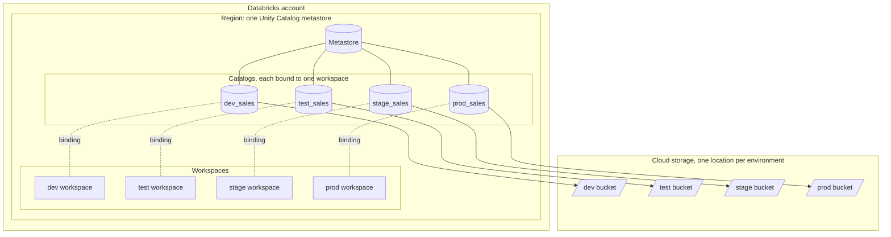
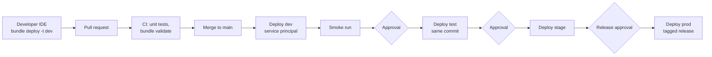

# Environment separation: workspaces, Unity Catalog, and metastores

How to lay out dev, test, stage, and prod on Databricks so code moves forward through Git and CI/CD, data stays where it belongs, and production changes only through automation.

## The short version

1. **One metastore per region.** Unity Catalog allows one metastore per region per account. Every environment workspace in that region attaches to it, so separation happens in catalogs and bindings, not in multiple metastores.
2. **One workspace per environment.** Use dev, test, stage, and prod workspaces. Teams that need fewer can merge dev and test, but prod always gets its own workspace.
3. **One catalog per environment** (or per environment and domain), each bound only to its own workspace and backed by its own storage.
4. **Promote code, not data.** The same Git commit deploys to every target through a bundle. Data is rebuilt in each environment from that environment's sources.
5. **Only service principals change prod.** People deploy to dev from their IDE. CI/CD deploys to test, stage, and prod with a service principal, and prod waits for an approval.

## Layout

## Promotion flow

## Workspace practices

| Practice | Why |
|---|---|
| Separate prod workspace | Isolates prod identities, network rules, secrets, and quotas from development traffic. |
| Same region for all environment workspaces | They share one metastore, so lineage, grants, and system tables cover the whole path. |
| Workspace-catalog bindings | A prod catalog is not even visible from dev, regardless of grants. |
| Serverless compute with budget policies per environment | No cluster sprawl. Cost is attributed by environment tag. |
| Private networking and IP access lists on stage and prod | Prod is reachable only from approved networks. |
| Bundle targets map to workspaces | `targets.prod.workspace.host` is the only place the prod host appears. |

## Unity Catalog practices

| Practice | How |
|---|---|
| Catalog per environment | `dev_<domain>`, `test_<domain>`, `stage_<domain>`, `prod_<domain>`, or one catalog per environment with domain schemas. Pass the catalog as a bundle variable. Never hard-code it. |
| Managed storage per catalog | Set a managed location on each catalog pointing at that environment's bucket or container. |
| Bind catalogs to workspaces | Set the catalog's isolation mode to isolated and bind it to the environment's workspace. Bind prod read-only into stage only when a parity check needs it. |
| Grant to groups, not users | `<env>-engineers`, `<env>-analysts`, `<env>-deployers`. In prod, people get read access and the deploy service principal owns objects. |
| Service principal ownership in prod | Jobs and pipelines `run_as` the environment's service principal. Ownership does not leave with a person. |
| No prod data in dev | Use generated sample data (this repo builds it from a use-case spec), masked samples, or Delta Sharing of approved datasets. |
| Tags for environment and release | Every resource carries `environment` and `release` tags, so system tables can report by environment and commit. |

## Metastore practices

- **One metastore per region, owned by a group.** Assign the metastore admin role to a small admin group, not a person.
- **No metastore-level default storage for business data.** Give each catalog its own managed location, so the storage boundary follows the environment.
- **Storage credentials and external locations per environment.** The dev credential cannot reach the prod bucket.
- **Use Delta Sharing between regions or accounts.** When environments span regions, share across metastores instead of copying data.
- **System tables are account-wide.** Monitor every environment from one place and filter by `workspace_id` or the `environment` tag (see the monitoring guide).

## How this repo applies it

| Item | Where |
|---|---|
| `dev` and `test` targets with separate prefixes and schemas | `reference/ingestion/databricks.yml` |
| Catalog, warehouse, and app identity are variables with no defaults | every `reference/*/databricks.yml` |
| CI deploys the same commit to dev, then test after approval | `.github/workflows/reference-cicd.yml` |
| Resources tagged with `environment` and `release` | bundle `presets.tags` |
| Synthetic data only | `use_cases/*.yml` with `src/sample_data.py` |

To add stage and prod, add targets with `mode: production`, a `workspace.host` per target, `run_as` set to that environment's service principal, and a GitHub environment for each with required reviewers.
