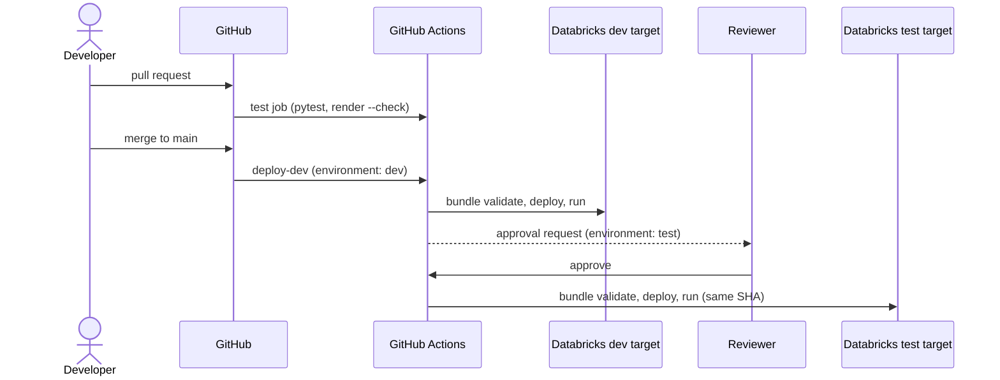

# GitHub integration and CI/CD

## Overview

The ingestion reference bundle is versioned in this GitHub repository and deployed by GitHub Actions. A pull request runs unit tests and spec drift checks. A merge to `main` deploys the commit to `dev` and smoke-runs it. The same commit is then deployed to `test` after a reviewer approves the `test` environment. Every deployed resource is tagged with the commit SHA.

## What this shows

| Success criterion | Artifact |
|---|---|
| Artifacts versioned in GitHub | `reference/ingestion/` (bundle, code, specs) and `.github/workflows/reference-cicd.yml` |
| Same release through dev and test | one workflow run deploys one commit to both targets; resources carry `release: <sha>` |
| Automation | the GitHub Actions run: test → deploy-dev → deploy-test |
| Approval | the `test` GitHub environment has required reviewers, so the run pauses until approved |

## Architecture

For the workspace, catalog, and metastore layout behind the dev, test, stage, and prod targets, see [environment-separation.md](environment-separation.md).

## Reference code

- `.github/workflows/reference-cicd.yml`: the pipeline
- `reference/ingestion/databricks.yml`: `dev` and `test` targets, `release` tag
- `reference/ingestion/tests/`: unit tests run on every pull request

## Setup

1. Create a service principal for deployments in the target workspace. Grant it `USE CATALOG` and `CREATE SCHEMA` on the catalog and `CAN_USE` on the warehouse.
2. Configure authentication. Prefer GitHub OIDC workload identity federation: add a federation policy on the service principal for this repository and set `DATABRICKS_AUTH_TYPE=github-oidc`. No secret is stored. Otherwise, create an OAuth secret and store it as `DATABRICKS_CLIENT_SECRET` with `DATABRICKS_AUTH_TYPE=oauth-m2m`.
3. In GitHub, create the environments `dev` and `test` with the variables listed at the top of the workflow. Add required reviewers to `test`.

## Demo steps

1. Open a pull request that changes `use_cases/general.yml`, for example a new bad-row rule. The `test` job runs pytest and `render_use_case.py --check`, and fails until the feeds are re-rendered.
2. Re-render the feeds, push, and merge. Open the workflow run.
3. Show `deploy-dev`: validate, deploy, and the smoke run's job URL.
4. Show the pending approval on `deploy-test`, approve it, and watch the same commit deploy to `test`.
5. In Databricks, open the `[test]` job and show the `release` tag matching the commit SHA.
6. Roll back by re-running the workflow for an earlier commit (`workflow_dispatch` on that SHA), or run the rollback job for a single table.

## Artifacts produced

- GitHub Actions run with three jobs and one approval
- Databricks jobs in `dev` and `test` tagged with the same `release`
- Job runs in both environments from the same commit

## Limitations and next steps

- Stage and prod targets follow the same pattern with `mode: production`, per-target `workspace.host`, and `run_as`.
- Model deployment through CI/CD is covered by its own guide.
