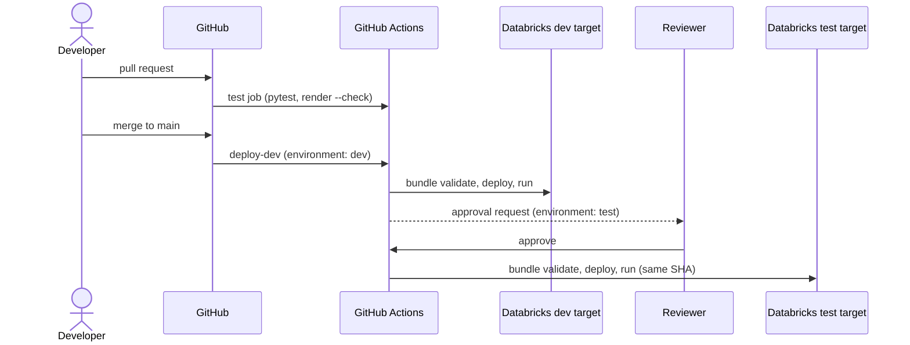
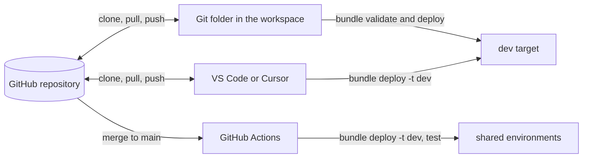

# GitHub integration and CI/CD

## Overview

The ingestion reference bundle is versioned in this GitHub repository and deployed by GitHub Actions. A pull request runs unit tests and spec drift checks. A merge to `main` deploys the commit to `dev` and smoke-runs it. The same commit is then deployed to `test` after a reviewer approves the `test` environment. Every deployed resource is tagged with the commit SHA.

## What this shows

| Success criterion | Artifact |
|---|---|
| Artifacts versioned in GitHub | `reference/ingestion/` (bundle, code, specs) and `.github/workflows/reference-cicd.yml` |
| Same release through dev and test | one workflow run deploys one commit to both targets; resources carry `release: <sha>` |
| Automation | the GitHub Actions run: test → deploy-dev → deploy-test |
| Approval | the `test` GitHub environment has required reviewers, so the run pauses until approved |

## Architecture

For the workspace, catalog, and metastore layout behind the dev, test, stage, and prod targets, see [environment-separation.md](environment-separation.md).

## Git folders and deployment as code

Two Databricks features connect GitHub to the workspace. They do different jobs:

| | Git folders | Declarative Automation Bundles |
|---|---|---|
| What it is | A clone of the GitHub repository inside the workspace | Deployment as code: jobs, pipelines, schemas, volumes, dashboards, and permissions in YAML next to the code |
| Used for | Authoring and review: branch, edit, commit, push, and open a pull request from the Databricks UI | Releasing: the same definition deploys to dev, test, stage, and prod targets |
| Who changes prod | Nobody edits prod Git folders by hand. Automation can move a production folder to a release branch | CI/CD with a service principal (`bundle deploy --target prod`) |
| Links | [Git folders](https://docs.databricks.com/aws/en/repos/) · [Git operations](https://docs.databricks.com/aws/en/repos/git-operations-with-repos) · [CI/CD with Git folders](https://docs.databricks.com/aws/en/repos/ci-cd-techniques-with-repos) | [Bundles](https://docs.databricks.com/aws/en/dev-tools/bundles/) · [Bundles in the workspace](https://docs.databricks.com/aws/en/dev-tools/bundles/workspace-bundles) · [Bundles in VS Code](https://docs.databricks.com/aws/en/dev-tools/vscode-ext/bundles) |

The developer loop that ties them together:

1. Create a Git folder from this repository (**Workspace → Create → Git folder**, URL of the GitHub repo) and create a feature branch.
2. Open `reference/ingestion/databricks.yml` in the Git folder and deploy the `dev` target from the workspace bundle UI, or run `databricks bundle deploy -t dev` from the IDE.
3. Commit and push from the Git folder, then open the pull request in GitHub. The workflow runs tests on the pull request.
4. After the merge, the workflow deploys the same commit to dev and then to test after approval. No one deploys shared environments from a laptop or a Git folder.

## Reference code

- `.github/workflows/reference-cicd.yml`: the pipeline
- `reference/ingestion/databricks.yml`: `dev` and `test` targets, `release` tag
- `reference/ingestion/tests/`: unit tests run on every pull request

## Setup

1. Create a service principal for deployments in the target workspace. Grant it `USE CATALOG` and `CREATE SCHEMA` on the catalog and `CAN_USE` on the warehouse.
2. Configure authentication. Prefer GitHub OIDC workload identity federation: add a federation policy on the service principal for this repository and set `DATABRICKS_AUTH_TYPE=github-oidc`. No secret is stored. Otherwise, create an OAuth secret and store it as `DATABRICKS_CLIENT_SECRET` with `DATABRICKS_AUTH_TYPE=oauth-m2m`.
3. In GitHub, create the environments `dev` and `test` with the variables listed at the top of the workflow. Add required reviewers to `test`.

## Demo steps

1. Show the Git folder for this repository in the workspace and the feature branch in its Git dialog.
2. Open a pull request that changes `use_cases/general.yml`, for example a new bad-row rule. The `test` job runs pytest and `render_use_case.py --check`, and fails until the feeds are re-rendered.
3. Re-render the feeds, push, and merge. Open the workflow run.
4. Show `deploy-dev`: validate, deploy, and the smoke run's job URL.
5. Show the pending approval on `deploy-test`, approve it, and watch the same commit deploy to `test`.
6. In Databricks, open the `[test]` job and show the `release` tag matching the commit SHA.
7. Roll back by re-running the workflow for an earlier commit (`workflow_dispatch` on that SHA), or run the rollback job for a single table.

## Artifacts produced

- GitHub Actions run with three jobs and one approval
- Databricks jobs in `dev` and `test` tagged with the same `release`
- Job runs in both environments from the same commit

## Limitations and next steps

- Stage and prod targets follow the same pattern with `mode: production`, per-target `workspace.host`, and `run_as`.
- Model deployment through CI/CD is covered by its own guide.
