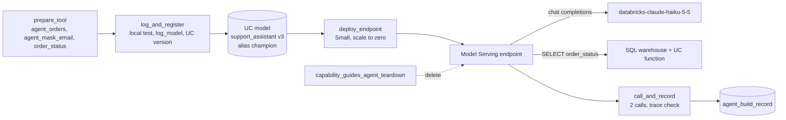

# Building and shipping agents

## Overview

One job builds a small tool-calling support assistant, registers a version in Unity Catalog, deploys it to a Model Serving endpoint that scales to zero, calls the endpoint, and records the result with traces. A second job deletes the endpoint. The assistant answers order questions by calling a Unity Catalog function, so the tool runs under the same grants as any other SQL.

Model Serving is no longer the recommended place for new agents. The October 12, 2026 release notes move agents deployed to Model Serving to the Legacy list and point new work to the Agent Bricks CLI on Agent Runtime. This guide uses Model Serving because it is the pattern the guide asked for, and it still works.

## What this shows

| Question | Artifact |
|---|---|
| What is the code? | `src/agent/assistant.py`, an MLflow `ResponsesAgent` logged from code with `set_model`. |
| Is it versioned? | `support_assistant` in Unity Catalog, version 3, alias `champion`, tags `release` and `tool_function`. |
| Where does it run, and what does it cost at rest? | Endpoint `capability-guides-support-assistant`, workload size Small, `scale_to_zero_enabled: true`. |
| What does it depend on? | Pinned in `agent_build_record`: `mlflow==3.17.1`, `databricks-sdk==0.152.0`, `openai==3.31.0`, `httpx==0.27.0`, plus declared resources (chat endpoint, function, table, SQL warehouse). |
| Who owns it? | `agent_build_record.owners` lists the agent owner, tool owner, and on-call roles from the spec; `deployed_by` records the identity that deployed. |
| Can I see what it did? | Trace spans `predict`, `chat_model`, and `uc_function_tool` returned by the endpoint, and traces from the local test in the MLflow experiment. |
| How is it removed? | `capability_guides_agent_teardown` deletes the endpoint and confirms it is gone. |

## Architecture

## Reference code

- `src/agent/assistant.py`: `SupportAssistant.predict` runs the tool loop; `_call_tool` casts the id to `int` before it builds the SQL; `_llm` and `_call_tool` carry `@mlflow.trace` spans.
- `src/log_register_agent.py`: `main` tests the agent locally, calls `mlflow.pyfunc.log_model` with `resources=[...]`, registers the version, and sets the `champion` alias.
- `src/deploy_agent.py`: `main` creates or updates the endpoint, polls `ready` and `config_update`, and sets the task outputs.
- `src/call_agent.py`: `main` calls the endpoint with `return_trace`, asserts the tool span exists, and appends `agent_build_record`.
- `src/teardown_agent.py`: `main` deletes the endpoint and the gateway model services.
- `resources/agent_build.job.yml` and `resources/agent_teardown.job.yml`: the jobs.

## Demo steps

1. Open `src/agent/assistant.py` and show the tool definition and the `@mlflow.trace` spans.
2. Run `capability_guides_agent_build`. `prepare_tool` creates the `agent_orders` table, the `agent_mask_email` mask, and `order_status`.
3. Open `log_and_register` output: the local answer, the trace count, and the registered version.
4. In Catalog Explorer, open `support_assistant`. Show version 3, the `champion` alias, and the declared resources.
5. Open the endpoint in Serving. Show workload size Small and scale to zero.
6. Open `call_and_record` output: two timed requests and the span names returned by the endpoint.
7. Query `agent_build_record` for the dependencies, owners, latency, and answer.
8. Open the MLflow experiment `agent_build_experiment` and a trace with the `uc_function_tool` span.
9. Run `capability_guides_agent_teardown`.
10. Confirm in Serving that the endpoint is gone while the model version remains.

## Artifacts produced

- Registered model `support_assistant`, version 3, alias `champion`
- Table `agent_build_record` with one row per build (code path, dependencies, owners, latency, trace spans, answer)
- MLflow experiment `agent_build_experiment` with the logged model and local-test traces
- Model Serving endpoint `capability-guides-support-assistant` (deleted by the teardown job)
- Runs: one build run and one teardown run, linked from the guide page

## Limitations and next steps

- **The tool runs through a SQL warehouse, not MCP.** The first deployed version used the managed MCP server for the function. On the endpoint, `tools/list` returned no tools, so the model answered without a lookup. Endpoint credentials are scoped to the declared resources, and the MCP route was not covered. The build now asserts that the `uc_function_tool` span exists, so this failure stops the job.
- **Endpoint updates take minutes.** Updating the existing endpoint to version 3 took 512 seconds to reach READY.
- **Two calls are not a latency benchmark.** The first call took 4.7 s and the second 3.6 s, mostly model time.
- **Scale to zero is configured, not exercised.** The job deletes the endpoint before it idles long enough to scale down.
- **Versions 1 and 2 are earlier iterations** of the same job. Version 3 holds `champion`.
- Next step: move the agent to the Agent Bricks CLI and Agent Runtime, which is the current path for new agents, and add `mlflow.genai.evaluate` scorers before promoting a version.
