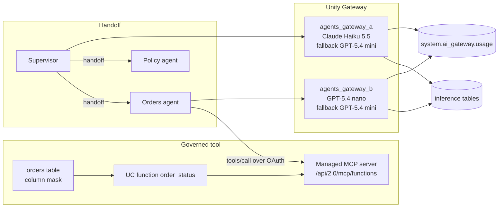

# Agents, MCP, and model gateway

## Overview

One job runs four checks on a Databricks workspace in us-west-2. A Python client calls a Unity Catalog function as an MCP tool with an OAuth token. A supervisor agent hands the result to a second agent. The same prompt goes through two Unity Gateway model services that carry rate limits, a fallback model, and inference tables. A capability table then records each feature's status, protocol, and measured latency, including the ones the workspace did not have.

## What this shows

| Question | Artifact |
|---|---|
| Is a tool call governed by Unity Catalog? | `mcp_tool_call`: `initialize`, `tools/list`, and `tools/call` against the schema's managed MCP server, plus the function's grants. The tool result shows the customer email masked by a column mask. |
| Can one agent hand work to another? | `agent_handoff_trace`: six steps from supervisor to orders agent (MCP tool call) to policy agent and back. |
| Can one prompt reach two approved models behind a gateway? | `gateway_comparison`: the same prompt through `agents_gateway_a` (Claude Haiku 5.5) and `agents_gateway_b` (GPT-5.4 nano), with latency, tokens, and the served model. |
| Do limits, fallback, and audit exist? | `gateway_burst` (HTTP 429 after the limit), the model services' `routing.fallback`, the `*_payload` inference tables, and `gateway_usage_by_service` from `system.ai_gateway.usage`. |
| What is GA, what is preview, what is missing? | `agent_capability_matrix`: status, region, protocol version, latency, and the result in this run. |

## Architecture

## Reference code

- `src/mcp_call.py`: `main` runs `initialize`, `tools/list`, and three `tools/call` requests, then reads `SHOW GRANTS` on the function.
- `src/agents_common.py`: `mcp_rpc`, `parse_mcp_body`, `mcp_tools_as_chat_tools`, and `chat` (the gateway call). Pure Python, tested in `tests/test_agents_common.py`.
- `src/handoff.py`: `run_orders_agent`, `run_policy_agent`, and the supervisor loop in `main`.
- `src/gateway_routing.py`: `service_config` (routing, fallback, rate limits, inference table) and `recreate`.
- `src/gateway_audit.py`: polls the inference tables and `system.ai_gateway.usage`, then builds `gateway_usage_by_service`.
- `use_cases/general.yml`: models, limits, prompt, and the capability facts. Change the spec, not the code.

## Demo steps

1. Run `capability_guides_agent_gateway`. It deploys the schema, sample orders, the function, and the mask first.
2. Open `mcp_tool_call`. Point at `protocol_version` (2025-06-18), `tools_listed` (2: the function and the mask function), and the masked address in `result`.
3. Show `function_grants`. The caller reaches the tool through Unity Catalog privileges on the function.
4. Open `agent_handoff_trace`. Follow the steps: handoff, MCP tool call, answer, handoff, answer, final.
5. Open `gateway_comparison`. Same prompt, two services, different served models and latencies.
6. Open `gateway_burst`. Thirty requests to `agents_gateway_b`, limited to four per minute, produce a mix of 200 and 429.
7. In Unity Gateway, open `agents_gateway_a`. Show routing, fallback, rate limits, and the inference table link.
8. Query `gateway_usage_by_service` and one `*_payload` table for per-service tokens, latency, and requester.
9. Open `agent_capability_matrix` and read the status and result columns.
10. Run `capability_guides_agent_teardown` to delete the model services and drop their inference tables, after you have finished with the steps above.

## Artifacts produced

- Tables in the guide schema: `orders`, `mcp_tool_call`, `agent_handoff_trace`, `gateway_comparison`, `gateway_burst`, `gateway_audit_counts`, `gateway_usage_by_service`, `agent_capability_matrix`, and `agents_gateway_a_payload` / `agents_gateway_b_payload`
- Unity Catalog function `order_status` and mask function `mask_email`
- Two Unity Gateway model services (created by the job, deleted by the teardown job)
- Run: `capability_guides_agent_gateway`

## Limitations and next steps

- **A2A is not available.** The docs index and release notes list no A2A endpoint, so the handoff is a supervisor pattern: the supervisor model calls a `handoff` tool and each specialist is its own model call.
- **The managed MCP server for Unity Catalog functions is Public Preview.** Every function in the schema with EXECUTE appears as a tool, including the mask function. Keep tool functions in their own schema.
- **Guardrails are Beta and UI-only.** Service policies (built-in unsafe-content, jailbreak, and sensitive-data checks) attach to a service in the Unity Gateway UI. The job does not attach one, so no guardrail result appears in the run.
- **Fallback was configured but not triggered.** Both primaries answered every request, so `routing_information.attempts` shows one attempt per call.
- **Limits are approximate.** The 4 requests per minute limit let 21 of 30 burst requests through, because the limiter records usage after a response and runs per instance. Expect a delay after creation before limits apply; the job waits 120 seconds.
- **Audit tables lag.** `system.ai_gateway.usage` showed this run's 36 requests (3 for service a; 24 answers and 9 HTTP 429 for service b) about 30 minutes after the calls. The inference tables held 3 and 23 rows. The audit task polls for 5 minutes and records what it saw, so the recorded run was repaired once the rows landed: rerun `gateway_audit` and `capability_matrix` after a wait.
- Next step: attach `system.ai.block_unsafe_content` and `system.ai.detect_sensitive_data` to the services in the UI, and add a budget scoped to a service tag.
