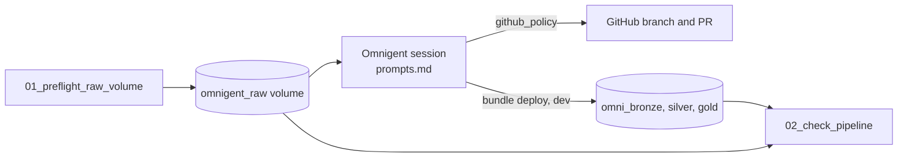

# Omnigent: connect GitHub and let it build a pipeline

## Overview

One job writes deterministic raw files to a Unity Catalog volume, then checks the pipeline that Omnigent builds from them. The Omnigent steps run in a chat session: connect GitHub, paste three prompts, review the pull request. Omnigent writes a Declarative Automation Bundle with a bronze, silver, and gold Lakeflow Declarative Pipeline on a feature branch, deploys it to dev, runs it, and opens a pull request. The check job reports `needs_manual_check` until those steps have run, then reconciles the tables to the raw files.

## Required setup

`<principal>` is the person or service principal behind `databricks bundle run`.

1. **Foundation bundle.** Deploy `reference/foundation` first. It creates the shared schema.
2. **Schema privileges.**
   ```sql
   GRANT USE CATALOG ON CATALOG <catalog> TO `<principal>`;
   GRANT USE SCHEMA, CREATE VOLUME, CREATE TABLE ON SCHEMA <catalog>.<schema> TO `<principal>`;
   ```
3. **An Omnigent server.** Omnigent on Databricks (Beta) or a server you run on Databricks Apps, and access to start a session.
4. **A GitHub repository and connection.** A repository you can push branches to, and a GitHub account connected to Omnigent under Settings, Sandbox Integrations, Connect GitHub.
5. **Policy.** A `github_policy` that limits writes to your repository and `feature/*` branches.
6. **Git credentials.** A Databricks Git credential for the identity that runs code, only if you want a Git folder or a job that pulls from the repository:
   ```bash
   databricks git-credentials create gitHub --git-username <github-user> --personal-access-token "$GITHUB_TOKEN"
   ```
7. **Serverless compute.** The job and the pipeline Omnigent deploys run on serverless compute.

Nothing in this guide is created at the account level.

## What this shows

| Question | Artifact |
|---|---|
| Where is the raw data? | Volume `omnigent_raw` with `orders.csv`, `customers.json`, and `events/events_001.json` to `events_003.json`. |
| Are the files the same on every run? | A fixed seed (`42`) and fixed paths. A rerun overwrites in place. |
| What do I paste into Omnigent? | `prompts.md`, printed by the preflight with your catalog and schema filled in. |
| Did Omnigent build the right thing? | `omnigent_pipeline_check`: expected and actual counts per layer, with `pass`, `fail`, or `missing`. |
| What if I have not run Omnigent yet? | The check ends with `needs_manual_check` and lists the steps left. It does not fail. |

## Architecture



## Reference code

- `src/omnigent_lib.py`: pure helpers. `generate_orders` plants a repeated `order_id` and a missing amount, `expected_counts` applies the silver rules, `find_pipeline` ignores the `[dev user]` prefix, and `overall_status` returns `pass`, `fail`, or `needs_manual_check`.
- `guides/omnigent/01_preflight_raw_volume`: `main` creates the volume and writes the raw files.
- `guides/omnigent/02_check_pipeline`: `main` finds the pipeline and tables and reconciles counts.
- `resources/omnigent.job.yml`: the job `capability_guides_omnigent`.
- `tests/test_omnigent_lib.py`: the helpers, the prompts file, and the job file.

## Demo steps

1. Run `capability_guides_omnigent`. Show the printed volume paths and the `needs_manual_check` result.
2. In Omnigent, connect GitHub and set `github_policy` for your repository.
3. Paste prompts 1 to 3 from `prompts.md`.
4. Review the pull request. Confirm the target is `dev` and every table starts with `omni_`.
5. Run the job again and open `omnigent_pipeline_check`.

## Limitations and next steps

- The interactive steps are not automated, so a recorded run shows `needs_manual_check` until you run them.
- Omnigent is open source and labeled alpha, and the Databricks offering is in Beta. Re-check the release notes before a rollout.
- Next step: gate the merge on the check job in CI.

## Cleanup

Delete the pipeline with `databricks bundle destroy --target dev` in the repository Omnigent built, and run `DROP VOLUME IF EXISTS <catalog>.<schema>.omnigent_raw`. Idle cost is storage only.
