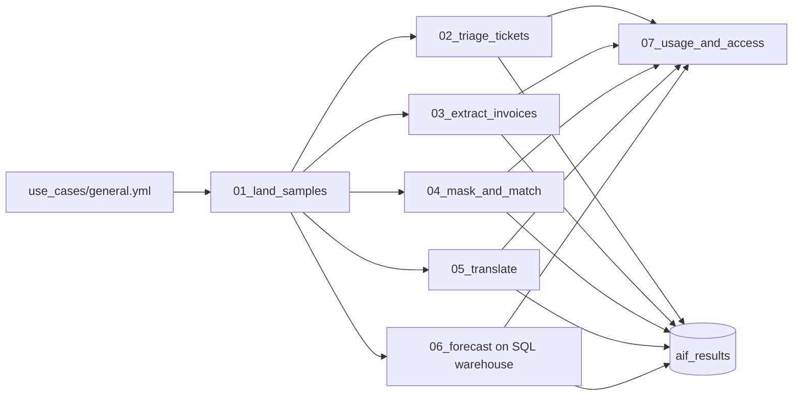

# AI Functions in SQL

## Overview

A folder of notebooks runs AI Functions over small sample tables and scores every output against the answer a person would give. It triages support tickets, reads invoice PDFs and two real scanned documents with OCR, masks personal details in call notes, matches company names across two lists, translates reviews with `ai_query`, and forecasts daily orders. The last notebook reads who can call the functions and what they have cost. Every notebook shows what goes in next to what comes out. The same notebooks run as one serverless job; job key: `capability_guides_ai_functions`.

All sample data is in `use_cases/general.yml`. The names, emails, and phone numbers are made up (555-01xx numbers, example.com addresses). The invoice PDFs are rendered at run time with fpdf2. The two scans are public domain and are downloaded once, then checked against a pinned SHA-256: [a 1947 letter from Harry S. Truman to Eleanor Roosevelt](https://commons.wikimedia.org/wiki/File:Letter_from_Harry_S._Truman_to_Eleanor_Roosevelt_-_DPLA_-_49b1c8f89d84a70ed20acf75b97ae3bf.pdf) (National Archives; one page, typed, with a signature and a handwritten postscript) and [US Patent 223,898, Edison's electric lamp](https://patents.google.com/patent/US223898A/en) (four pages from 1880 with drawings).

## Run it

- **By hand:** open the `guides/ai-functions` folder, read `00_start_here`, then Run all in `01_land_samples` and each notebook after it. Attach `06_forecast` to a Pro or serverless SQL warehouse. Widgets fill from the deployed job.
- **As a job:** run `capability-guides-ai-functions`, or Quick run in the app.
- **Safe to rerun, in any mix:** every table is replaced, never appended; each step swaps its own rows in `aif_results`; the page-image folder is cleared before each parse; a scan whose checksum matches is not downloaded again; and step 1 creates the schema and volume if they are missing.

## Reference run

Results from one run in the reference workspace. They show the setup works, not how a model does on your data.

| Step | Functions | Result in the reference run |
|---|---|---|
| Triage 24 tickets | `ai_classify`, `ai_analyze_sentiment`, `ai_summarize` | Category 24 of 24 correct. Sentiment 20 of 24: three neutral requests read as negative or positive, and one praise-plus-request read as mixed. |
| Decide on 24 tickets | `ai_decide` (Beta) | Not run: the AI Decide preview is off in the reference workspace. The step records the error and the job continues. With the preview on, it scores the service-down probability against tickets 7 to 11. |
| Extract 6 invoice PDFs | `ai_parse_document`, `ai_extract` | All 6 parsed; number, vendor, date, and total correct on every invoice (24 of 24 fields). |
| Read 2 public-domain scans (5 pages) | `ai_parse_document` with page images and figure descriptions, `ai_extract` | 41 elements found, all 3 patent drawings described. 8 or 9 of 10 fields correct across four runs. The letter's sender, whose name is only in the handwritten signature, was wrong every time (it returned the recipient). |
| Mask 6 call notes | `ai_mask` | 15 planted names, emails, and phone numbers; none left in the output. |
| Match 8 accounts to 8 vendors | `ai_similarity` | 30 pairs scored within country. At 0.85: 5 of 6 true matches, no false ones. |
| Translate 5 reviews to Japanese | `ai_query` with `databricks-meta-llama-3-3-70b-instruct` | 5 of 5 translated, no errors. |
| Forecast daily orders | `ai_forecast` | Backtest on September 2026: mean absolute percentage error 0.72% (east) and 0.78% (west); 60 forecast rows to 2026-10-31. |
| Check access and usage | `SHOW GRANTS`, `system.billing.usage` | `account users` holds EXECUTE on `system.ai`. Usage is read for the whole account, not just this job. |

Each step writes its scores to `aif_results`, replacing its own rows.

### What the reference run taught

- **A VARIANT null is not SQL NULL.** `WHERE doc:error_status IS NULL` dropped every parsed PDF, because `ai_parse_document` returns a VARIANT and a JSON null inside it is a value. Count the errors instead: `coalesce(array_size(try_variant_get(doc, '$.error_status', 'ARRAY<VARIANT>')), 0) = 0`, which also handles a missing field and an empty array.
- **Not every pay-per-token endpoint accepts batch calls.** `databricks-claude-haiku-5-5` and `databricks-claude-sonnet-5-5` returned "not supported for batch inference". Llama 3.3 70B, GPT OSS 120B, Claude Sonnet 4.6, and GPT-5 mini worked.
- **`failOnError => false` returns `result` and `errorMessage`.** Read `r.result`, not `r.response`.
- **`ai_forecast` needs a SQL warehouse here.** Serverless notebook compute rejected it as a disabled preview, so `06_forecast` is a SQL notebook task on the warehouse.
- **Some functions need a preview switched on.** `ai_decide` failed with "AI Decide Preview is not enabled. A workspace admin must enable it in workspace preview settings." `ai_predict_class` and `ai_predict_value` need the Predictive AI Functions preview.
- **Filter OCR by confidence before extracting.** On the faded patent page OCR read "No. 223,996, dated January 17, 1886" at confidence 0.70; the cover page reads 223,898 and January 27, 1880 at 0.86. Extracting from every element picked the misread values in one of three runs. Keeping elements at 0.8 and above, and skipping signature text, got the number and date right in all four runs since.
- **Extraction from scans varies between runs.** The same two scans scored 9, 8, and 6 of 10 fields in three runs without the confidence filter, and 8, 8, 9, and 9 in four runs with it. The letter's sender was wrong in all seven. Score a labeled sample more than once.
- **Similarity has no clean cutoff.** The true pair Adventure Works Cycles / Adventure Works scored 0.783; the wrong pair Proseware Health / Proseware Logistics scored 0.797. Review a middle band by hand.

## Architecture



## Reference code

- `use_cases/general.yml`: every sample, label set, extraction schema, threshold, and the `ai_query` endpoint
- `guides/ai-functions/00_start_here`: what the guide shows, the variables, links to the job
- `guides/ai-functions/02_triage_tickets` to `06_forecast`: one AI Functions query per notebook, then the scoring
- `src/aif_lib.py`: spec checks, invoice PDFs, scoring (`accuracy`, `leaked`, `match_scores`), and `write_results`
- `resources/ai_functions.job.yml`: the seven-task job; `forecast` sets `warehouse_id`

## Demo steps

1. Open `use_cases/general.yml` and point out the expected answers next to each sample.
2. Open the latest `capability-guides-ai-functions` run. Steps 2 to 6 ran in parallel.
3. Query the scores:
   ```sql
   SELECT step, metric, round(value, 4) AS value, detail FROM <catalog>.<schema>.aif_results ORDER BY step, metric;
   ```
4. Open `03_extract_invoices` and scroll to the two scans: each page has what OCR found drawn on top. Hover a box for its type, confidence, and text. Open `aif_document_elements` for the same elements as rows.
5. Open `aif_call_notes_masked` and search for any planted value.
6. Open `aif_account_vendor_scores` sorted by score and find the two pairs around 0.78 to 0.80.

## Limitations

- The samples are small on purpose. Accuracy on 24 tickets says the setup works, not how a model does on your data. Label a few hundred of your own rows before you rely on a function.
- `07_usage_and_access` reads grants and does not change them. Revoking EXECUTE on `system.ai` affects every user in the metastore.
- Usage lands in `system.billing.usage` hours after a call, so a run's own calls may not appear yet.
- Function-level permissions are in Public Preview and turned on through the account team; this guide does not use them.
