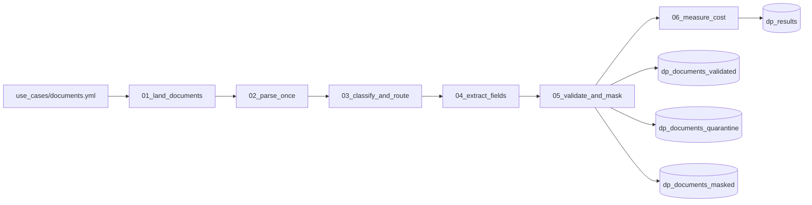

# Document processing pipelines and their cost

## Overview

A folder of notebooks runs a document pipeline end to end on 28 generated documents and then measures what the run cost. It lands the files in a Unity Catalog volume and tracks them with Auto Loader, parses each file once with `ai_parse_document`, classifies and routes with `ai_classify`, extracts a schema per type with `ai_extract`, validates the fields and quarantines doubtful results, masks personal data with `ai_mask`, and reads the run's billed usage from `system.billing.usage` to compute cost per page and per document. The same notebooks run as one serverless Lakeflow Job; job key: `capability_guides_document_processing`.

The walkthrough is organized as patterns (land and track, parse once, classify and route, extract by schema, validate and review, mask before sharing, measure then extrapolate). This folder is the run behind it. For the functions one by one, see the AI Functions in SQL guide in the same bundle.

All documents are generated at run time from `use_cases/documents.yml`: 9 invoices (two run to a second page, one has no total), 7 request forms (one has no date), 6 letters, and 6 scanned receipts. The receipts are images in a PDF with no text layer, so the parser uses OCR; one is faint, noisy, and tilted. Names, emails, and phone numbers are made up (example.com addresses, 555-01xx numbers). The answer key for every file is in the `dp_truth` table.

## Run it

- **By hand:** open the `guides/document-processing` folder, read `00_start_here`, then Run all in `01_land_documents` and each notebook after it, in order. Everything runs on serverless notebook compute. Widgets fill from the deployed job.
- **As a job:** run `capability-guides-document-processing`, or Quick run in the app.
- **Billing lags.** `system.billing.usage` receives rows hours after the work. `06_measure_cost` polls for a few minutes, writes what is there, and sets `billing_status` to `complete`, `partial`, or `not_available`. Run `06_measure_cost` again later, from the workspace folder with Run all, and it measures the latest run in `dp_run_log` (or set its `measure_run_id` widget to a job run id).
- **Safe to rerun:** `01_land_documents` clears the landing folder, the Auto Loader checkpoint, and every table the guide writes except `dp_run_log`, so each run starts from the same state. The parse step adds only files not yet in the parsed table. Result tables keep their row counts; only `dp_run_log` grows.

## Reference run

Results from one run in the reference workspace (28 documents, 33 pages). They show the setup works, not how the functions do on your documents: the samples are clean and made up.

| Step | Functions | Result in the reference run |
|---|---|---|
| Land 28 documents | Auto Loader (`binaryFile`) | 28 files ingested on the first pass, none on the second. 410,805 bytes of originals stay in the volume. |
| Parse once | `ai_parse_document` | 28 documents and 33 pages, no errors, about 22 seconds. A second pass parsed nothing. The faint, tilted receipt came through OCR with every field correct. |
| Classify and route | `ai_classify` (version 2.1) | 28 of 28 correct; none routed to review. |
| Extract by schema | `ai_extract` (version 2.1, confidence scores) | 112 of 113 fields correct. An earlier run of the same code scored 113 of 113. |
| Validate and quarantine | Python rules over the stored fields | 26 validated, 2 quarantined (the invoice with no total, and the form with no date). No good document held back. |
| Mask 13 forms and letters | `ai_mask` | 0 of 33 planted names, emails, and phone numbers left. |
| Measure cost | `system.billing.usage` | The last task found no billing rows yet (the newest row for the workspace was about three hours older than the run), so `billing_status` is `not_available` and every cost line is -1, meaning no usage yet. Run `06_measure_cost` again after the table catches up. |

Each step writes its metrics to `dp_results`, replacing its own rows. `dp_run_log` keeps when each step ran and how many documents and pages it handled.

### What the reference run taught

- **The same input gave different answers.** The invoice with its total line removed came back as null in one run. In the recorded run it came back as 2868.04, a value that is not on the page (the line items sum to 2,870.24), with a confidence of 0.10. The 0.8 floor in the validation step quarantined it.
- **Billing arrives hours later.** The newest billing row for the workspace was about three hours behind when the run finished. The docs say records are typically available within 12 hours. The last task polls for four minutes, records `billing_status`, and the notebook is run again later to fill in the numbers.
- **The usage table covers the whole account.** An unfiltered query returned AI Functions usage from other users. Filter by workspace and by the identity that ran the job.
- **A VARIANT null is not SQL NULL.** `doc:error_status IS NULL` drops every parsed row; count the entries with `array_size(try_variant_get(...))` instead.
- **Task functions do not return token counts.** The run records characters sent and an estimate (characters divided by 4), labeled as an estimate.
- **Serverless startup outlasts the work.** Parse took about 22 seconds, classify about 18, and extract about two minutes. Each serverless task took longer than that to start.

## Architecture



## Reference code

- `use_cases/documents.yml`: the documents, labels, extraction schemas, thresholds, and the cost polling settings
- `guides/document-processing/00_start_here`: what the guide shows, the variables, links to the job and tables
- `guides/document-processing/01_land_documents` to `06_measure_cost`: one pipeline step per notebook
- `src/docproc_lib.py`: document generators, validation rules, field scoring, the cost arithmetic, and the run log
- `src/guide_params.py`: shared notebook variables (copy of `reference/_shared/guide_params.py`)
- `resources/document_processing.job.yml`: the six-task job, tagged `capability_guide_job: capability_guides_document_processing`
- `tests/test_docproc_lib.py`: unit tests for the generators, validation, scoring, and cost helpers

## Demo steps

1. Open `use_cases/documents.yml` and point out the planned failures (`expect_quarantine`).
2. Open the latest `capability-guides-document-processing` run.
3. Query the results:
   ```sql
   SELECT step, metric, round(value, 4) AS value, detail FROM <catalog>.<schema>.dp_results ORDER BY step, metric;
   ```
4. Open `dp_documents_quarantine` to see what was held and why, then `dp_documents_masked` and search for any name or phone number from `dp_truth.planted`.
5. Open `dp_billing_usage` for the usage rows the cost figures came from, split by `ai_function`.

## Limitations

- The sample is 28 documents and 33 pages of clean, generated files. Use it to learn the method, not to size a program: measure on at least 100 of your own documents, including your worst scans.
- Accuracy here is high because the documents are simple and made up. It says the setup works, not how a model does on your data.
- Cost figures come from one run in one workspace. They are DBUs from `system.billing.usage`, plus a USD figure at the list price recorded in `system.billing.list_prices`. That list price is not a contract rate.
- `system.billing.usage` covers the whole account. The step filters to this workspace and identity and to the run's window and job run id; another job by the same identity in the same window would be counted.
- Storage is not in `system.billing.usage`. The run records the bytes stored and leaves pricing to your cloud storage rate.
- The task functions do not return token counts. The run records characters sent and an estimated token count (characters divided by 4), labeled as an estimate.
- Agent Bricks Information Extraction and Classification are not run here; the guide describes them from the docs.
