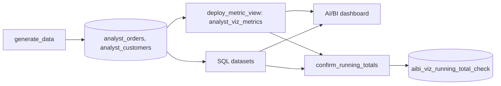

# AI/BI dashboard visualizations

## Overview

One AI/BI dashboard, deployed by the bundle, shows the built-in chart types, four ways to draw a running total, charts read straight from a metric view, and three Vega-Lite custom visualizations. A job writes the sample data, deploys the `analyst_viz_metrics` metric view from a SQL file, and checks the running totals against a cumulative sum computed in Python.

## What this shows

| Guide goal | Artifact |
|---|---|
| Built-in chart types | "Chart types" page: counter, bar, line, area, combo, pie, heatmap, scatter, histogram, box, funnel, Sankey, pivot, table |
| Running total (cumulative sum) | "Running totals" page: `AGGREGATE OVER (ORDER BY order_month CUMULATIVE)`, metric view `range: cumulative`, `SUM() OVER` in the dataset SQL, and a waterfall |
| Which methods follow filters | A region filter on the same page. The custom calculation and the metric view follow it. The SQL window dataset does not |
| Metric view as a dataset | "Metric view" page: `asset_name: analyst_viz_metrics`, widgets ask for `MEASURE(revenue)`, `MEASURE(avg_order_value)`, `MEASURE(revenue_mom_growth)` |
| Custom visualizations (Public Preview) | "Custom visualizations" page: Vega-Lite running total, bullet chart, dot plot that cross-filters a pivot through `databricks_mark_selection` |
| Numbers agree | `aibi_viz_running_total_check`: one row per month and method |

## Architecture



## Reference code

- `guides/aibi-visualizations/00_start_here`: what the guide shows, the files in order, and the variables
- `guides/aibi-visualizations/02_viz_metric_view.sql`: the metric view, with window measures for the running total, a rolling three months, and the prior month
- `src/dashboards/aibi_visualizations.lvdash.json`: the dashboard, with datasets, custom calculations, widgets, and the Vega-Lite specs (each spec is a JSON string in `spec.jsonSpec.spec`)
- `guides/aibi-visualizations/03_confirm_running_totals`: compares the SQL dataset and the metric view with a hand-computed cumulative sum
- `resources/aibi_visualizations.job.yml`, `resources/aibi_visualizations.dashboard.yml`

## Demo steps

1. Open the published dashboard on the **Chart types** page. Click a bar in the stacked bar chart, and the line, area, and pie tiles on the same dataset filter to that region.
2. Open **Running totals**. The three line charts end at the same total, and the waterfall's last bar tops out at it too.
3. Pick **North** in the region filter. Tiles 1 and 2 drop to the North total. Tile 3 does not move, because its window ran in the dataset SQL before the filter applied.
4. Edit the dashboard, open the `ds_orders` dataset, and show the **Running revenue** custom calculation: `SUM(order_value) AGGREGATE OVER (ORDER BY order_month CUMULATIVE)`.
5. Open **Metric view**. Average order value is right at every grouping because the ratio is computed after grouping. Open `analyst_viz_metrics` in Catalog Explorer to show the YAML.
6. Open **Custom visualizations**, then click a dot. The pivot below filters to that region.
7. Query the check:
   ```sql
   SELECT method, COUNT(*) AS months, BOOL_AND(matches) AS all_match
   FROM <catalog>.<schema>.aibi_viz_running_total_check GROUP BY method;
   ```

## Artifacts produced

- Tables: `analyst_customers`, `analyst_orders` (shared with the other analyst guides), `aibi_viz_running_total_check`
- Metric view: `analyst_viz_metrics`
- Dashboard: "Capability guides AI-BI visualizations", published (display names cannot contain a slash)

## Limitations and next steps

- Custom calculations (`AGGREGATE OVER`) and the Vega-Lite window transform are computed by the dashboard, so the check notebook can't query them. Compare their tiles with the metric view tiles on the same page.
- `AGGREGATE OVER ... TRAILING 3 MONTH` covers the current month and the two before it, the same as the metric view's `trailing 3 month inclusive`.
- Custom visualizations are in Public Preview. A layered Vega-Lite spec can't cross-filter. Keep a spec single-view when you add `databricks_mark_selection`.
- Widget spec versions differ by type: box, funnel, and waterfall use version 3 in this dashboard. When a widget shows "Invalid widget definition", select **Show error** to see which property the validator rejected.
