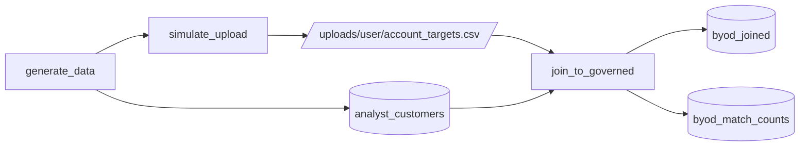

# Bring your own data

## Overview

A user uploads a spreadsheet to a volume folder named after their login and joins it to a governed table. A full outer join keeps keys that exist on only one side, so a bad key appears as a row.

## What this shows

| Guide goal | Artifact |
|---|---|
| File in a per-user location | `/Volumes/<catalog>/<schema>/uploads/<user>/account_targets.csv` |
| Join to a governed table | `byod_joined`, a full outer join of the file and `analyst_customers` |
| Unmatched keys stay visible | `match_status` is `matched`, `upload_only`, or `governed_only` |
| Match counts | `byod_match_counts`: 450 matched, 30 upload_only, 4,550 governed_only |

## Architecture



## Reference code

- `src/byod.py`: `--step upload` writes the CSV, `--step join` joins and counts
- `src/analyst_common/helpers.py`: `user_folder`, `upload_path`, `match_status`, `match_counts`
- `resources/uploads.volume.yml`: the volume
- `resources/byod.job.yml`: the job

## Demo steps

1. In Catalog Explorer, open the `uploads` volume and show the folder named after the signed-in user.
2. Preview `account_targets.csv`. It has 480 rows with `customer_id`, `account_owner`, and `annual_target`.
3. Run the job, or open the latest run.
4. Query the counts:
   ```sql
   SELECT match_status, key_count FROM <catalog>.<schema>.byod_match_counts;
   ```
5. List the upload-only keys:
   ```sql
   SELECT customer_id, account_owner FROM <catalog>.<schema>.byod_joined WHERE match_status = 'upload_only';
   ```
6. Explain that a plain inner join would have dropped those 30 rows without a message.

## Artifacts produced

- Volume file: `uploads/<user>/account_targets.csv`
- Tables: `byod_joined`, `byod_match_counts`
- Reference run: 450 matched, 30 upload_only, 4,550 governed_only

## Limitations and next steps

- The job writes the CSV to simulate a user upload. In real use the person uploads through Catalog Explorer or Lakeflow Designer.
- The per-user folder is a convention. Enforce it with volume grants or a folder-per-group layout.
- Keys are trimmed but not case-normalized. Add normalization when the source spreadsheet is messy.
