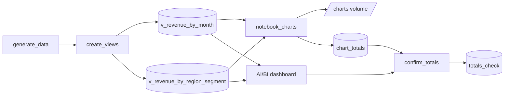

# Charts and dashboards in the platform

## Overview

Two governed views feed a notebook that draws matplotlib charts and a published AI/BI dashboard. A final task runs the dashboard's dataset queries and compares totals with the views and the notebook.

## What this shows

| Guide goal | Artifact |
|---|---|
| Shared governed views | `v_revenue_by_month`, `v_revenue_by_region_segment` |
| Notebook charts | `revenue_by_month.png`, `revenue_by_region_segment.png` in the `charts` volume |
| Published dashboard | "Capability guides revenue overview", on the same two views |
| Totals match | `totals_check`: view, dashboard, and notebook totals are 246,476,934.00 for both views |

## Architecture



## Reference code

- `sql/create_views.sql`: the two views
- `src/notebooks/charts.py`: charts, PNG export, `chart_totals`
- `src/dashboards/visualization.lvdash.json`: dashboard definition
- `src/confirm_totals.py`: runs the dashboard dataset queries and compares totals
- `resources/visualization.job.yml`, `resources/visualization.dashboard.yml`

## Demo steps

1. Open `v_revenue_by_month` in Catalog Explorer and show the view comment and columns.
2. Open the `notebook_charts` task output and show the two charts.
3. Browse the `charts` volume and open a PNG.
4. Open the published dashboard. The revenue counter and line chart show the same totals as the notebook.
5. Query the check:
   ```sql
   SELECT view_name, dashboard_total, view_total, notebook_total, totals_match FROM <catalog>.<schema>.totals_check;
   ```
6. Change a view definition, rerun `confirm_totals`, and note that the dashboard and notebook move together because they share the view.

## Artifacts produced

- Views: `v_revenue_by_month`, `v_revenue_by_region_segment`
- Tables: `chart_totals`, `totals_check`
- Volume files: two PNG charts
- Dashboard: published AI/BI dashboard
- Reference run: all totals 246,476,934.00

## Limitations and next steps

- The notebook uses matplotlib. Plotly works the same way and adds interactivity in the notebook.
- The totals check compares dataset queries, not rendered tiles. The dashboard widgets aggregate those datasets without extra filters.
- Add dashboard filters carefully. A filtered tile differs from the unfiltered view total by design.
