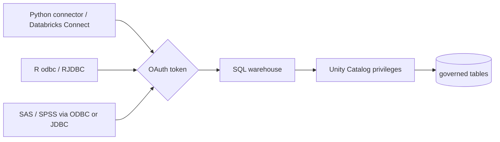

# Connecting local tools

## Overview

Python, R, SAS, and SPSS on a workstation reach the same SQL warehouse through the Databricks SQL connector, Databricks Connect, ODBC, or JDBC. Clients sign in with OAuth and see only the data Unity Catalog grants that identity. The job runs the Python connector path against the warehouse.

## What this shows

| Guide goal | Artifact |
|---|---|
| Connection examples per tool | `examples/`: Python, Databricks Connect, R odbc, R JDBC, `odbc.ini.example`, `jdbc_url.txt`, `sas_spss.md` |
| OAuth sign-in | U2M (browser) and M2M (service principal) in each example |
| Result from a client | `connectivity_check`: 4 groups, 5,000 customers, 1.56 s, job identity |

## Architecture



## Reference code

- `guides/local-tool-connectivity/00_start_here`: what the guide shows, the notebooks in order, and the variables
- `guides/local-tool-connectivity/02_sql_connector_check`: `sql.connect` with `credentials_provider=lambda: cfg.authenticate`
- `examples/python_sql_connector.py`, `examples/databricks_connect.py`
- `examples/r_odbc.R`, `examples/r_jdbc.R`
- `examples/odbc.ini.example`, `examples/jdbc_url.txt`, `examples/sas_spss.md`
- `resources/local_connectivity.job.yml`: the job

## Demo steps

1. Install the connector with `pip install databricks-sql-connector databricks-sdk`.
2. Run `databricks auth login --host <workspace-host>` for U2M. A browser opens once.
3. Set `DATABRICKS_HOST` and `DATABRICKS_WAREHOUSE_ID`, then run `examples/python_sql_connector.py`.
4. For an unattended script, set `DATABRICKS_CLIENT_ID` and `DATABRICKS_CLIENT_SECRET` for a service principal. The same script now uses M2M.
5. For R, open `examples/r_odbc.R`, install the Databricks ODBC driver, and run it.
6. For SAS or SPSS, copy `odbc.ini.example` and follow `sas_spss.md`.
7. Open the latest job run and read the `sql_connector_check` output.
8. Query the record:
   ```sql
   SELECT auth_mode, connected_as, rows_counted, seconds FROM <catalog>.<schema>.connectivity_check;
   ```

## Artifacts produced

- Table: `connectivity_check`
- Files: the connection examples under `examples/`
- Reference run: connected with the job identity, 4 regions, 5,000 customers, 1.56 s

## Limitations and next steps

- The job proves the Python connector path. The R, SAS, and SPSS examples need a workstation with the driver installed, and were not run here.
- The job authenticates as the job identity. Set the M2M environment variables on the task to test a service principal.
- Fill in the `<...>` placeholders. Workspace hosts and IDs are not in the repo.
