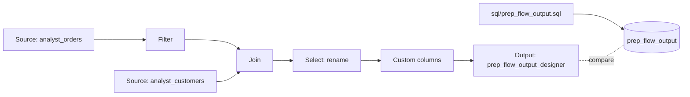

# No-code data preparation

## Overview

A business user builds a visual data prep in Lakeflow Designer: browse tables, filter, join, rename, derive a column, and save. Designer is UI-only, so the bundle builds the same output with SQL. The guide compares the two tables.

## What this shows

| Guide goal | Artifact |
|---|---|
| Browse, filter, join, rename, derive | The click-by-click steps below |
| Saved flow | A visual data prep file, stored as `<name>.designer.ipynb` |
| Output table | `prep_flow_output` from the job, `prep_flow_output_designer` from Designer |
| Steps a non-coder can follow | Nine demo steps, no code |

## Architecture



## Reference code

- `sql/prep_flow_output.sql`: the SQL version of the flow, plus `prep_flow_summary`
- `resources/no_code_prep.job.yml`: generates data and runs the SQL

## Demo steps

1. Run the job once so `analyst_orders`, `analyst_customers`, and `prep_flow_output` exist.
2. In the sidebar, click **New** and choose **Visual data prep**.
3. Click **Select source operator**, choose **Browse existing**, and pick `analyst_orders`. Add a second Source for `analyst_customers`.
4. Add a **Filter** after `analyst_orders`. Add two conditions: `status` **Is equal to** `completed`, and `order_ts` after 2026-01-01. Click **Apply**.
5. Add a **Join**. Connect the filter and the `analyst_customers` Source to it. Match `customer_id` to `customer_id`. Click **Apply**.
6. Add a **Select** operator. Rename `order_id` to `order_number`, `region` to `sales_region`, and `segment` to `customer_segment`. Click **Apply**.
7. Add **Custom columns**. Create `order_total` as `quantity * unit_price` and `order_size` as `large` when the total is 1000 or more, else `standard`.
8. Add an **Output** operator. Choose type **Table**, name it `prep_flow_output_designer`, pick the guide schema, and keep write mode **Overwrite**. Click **Run all**.
9. Compare with the SQL output:
   ```sql
   SELECT * FROM <catalog>.<schema>.prep_flow_summary;
   SELECT COUNT(*), SUM(order_total) FROM <catalog>.<schema>.prep_flow_output_designer;
   ```
   Save the flow with the editor's save control. Use **Schedule** to rerun it.

## Artifacts produced

- Tables: `prep_flow_output`, `prep_flow_summary`
- Reference run: 99,710 rows, 5,000 customers, total 138,172,774.00
- In Designer: the visual data prep file and `prep_flow_output_designer`

## Limitations and next steps

- Lakeflow Designer has no public API, so the job cannot create or run the flow. The steps above are manual.
- The Designer operator names follow the current documentation. Menu labels may change between releases.
- Move the saved flow to production by placing it in a Git folder and running it as a job task.
