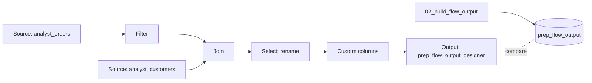

# Lakeflow Designer: no-code data preparation

## Overview

A business user builds a visual data prep in Lakeflow Designer: browse tables, filter, join, rename, derive a column, and save. Designer is UI-only, so the bundle builds the same output with SQL. The guide compares the two tables.

## What this shows

| Guide goal | Artifact |
|---|---|
| Browse, filter, join, rename, derive | The click-by-click steps below |
| Saved flow | A visual data prep file, stored as `<name>.designer.ipynb` |
| Output table | `prep_flow_output` from the job, `prep_flow_output_designer` from Designer |
| Steps a non-coder can follow | Nine demo steps, no code |

## Architecture



## Reference code

- `guides/no-code-data-prep/00_start_here`: what the guide shows, the notebooks in order, and the variables
- `guides/no-code-data-prep/02_build_flow_output`: the SQL version of the flow, plus `prep_flow_summary`
- `guides/no-code-data-prep/prompts.md`: the Designer prompt to keep in Git
- `resources/no_code_prep.job.yml`: generates data and runs the SQL

## Demo steps

1. Run the job once so `analyst_orders`, `analyst_customers`, and `prep_flow_output` exist.
2. In the sidebar, click **New** and choose **Visual data prep**.
3. Click **Select source operator**, choose **Browse existing**, and pick `analyst_orders`. Add a second Source for `analyst_customers`.
4. Add a **Filter** after `analyst_orders`. Add two conditions: `status` **Is equal to** `completed`, and `order_ts` after 2026-01-01. Click **Apply**.
5. Add a **Join**. Connect the filter and the `analyst_customers` Source to it. Match `customer_id` to `customer_id`. Click **Apply**.
6. Add a **Select** operator. Rename `order_id` to `order_number`, `region` to `sales_region`, and `segment` to `customer_segment`. Click **Apply**.
7. Add **Custom columns**. Create `order_total` as `quantity * unit_price` and `order_size` as `large` when the total is 1000 or more, else `standard`.
8. Add an **Output** operator. Choose type **Table**, name it `prep_flow_output_designer`, pick the guide schema, and keep write mode **Overwrite**. Click **Run all**.
9. Compare with the SQL output:
   ```sql
   SELECT * FROM <catalog>.<schema>.prep_flow_summary;
   SELECT COUNT(*), SUM(order_total) FROM <catalog>.<schema>.prep_flow_output_designer;
   ```
   Save the flow with the editor's save control. Use **Schedule** to rerun it.

## Run it

1. From `reference/analyst`, run `databricks bundle deploy --target dev`, then `databricks bundle run capability_guides_no_code_prep --only generate_data --target dev`.
2. Click the plus icon (**New**) and choose **Visual data prep**. Paste this into the Genie Code prompt above the canvas, with `<catalog>` and `<schema>` replaced. The same text is in `prompts.md`.

```text
Sources: <catalog>.<schema>.analyst_orders and <catalog>.<schema>.analyst_customers.
Filter analyst_orders to rows where status is equal to completed and order_ts is on or after 2026-01-01.
Join the filtered orders to analyst_customers on customer_id (inner join).
Add Custom columns: order_date = order_ts cast to a date, order_total = quantity * unit_price cast to decimal(12,2), and order_size = 'large' when quantity * unit_price is 1000 or more, otherwise 'standard'.
Add a Select operator that keeps only these columns, in this order: order_number (renamed from order_id), customer_id, sales_region (renamed from region), customer_segment (renamed from segment), order_date, quantity, unit_price, order_total, order_size.
Write the result to the table <catalog>.<schema>.prep_flow_output_designer, overwrite mode.
```

3. Select each operator to check it, then click **Run all**.
4. Run `databricks bundle run capability_guides_no_code_prep --only build_flow_output --target dev`, then compare:

```sql
SELECT * FROM <catalog>.<schema>.prep_flow_summary;
SELECT COUNT(*), SUM(order_total) FROM <catalog>.<schema>.prep_flow_output_designer;
SELECT * FROM <catalog>.<schema>.prep_flow_output EXCEPT SELECT * FROM <catalog>.<schema>.prep_flow_output_designer;
```

If the flow differs, edit the operator that is off or re-prompt with the exact condition.

## Artifacts produced

- Tables: `prep_flow_output`, `prep_flow_summary`
- Reference run: 99,710 rows, 5,000 customers, total 138,172,774.00
- In Designer: the visual data prep file and `prep_flow_output_designer`

## Limitations and next steps

- Lakeflow Designer has no public API, so the job cannot create or run the flow. The steps above are manual.
- The Designer operator names follow the current documentation. Menu labels may change between releases.
- Move the saved flow to production by placing it in a Git folder and running it as a job task.

## Reference run

Numbers from the recorded run of the bundle job (run 577542446375509).

- Lakeflow Designer is UI-only here, so the job runs the same steps in SQL (`sql/prep_flow_output.sql`) and writes `prep_flow_output`: 99,710 rows, 5,000 customers, total 138,172,774.00. `prep_flow_summary` holds those numbers.
- To compare with a flow built in Designer, query `prep_flow_output_designer` for its row count and `SUM(order_total)`, and list rows on one side only with `EXCEPT` on `order_number`. A difference usually points to a filter condition or a join type.
- Operator to SQL: Source is `FROM`, Filter is `WHERE status = 'completed' AND order_ts >= '2026-01-01'`, Join is `JOIN ... ON customer_id`, Select is column aliases, Custom columns is `CASE WHEN` for `order_total` and `order_size`.
