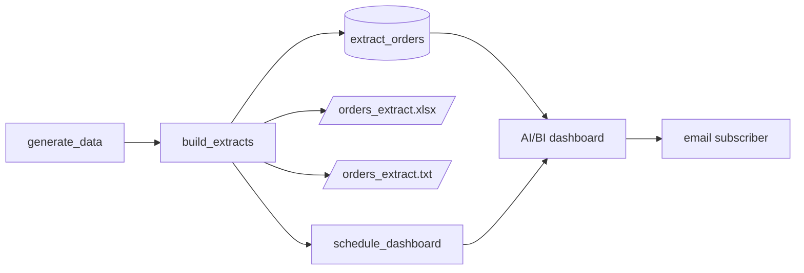

# Self-service extracts and subscriptions

## Overview

One filter feeds an AI/BI dashboard with a weekly schedule and an email subscription, an Excel workbook, and a pipe-delimited file for an external partner. The files land in a volume. The dashboard reads the same table.

## What this shows

| Guide goal | Artifact |
|---|---|
| Dashboard subscription | A Monday 07:00 America/New_York schedule and a subscription for `notification_email`, recorded in `dashboard_subscription` |
| Formatted Excel workbook | `extracts/partner/orders_extract_<date>.xlsx`, 13,211 rows |
| Delimited file for partners | `extracts/partner/orders_extract_<date>.txt`, pipe-delimited |
| Files match the table | `extract_manifest` rows, and the task fails if counts differ |

## Architecture



## Reference code

- `guides/self-service-extracts/00_start_here`: what the guide shows, the notebooks in order, and the variables
- `guides/self-service-extracts/02_build_extracts`: filter, openpyxl workbook, pipe-delimited file, read-back check
- `src/analyst_common/helpers.py`: `write_delimited`, `read_delimited`
- `guides/self-service-extracts/03_schedule_dashboard`: creates the schedule and subscription through the SDK
- `src/dashboards/extracts.lvdash.json`: dashboard definition
- `resources/extracts.job.yml`, `resources/extracts.dashboard.yml`

## Demo steps

1. Open the published dashboard. Filter by segment and date to show the tiles change.
2. Open the dashboard's **Schedule** menu and show the weekly schedule and the subscriber.
3. Open the `extracts` volume in Catalog Explorer and browse to `partner/`.
4. Download the `.xlsx` and show the styled header, frozen row, autofilter, and the Summary sheet.
5. Open the `.txt` in a text editor. Fields are separated by `|` and the first row is the header.
6. Query the manifest:
   ```sql
   SELECT file_name, format, row_count, bytes FROM <catalog>.<schema>.extract_manifest;
   ```
7. For a one-off file, use the table widget's download option on the dashboard.

## Artifacts produced

- Tables: `extract_orders`, `extract_manifest`, `dashboard_subscription`
- Volume files: one `.xlsx` and one `.txt`, 13,211 rows each (621,272 and 1,052,781 bytes)
- Dashboard: published, with the weekly schedule
- Reference run: West region, completed orders, 2026-01-01 to 2026-06-30, revenue 18,124,357.00

## Limitations and next steps

- The bundle cannot declare a dashboard schedule or subscription. The job task creates them and reruns reuse them.
- The subscription targets a workspace user by email. For addresses outside the workspace, use a notification destination.
- Scheduled dashboards email a snapshot. Files for partners need a job schedule on `build_extracts`.
- Unity Catalog Volumes do not support seeks in zip files, so the task builds the workbook locally and copies it.
