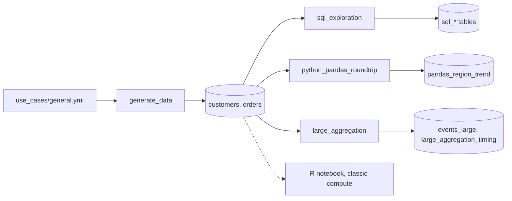

# SQL and notebooks at scale

## Overview

One job runs SQL exploration on a SQL warehouse, a Python notebook that round-trips a result through pandas, and a timed aggregation over 6 million generated rows. An R notebook ships with the bundle but is not a task, because serverless compute does not run R.

## What this shows

| Guide goal | Artifact |
|---|---|
| Analysts query governed tables with SQL | `sql_revenue_by_region`, `sql_top_customers`, `sql_monthly_running_total` |
| Python round-trips to pandas | `pandas_region_trend`, written from a pandas result and re-read |
| R is available | `src/notebooks/r_sparklyr_summary.r`, for classic compute |
| Millions of rows aggregate in seconds | `large_aggregation_timing`: 6,000,000 rows, 4.18 s for the customer-by-month aggregate |

## Architecture



## Reference code

- `sql/sql_exploration.sql`: three statements, each saved as a table
- `src/notebooks/python_pandas_roundtrip.py`: SQL to pandas, reshape, write back, row-count assert
- `src/notebooks/r_sparklyr_summary.r`: sparklyr aggregation, R statistics, Delta write
- `src/large_aggregation.py`: generates 6 million rows and times each step
- `resources/sql_notebooks.job.yml`: the job

## Demo steps

1. Open the latest run of `capability-guides-sql-notebooks`. Four tasks ran, and the three analysis tasks ran in parallel.
2. Open `sql_exploration.sql`. Point out the `:catalog` and `:schema` job parameters.
3. Query `sql_monthly_running_total` and show the running total and month-over-month change.
4. Open `python_pandas_roundtrip` and walk through collect, reshape, write back.
5. Query the timings:
   ```sql
   SELECT step, rows, seconds FROM <catalog>.<schema>.large_aggregation_timing ORDER BY recorded_at DESC;
   ```
6. Open `r_sparklyr_summary.r`. Explain that it needs a classic cluster with R, so the job leaves it out.

## Artifacts produced

- Tables: `sql_revenue_by_region`, `sql_top_customers`, `sql_monthly_running_total`, `pandas_region_trend`, `events_large`, `events_large_customer_month`, `large_aggregation_timing`
- Reference run: 6,000,000 rows generated and written in 6.49 s, counted in 0.42 s, aggregated into 59,594 customer-month rows in 4.18 s, percentiles by event type in 0.83 s

## Limitations and next steps

- The R notebook was not run. Serverless has no R runtime, so verify it on a classic cluster.
- Timings include generation and a table write. They change with serverless load, so compare reruns in the timing table.
- Collecting to pandas suits results that fit on the driver. Aggregate in Spark first.
