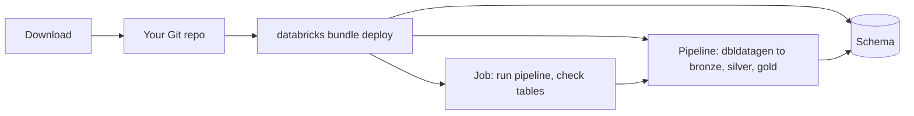

# Running a Declarative Automation Bundle

## Overview

A Declarative Automation Bundle (formerly Databricks Asset Bundles) describes jobs, pipelines, and schemas as YAML next to the code they run. This starter bundle holds one serverless Lakeflow Declarative Pipeline and one job. The pipeline generates 100,000 synthetic orders with dbldatagen (bronze), drops the rows that break a rule (silver), and totals revenue per day and category (gold). The job runs the pipeline, then checks the row counts and reads the expectation results. Job key: `capability_guides_dab_starter`.

The guide page offers the bundle as a zip. You unzip it, push it to your own Git repo, then validate, deploy, and run it with the Databricks CLI, and deploy it again to a second target. The folder `reference/dab-starter/` is the download, minus `resources/app_access.yml` (see Limitations).

## Required setup

- **Deploy the bundle:** `databricks bundle deploy --var catalog=<catalog>`. The catalog must already exist and you need `CREATE SCHEMA` on it.
- **Run the pipeline once before `01_check_gold`.** Deploying creates the pipeline definition but no tables, so a standalone run of `01_check_gold` fails with `TABLE_OR_VIEW_NOT_FOUND` on `orders_bronze`. Run either of these:
  - `databricks bundle run orders --var catalog=<catalog>` (the pipeline alone)
  - `databricks bundle run capability_guides_dab_starter --var catalog=<catalog>` (the job: pipeline, then the check)

## What this shows

| Step | Command | Result in the reference run |
|---|---|---|
| Validate | `databricks bundle validate --strict` | Passes for `dev` and `prod`. |
| Deploy to `dev` | `databricks bundle deploy` | Creates a schema, a pipeline, and a job, all prefixed `dev_<you>` or `[dev <you>]`. The job's daily schedule is paused. |
| Run | `databricks bundle run capability_guides_dab_starter` | Succeeded in about two minutes: pipeline update, then the check notebook. |
| Bronze | `orders_bronze` | 100,000 rows. |
| Silver | `orders_silver` | 77,328 rows. 22,672 dropped by three expectations (a row can break more than one). |
| Gold | `orders_daily_revenue` | 450 rows (90 days by 5 categories), 68,137 orders, 43,929,294.34 in revenue. Cancelled orders are left out. |
| Rerun | same command | Same counts. The seeds are fixed. |
| Deploy to `prod` | `databricks bundle deploy -t prod` | Unprefixed names, schema `dab_starter`, schedule live. Ran successfully. |

Expectation results from the latest update, read from the event log:

| Expectation | Passed | Failed | On violation |
|---|---|---|---|
| `customer_present` | 97,977 | 2,023 | drop row |
| `quantity_positive` | 83,535 | 16,465 | drop row |
| `status_known` | 94,490 | 5,510 | drop row |
| `price_in_range` | 100,000 | 0 | keep row, record |

## What the runs taught

- **Use the schema resource's name, not the variable.** Development mode renames the schema to `dev_<you>_dab_starter`. The pipeline and job read `${resources.schemas.starter.name}`, which carries the prefix. `${var.schema}` would point at a schema that does not exist.
- **Production mode needs a fixed `root_path`.** `validate` fails without one, so only one copy deploys. The CLI's own suggestion, a path under the deploying identity's user folder that names the target, passes `--strict`. `/Workspace/Shared` raises a warning, which `--strict` treats as an error.
- **dbldatagen needs a seed per column.** With one generator-level `randomSeed`, every random column drew the same number per row on serverless (dbldatagen 0.4.0.post1): rows with a low quantity were all one category, one status, and early dates, and one category never reached gold. Setting `seedMethod="hash_fieldname"` made no difference. A `randomSeed` on each column fixed it, and two builds then matched row for row.
- **`environment.dependencies` installs dbldatagen.** The pipeline resource lists `dbldatagen>=0.4`; the source has no `%pip`.
- **The app permission lives in its own file.** `resources/app_access.yml` holds the `app_service_principal` variable and the `CAN_RUN` grant. The zip leaves it out, so a downloaded copy needs only `catalog`.
- **Notebook output is not in the Jobs API.** `get-run-output` returns nothing for a notebook that prints. The tables and `event_log()` are the record.

## Architecture



## Reference code

- `databricks.yml`: bundle name, variables, and the `dev` and `prod` targets
- `resources/orders.pipeline.yml`: serverless pipeline, `dbldatagen` dependency, `row_count` as pipeline configuration
- `resources/orders.job.yml`: pipeline task, then the check notebook; daily schedule
- `resources/orders.schema.yml`: the schema the bundle creates and `bundle destroy` drops
- `resources/app_access.yml`: the app service principal's `CAN_RUN` grant (not in the download)
- `guides/dab-starter/pipeline/orders.py`: `orders_bronze`, `orders_silver` with expectations, `orders_daily_revenue`
- `guides/dab-starter/01_check_gold.py`: row counts across layers and expectation results from the event log
- `src/dab_starter_lib.py`: `check_layers` and `expectation_totals`, tested without Spark in `tests/`
- `.github/workflows/bundle.yml`: validate on pull request, deploy `main` to prod

## Demo steps

1. Download the bundle from the guide page and unzip it.
2. Push it to a new Git repo: `git init -b main`, `git add .`, `git commit`, `git remote add origin`, `git push`.
3. Run `databricks auth login`, then `databricks bundle validate --var catalog=<catalog>`.
4. Run `databricks bundle deploy --var catalog=<catalog>`. Open Jobs & Pipelines and find `[dev <you>] dab-starter-orders`; the schedule is paused.
5. Run `databricks bundle run capability_guides_dab_starter --var catalog=<catalog>` and open the run URL it prints.
6. Open the pipeline, select `orders_silver`, and read the expectation counts.
7. Query the gold table:
   ```sql
   SELECT product_category, sum(orders) AS orders, round(sum(revenue), 2) AS revenue
   FROM <catalog>.dev_<you>_dab_starter.orders_daily_revenue GROUP BY 1 ORDER BY 3 DESC;
   ```
8. Change `row_count`, deploy, run again, and check that bronze changed.
9. Deploy with `-t prod`, then clean up with `databricks bundle destroy` for each target.

## Limitations

- The bundle creates its own schema (`dab_starter`) so it works in any catalog. Other bundles in this repo write to the shared `capability_guides` schema instead.
- `resources/app_access.yml` makes `app_service_principal` a required variable in this repo. The download drops the file, and with it the variable and the grant.
- The prod target here deploys from one person's user folder with that person's identity. Add `run_as` a service principal before you rely on it.
- The generated data is random but meaningless: revenue figures say nothing about a real business.
- `bundle destroy` drops the schema and every table in it.
