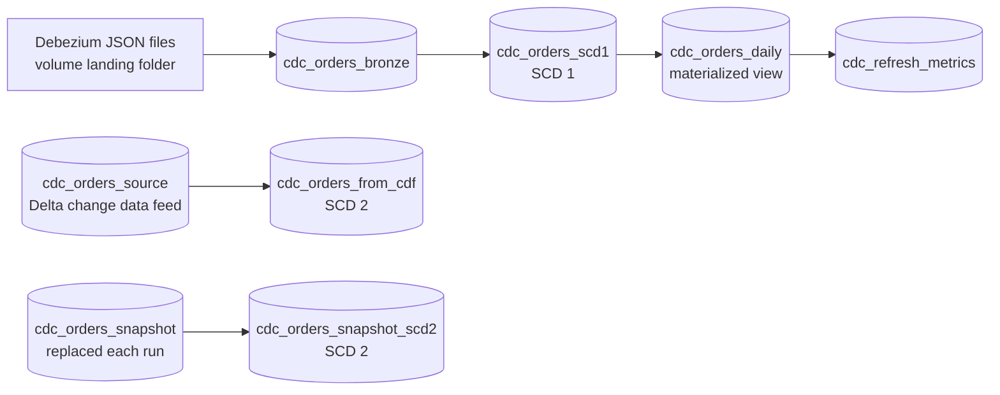

# CDC and incremental refresh in pipelines

## Overview

One serverless Lakeflow Spark Declarative Pipeline (`capability-guides-cdc`) loads change data from three kinds of source with AUTO CDC: Debezium-style change files, the Delta change data feed of an operational table, and a snapshot table that is replaced whole each run. A materialized view over the type 1 table shows incremental materialized view refresh. The job `capability_guides_cdc` runs the pipeline three times (full refresh, incremental update, selective full refresh) and records what each update did from the pipeline event log.

## What this shows

| Behavior | Where |
|---|---|
| Change files to type 1: Auto Loader bronze, `apply_as_deletes`, `sequence_by` the LSN | `cdc_orders_bronze`, `cdc_orders_scd1` |
| Delta change data feed to type 2, history on `status` and `amount` only | `cdc_orders_from_cdf` |
| Snapshot-only source to type 2 | `cdc_orders_snapshot_scd2` |
| Incremental materialized view refresh | `cdc_orders_daily` |
| Full refresh, incremental update and selective full refresh, measured | `cdc_refresh_metrics` |
| Bronze survives a full refresh | `pipelines.reset.allowed = false` on `cdc_orders_bronze` |

## Architecture

The job: `reset_sources`, `pipeline_initial` (full refresh), `inspect_initial`, `apply_changes`, `pipeline_incremental`, `inspect_incremental`, `pipeline_selective_full_refresh` (only `cdc_orders_daily`), `compare_refresh_modes`.

## How the pipeline knows what is new

| Part | What marks "new" | Stored in |
|---|---|---|
| Auto Loader | The files it has processed. A file with a name it has already seen is not read again, so rewriting one in place is not picked up. A file with a new name is. | The flow's checkpoint. The pipeline manages the checkpoint and schema locations. Detection is directory listing here (the default); file notification mode with file events is the recommended mode at scale. |
| Delta streaming read | The last Delta table version processed. | The flow's checkpoint (`reservoirVersion` in the event log). |
| Change data feed | `_change_type`, `_commit_version`, `_commit_timestamp` per row. With row tracking, Automatic change data feed computes them at query time, so the source needs no `delta.enableChangeDataFeed`. | The source table's Delta log and row ids. |
| AUTO CDC | `keys` identify the row, `sequence_by` orders events so a late one loses, `apply_as_deletes` (and `apply_as_truncates` for type 1) mark deletes. | The target table. |
| AUTO CDC from snapshot | Each snapshot is compared with the previous one by key. | The flow's state in the pipeline. |
| Materialized view | Row tracking and the Delta log of its sources show which rows changed. It recomputes completely when it cannot work that out. | The `planning_information` event of each update. |
| Full refresh | Nothing: it clears the checkpoints and state, so everything still in the source counts as new. | |

Renaming a flow or a streaming table starts it from a fresh checkpoint.

## Where to set the identifiers and settings

| Setting | Where | What it controls |
|---|---|---|
| `keys`, `sequence_by`, `apply_as_deletes`, `except_column_list` | `pipeline/cdc_orders.py` lines 75 to 84, 106 to 116 | Row identity, event order, deletes, dropped columns |
| `stored_as_scd_type`, `track_history_column_list` | `pipeline/cdc_orders.py` lines 83, 114 to 115 | Type 1 or 2, and which columns open a history version |
| `pipelines.reset.allowed` | `pipeline/cdc_orders.py` line 31 | A full refresh does not clear this table |
| `delta.enableRowTracking` | `pipeline/cdc_orders.py` line 69; `01_reset_sources.py` (source table DDL) | Incremental materialized view refresh and Automatic change data feed |
| `delta.enableChangeDataFeed` | Not set; row tracking is enough on serverless | Set it only to use the classic change data feed |
| `cloudFiles.format`, `schemaHints`, `inferColumnTypes` | `pipeline/cdc_orders.py` lines 35 to 39 | How Auto Loader reads and types the files |
| `cdc_landing_path`, `cdc_source_table`, `cdc_snapshot_table` | `resources/cdc.pipeline.yml` `configuration`; read with `spark.conf.get` at lines 20 to 22 | Where the pipeline reads, from bundle variables |
| `full_refresh`, `full_refresh_selection` | `resources/cdc.job.yml` `pipeline_task` entries | Which update clears which tables |
| Flow and table names | `name=` arguments in the pipeline | Checkpoint identity |

## Reference code

- `guides/cdc-incremental-refresh/pipeline/cdc_orders.py`: all three flows and the materialized view
- `guides/cdc-incremental-refresh/00_start_here` to `05_compare_refresh_modes`: one notebook per job step. `02`, `04` and `05` run the pipeline when you run them by hand.
- `src/de_common/cdc.py`: seed orders, Debezium event builders, fixed-name event files, event log parsing
- `src/de_common/cdc_metrics.py`: reads the event log and writes `cdc_refresh_metrics`
- `resources/cdc.pipeline.yml`, `resources/cdc.job.yml`

## Demo steps

1. Open `pipeline/cdc_orders.py`. Show the three sources and which AUTO CDC call each feeds.
2. Run the job and open the `pipeline_initial` update: a full refresh. Open `02_inspect_initial` for the rows each dataset wrote.
3. In `04_inspect_incremental`, compare the offsets: each flow started where the first update stopped.
4. In `05_compare_refresh_modes`, read the comparison table: the full refresh wrote everything, the incremental update only the changes, and the selective refresh touched one dataset.
5. Query `cdc_orders_from_cdf` for a channel-only update. It has one version, because only `status` and `amount` open a new one.
6. Query the late event's key in `cdc_orders_scd1`. The stale `cancelled` status lost to the later LSN.

## Artifacts produced

- `cdc_orders_source`, `cdc_orders_snapshot`, `cdc_orders_bronze`, `cdc_orders_scd1`, `cdc_orders_from_cdf`, `cdc_orders_snapshot_scd2`, `cdc_orders_daily`, `cdc_refresh_metrics`
- Reference run: 500 seed orders, then 50 inserts, 120 updates (40 channel-only) and 30 deletes. Final tables: 520 current rows in each target, 630 versions in `cdc_orders_from_cdf` and 670 in `cdc_orders_snapshot_scd2`.

Rows each update wrote, from the pipeline event log:

| Dataset | Full refresh | Incremental | Selective full refresh |
|---|---|---|---|
| `cdc_orders_bronze` | 500 | 201 | not part of the update |
| `cdc_orders_scd1` | 500 | 170 upserted, 30 deleted | not part of the update |
| `cdc_orders_from_cdf` | 500 | 280 | not part of the update |
| `cdc_orders_snapshot_scd2` | no row metric | no row metric | not part of the update |
| `cdc_orders_daily` | 6 (complete recompute) | 12 (`GROUP_AGGREGATE`) | 12 (complete recompute) |

- Streaming tables process only new input on an incremental update. Bronze read the three new files (201 events: 200 changes and the late event). The type 1 flow wrote 170 rows and deleted 30. The change data feed flow wrote 280 rows because a type 2 target counts the closed versions: 50 new orders, 80 new versions plus 80 closed ones, 30 closed deletes and 40 in-place channel updates.
- The incremental update knew where to start from the checkpoints. `04_inspect_incremental` prints the offsets from the `stream_progress` events: bronze read 3 new files (file-queue position 7 to 21), the type 1 flow read Delta version 3 to 4 of bronze, and the change data feed flow read two new versions of `cdc_orders_source`. Each start matches the end of the first update.
- The materialized view refreshed incrementally. The planning event of the incremental update chose `GROUP_AGGREGATE` and reports the changed rows of its source. The full refresh and the selective full refresh both chose `COMPLETE_RECOMPUTE`, with `FULL_REFRESH` as the reason incremental was ruled out.
- A full refresh clears the streaming tables and checkpoints and reprocesses what the source still holds. A full refresh of the whole pipeline after the change batch showed this. `cdc_orders_bronze` has `pipelines.reset.allowed = false`, so it stayed at 701 rows, and `cdc_orders_scd1` was rebuilt from those events and came back at 520. `01_reset_sources` drops bronze on purpose, so each run of the guide starts from an empty bronze table.
- A full refresh of an SCD type 2 target rebuilds history only from what the source still holds. In the same test `cdc_orders_from_cdf` went from 630 versions to 520 and `cdc_orders_snapshot_scd2` from 670 to 520: the change data feed flow restarted from the table's current rows and the snapshot flow from the current snapshot, so the old versions, which only the targets held, were gone. The type 1 table lost nothing because bronze still held every event.
- Automatic change data feed applies on serverless: `cdc_orders_source` has only `delta.enableRowTracking = true`, and `readChangeFeed` returned the inserts, updates and deletes. It went generally available on September 1, 2026 and needs row tracking.

## Choosing a refresh mode

| Situation | Use |
|---|---|
| New data arrived | Incremental update (the default). |
| You changed the logic of a streaming table or flow and the old rows are wrong | Full refresh of that table, if its source still holds all the history. If it does not, reset the checkpoint only, or backfill with a one-time flow, and keep the data. |
| A schema change the table cannot absorb | Full refresh of the affected tables. |
| Backfill a type 1 target | A one-time AUTO CDC backfill flow; a full refresh would drop rows the source no longer holds. |
| A materialized view looks stale or its logic changed | Selective full refresh of just that view. |
| A table must never be cleared | `pipelines.reset.allowed = false`. |

## Limitations and next steps

- A real Debezium feed adds fields the guide leaves out (`transaction`, `schema`). Auto Loader's schema hints cover the shape the flows use; the rest lands in `_rescued_data`.
- The snapshot flow reports no row metrics, so the comparison shows only its duration and its final row counts.
- File notification mode with file events scales better than directory listing for large landing folders. This guide leaves detection at the default.
- Materialized view maintenance depends on the query and the source. Check the planning event before relying on incremental refresh.

## Reference run

Numbers from the recorded run of the bundle job, read from the pipeline event log.

| Dataset | Full refresh | Incremental | Selective refresh |
|---|---|---|---|
| Bronze (Auto Loader) | 500 events | 201 new events | not in update |
| SCD 1 target (change files) | 500 rows | 170 upserted, 30 deleted | not in update |
| SCD 2 target (change data feed) | 500 rows | 280 rows written | not in update |
| SCD 2 target (snapshot) | rebuilt, no row metric | diffed, no row metric | not in update |
| `cdc_orders_daily` (materialized view) | `COMPLETE_RECOMPUTE` | `GROUP_AGGREGATE` | `COMPLETE_RECOMPUTE` |

- The late event is the 201st: bronze keeps it and AUTO CDC drops it because a later LSN is already applied.
- The guide uses fixed file names, so the job deletes the old files and drops bronze before the first update.
- Where each setting lives in this bundle: AUTO CDC arguments, table properties (`pipelines.reset.allowed`, row tracking), and Auto Loader options in `pipeline/cdc_orders.py`; `cdc_landing_path` and the source and snapshot table names in `cdc.pipeline.yml`; `full_refresh` and `full_refresh_selection` in `cdc.job.yml`. Flow and table names are the checkpoint identity.
