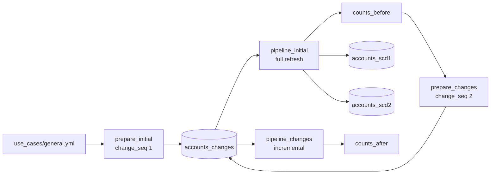

# SCD and change capture

## Overview

One change feed table drives two streaming tables through `AUTO CDC INTO`: an SCD type 1 table that keeps the latest row per key and an SCD type 2 table that keeps every version. The job runs the pipeline on an initial snapshot, appends a change batch with inserts, updates, and deletes, runs the pipeline again without a full refresh, and records counts after each run.

## What this shows

| Behavior | Where |
|---|---|
| Overwrite on update | `accounts_scd1` |
| History with `__START_AT` and `__END_AT` | `accounts_scd2` |
| Deletes applied with `APPLY AS DELETE WHEN` | both flows |
| Incremental second run | `pipeline_changes` task has `full_refresh: false` |
| Counts before and after | `scd_run_counts` |

## Architecture

## Reference code

- `guides/scd-change-capture/pipeline/accounts_scd.sql`: both `AUTO CDC INTO` flows
- `guides/scd-change-capture/00_start_here` to `06_counts_after`: one notebook per job task. `02_run_pipeline_initial` and `05_run_pipeline_changes` run the pipeline when you run them by hand.
- `src/de_common/accounts.py`: `initial_snapshot` and `change_batch`
- `src/de_common/spec.py`: `plan_changes` picks disjoint update, delete, and insert ids
- `src/de_common/scd.py`: `measure` counts current, history and deleted keys; `problems` compares them with the spec
- `resources/scd.job.yml`

## Demo steps

1. Open `pipeline/accounts_scd.sql`. Both flows share the key, the delete rule, and the sequence column. Only `STORED AS` differs.
2. Open the job run and its eight tasks: four notebooks and two pipeline updates, each update followed by an inspect notebook.
3. Show `scd_run_counts` for the `before` phase: 1,000 current rows in both tables, no deletes.
4. Show the `after` phase: 1,020 current rows in both tables, 40 deleted keys, and 1,210 rows in the type 2 table.
5. Query one updated key in `accounts_scd2` to see two versions with `__END_AT` set on the first.
6. Query one deleted key. It is absent from `accounts_scd1`, and its last version in `accounts_scd2` has an `__END_AT`.
7. Open the second pipeline update to confirm it was not a full refresh.

## Artifacts produced

- `accounts_changes`, `accounts_scd1`, `accounts_scd2`, `scd_run_counts`
- Reference run: 1,000 initial rows, then 60 inserts, 150 updates, and 40 deletes. Type 1 ends at 1,020 rows. Type 2 ends at 1,210 rows (1,020 current, 150 superseded versions, 40 closed deleted keys) with 150 keys that have more than one version.

## Limitations and next steps

- The feed is a Delta table with an op column. A source that only provides full snapshots needs `create_auto_cdc_from_snapshot_flow` in Python.
- Both tables track history for all columns. `TRACK HISTORY ON` limits type 2 versioning to chosen columns.
- A real feed needs a sequence column that never goes backwards for a key. Here `change_seq` is 1 or 2.
