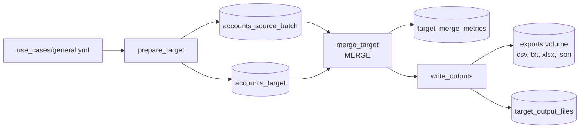

# Target loading and file outputs

## Overview

A job builds a Delta target with 1,000 accounts and a source batch of 60 inserts, 150 updates, and 40 deletes. One `MERGE` applies all three. The job records the operation metrics from Delta history, then writes the merged table to a Unity Catalog volume as CSV, pipe-delimited text, an Excel workbook, and JSON.

## What this shows

| Step | Artifact |
|---|---|
| `MERGE` with delete, update, and insert clauses | `accounts_target` |
| Operation metrics | `target_merge_metrics` |
| Four output files | `/Volumes/<catalog>/<schema>/exports/` |
| File names and sizes | `target_output_files` |

## Architecture

## Reference code

- `guides/target-loading-outputs/00_start_here`: what the guide shows, the notebooks in order, and the variables
- `guides/target-loading-outputs/01_prepare_target`: the initial target and the source batch
- `guides/target-loading-outputs/02_merge_target`: `whenMatchedDelete`, `whenMatchedUpdate`, `whenNotMatchedInsert`, and the metrics check
- `guides/target-loading-outputs/03_write_outputs`: `write_xlsx` formats the workbook; the notebook writes all four files
- `src/de_common/files.py`: `column_widths` and `merge_metrics`
- `resources/target_loading.job.yml` and `resources/exports.volume.yml`

## Demo steps

1. Open `02_merge_target`. The change type on each source row picks the MERGE clause.
2. Open the job run and the `merge_target` output: rows go from 1,000 to 1,020.
3. Query `target_merge_metrics`: 250 source rows, 60 inserted, 150 updated, 40 deleted.
4. Run `DESCRIBE HISTORY` on `accounts_target` to see the same metrics on the MERGE version.
5. Open the exports volume in Catalog Explorer and list the four files.
6. Download the workbook. It has a bold white-on-dark header row, widths sized to the data, a frozen header, and a number format on `balance`.
7. Query `target_output_files` for names, sizes, and row counts.

## Artifacts produced

| File | Size (bytes) | Rows |
|---|---|---|
| `accounts_export.csv` | 78,931 | 1,020 |
| `accounts_export.txt` | 78,931 | 1,020 |
| `accounts_export.xlsx` | 42,418 | 1,020 |
| `accounts_export.json` | 195,159 | 1,020 |

## Limitations and next steps

- Files are written from a pandas frame, so this suits exports of thousands of rows, not millions. For large exports use Spark's CSV or JSON writers, which produce a folder of part files.
- openpyxl needs a local file, because the volume's file system does not support the zip seeks it makes. The job builds the workbook in a temporary folder and copies it.
- The JSON output is one array. Use `lines=True` for newline-delimited JSON.
