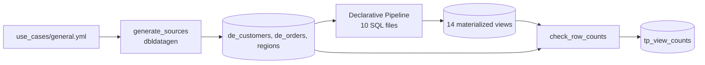

# Transformation patterns

## Overview

One Lakeflow Declarative Pipeline written in SQL holds ten common ETL patterns, one materialized view per pattern. A Lakeflow Job generates three source tables, runs the pipeline, and compares the row count of every view with an independent query on the sources.

## What this shows

| Pattern | Materialized view |
|---|---|
| Lookup enrichment | `tp_lookup_enrichment` |
| Inner, left, and full joins | `tp_join_inner`, `tp_join_left`, `tp_join_full` |
| String functions | `tp_string_functions` |
| Null detection and conditional logic | `tp_null_conditional` |
| Date and time with time zones and three input date formats | `tp_date_time` |
| Casting with a reject path | `tp_cast_valid`, `tp_cast_rejects` |
| Aggregation with running totals | `tp_running_totals` |
| Pivot and unpivot | `tp_pivot`, `tp_unpivot` |
| Last record per group | `tp_last_record` |
| Per-group iteration with array functions | `tp_group_iteration` |

## Architecture

## Reference code

- `src/transformations/*.sql`: one file per pattern
- `src/generate_sources.py`: builds the source tables from the spec
- `src/check_transformations.py`: `CHECKS` pairs each view with its expected-count query
- `resources/transformations.job.yml` and `resources/transformations.pipeline.yml`

## Demo steps

1. Open `use_cases/general.yml` and show the messy inputs: mixed-case names, three date formats, `N/A` amounts, region codes missing from the lookup.
2. Open the job run. `generate_sources` writes 5 regions, 2,000 customers, and 12,000 orders.
3. Open the pipeline update and its graph: 14 materialized views.
4. Open `02_joins.sql`. The full join returns 11,000 matched rows, 1,000 orders with no customer, and 100 customers with no orders.
5. Query `tp_date_time` to compare `order_ts_utc` with the Eastern, Pacific, and Tokyo columns.
6. Query `tp_cast_rejects`. 524 orders fail to cast, each with its reason. `tp_cast_valid` holds the other 11,476.
7. Query `tp_view_counts` for the per-view comparison.

## Artifacts produced

- 14 materialized views in the guide schema, prefixed `tp_`
- `tp_view_counts`: view, pattern, actual count, expected count, pass flag
- Reference run: all 14 views match their expected counts and valid plus rejected rows equal the 12,000 orders

## Limitations and next steps

- Materialized views recompute from batch sources here. On serverless pipelines with row tracking on the sources, refreshes can be incremental.
- The reject path keeps the raw values and a reason. A production pipeline would also add a retry or repair step for rejected rows.
- Time zone names come from the lookup table's `time_zone` column. `tp_date_time` hard-codes three zones to keep the example short.
