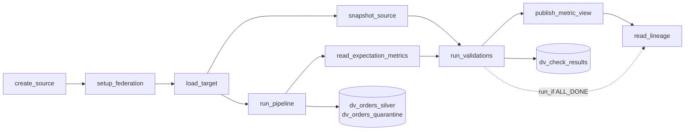

# Data validation framework

## Overview

The `capability-guides-data-validation` job builds a small source system, copies it into Databricks, and then validates the copy in the ways a data engineering team usually needs. It reconciles with the source through Lakehouse Federation, enforces row rules in a Lakeflow Spark Declarative Pipeline with a quarantine table, runs every other check from one spec into one results table, reads lineage for impact analysis, and publishes a metric view.

The source is a stand-in. There is no SQL Server in the reference workspace, so the job uses a schema (`dv_source`) in a Lakebase Postgres project and reads it through a Unity Catalog connection and `remote_query`, the same pattern as the relational database extracts guide. The validation logic lives only in Databricks, so pointing it at SQL Server means changing the connection type and the source-side SQL dialect, not the framework.

## What this shows

| Capability | Artifact |
|---|---|
| Source and copy | `dv_customers_landed`, `dv_orders_landed` (the bronze copy, loaded with `remote_query`) |
| Reconciliation without duplicate logic | `orders_totals_vs_source` (live source aggregates) and `orders_daily_vs_source` (per-day count, sum, checksum from a snapshot of source aggregates) |
| Expectations: warn, drop, fail | `dv_orders_silver`, with `status_known` (warn), `amount_positive` and `customer_present` (drop), `order_id_present` (fail) |
| Quarantine | `dv_orders_quarantine`, with `quarantine_reasons` and `quarantined_at` |
| Expectation metrics | `dv_expectation_metrics`, from the pipeline event log |
| Spec-driven checks | `use_cases/general.yml` (`checks:`), run by `src/dv_lib.py` into `dv_check_results` |
| Failures view for an alert | `dv_latest_failures`, read by a paused SQL alert |
| Blocking | `run_validations` fails on an error-severity check, which skips `publish_metric_view` |
| Lineage for impact analysis | `dv_lineage_impact`, from `system.access.table_lineage` |
| One metric definition | Metric view `dv_orders_metrics`, checked against the table in `dv_metric_view_checks` |

## Architecture



## Reference code

- `resources/validation.job.yml`: nine tasks. `publish_metric_view` waits for `run_validations`; `read_lineage` uses `run_if: ALL_DONE`.
- `resources/validation.pipeline.yml`: a serverless pipeline over `guides/data-validation-framework/pipeline/`.
- `resources/validation.alert.yml`: a SQL alert on `dv_latest_failures`, deployed paused.
- `guides/data-validation-framework/00_start_here`: what the guide shows, the variables, a link to the job.
- `guides/data-validation-framework/01_create_source` to `08_read_lineage`: one notebook per task.
- `guides/data-validation-framework/pipeline/dv_orders.py`: silver and quarantine, with the rules defined once.
- `use_cases/general.yml`: the sample data, the rules, the checks, and the metric view.
- `src/dv_lib.py`: SQL builders for both dialects, `diff_slices`, `run_check`, `blocking`, covered by `tests/test_dv_lib.py`.

## Demo steps

1. Run `capability-guides-data-validation`. Allow 25 to 40 minutes: the last task polls until lineage reaches the system tables.
2. Read the results:
   ```sql
   SELECT check_name, severity, observed, operator, expected, status, details
   FROM <catalog>.<schema>.dv_check_results ORDER BY status DESC, check_name;
   ```
3. Show the quarantined rows and why each was rejected:
   ```sql
   SELECT order_id, amount, customer_id, quarantine_reasons FROM <catalog>.<schema>.dv_orders_quarantine;
   ```
4. Show expectation counts from the event log:
   ```sql
   SELECT dataset, expectation, passed_records, failed_records FROM <catalog>.<schema>.dv_expectation_metrics_latest;
   ```
5. Show what the failed check touches downstream:
   ```sql
   SELECT dataset, direction, hops, related_table, entity_type FROM <catalog>.<schema>.dv_lineage_impact;
   ```
6. Query the metric:
   ```sql
   SELECT order_date, MEASURE(net_revenue) FROM <catalog>.<schema>.dv_orders_metrics GROUP BY ALL ORDER BY 1 DESC;
   ```
7. To see a block, run the job with the parameter `block_on` set to `warn`. `run_validations` fails on the per-day reconciliation, `publish_metric_view` is skipped, and `read_lineage` still runs.

## Artifacts produced

- Tables: `dv_customers_landed`, `dv_orders_landed`, `dv_source_snapshot`, `dv_orders_silver`, `dv_orders_quarantine`, `dv_expectation_metrics_latest`, `dv_expectation_metrics`, `dv_check_results`, `dv_metric_view_checks`, `dv_lineage_impact`
- Views: `dv_latest_failures`, and the metric view `dv_orders_metrics`
- A Unity Catalog connection `capability_guides_dv_source` (the job replaces its token each run), a schema `dv_source` in the Lakebase project, a serverless pipeline, and a paused SQL alert

## Limitations and next steps

- The source is Postgres in Lakebase, not SQL Server. The checksum is the one expression written in two dialects (Postgres and Spark); both come from one column list in the spec.
- The connection holds a Lakebase OAuth token that lasts about an hour, and each run replaces it. A real source uses a long-lived credential from a secret store.
- Federation runs the source aggregates on the source database. The snapshot task limits that to one query per snapshot check per run. Move busy sources to Lakeflow Connect and reconcile bronze with the source by count.
- The metric view certification needs `ASSIGN` on the `system.certification_status` governed tag. The notebook reports the outcome and continues if it is denied.
- The alert is paused. Unpause it and set the schedule and subscribers when you adopt the pattern.
- Data quality monitoring (anomaly detection, a Public Preview feature, and data profiling) is not enabled by this bundle. Anomaly detection is one setting per schema and needs table history before its range is useful. The data observability guide creates a profiling monitor.
- Pages (Beta) are a Unity Catalog semantics feature that account admins control from the Previews page. The bundle does not create Pages. Confirm availability with the account team.
- Lakebridge Reconcile is documented by Databricks Labs for migration-time reconciliation and is not part of this bundle.

## Reference run

Numbers from the recorded run of the bundle job (nine tasks, 4.5 minutes on serverless). A first run of the same job, from a clean schema, took about 15 minutes because the lineage task waited about 10 minutes for the pipeline edge to reach `system.access.table_lineage`. The recorded run found the first run's edges at once.

- Source and copy: 1,200 orders and 60 customers in the Postgres source, copied with `remote_query` into `dv_orders_landed` and `dv_customers_landed`.
- Event log metrics from the pipeline: `amount_positive` failed 12 rows, `customer_present` failed 5, `status_known` (warn) failed 2 and kept them, `order_id_present` (fail) failed none.
- Quarantine: `dv_orders_quarantine` holds 17 rows (12 with `amount_positive`, 5 with `customer_present`), and `dv_orders_silver` holds 1,183. 1,183 plus 17 equals the 1,200 landed rows, which `silver_plus_quarantine_equals_landed` checks.
- Results: 10 checks, 9 pass, 1 fails. The failing check is `orders_daily_vs_source`, severity `warn`: 2 of 30 days differ from the source snapshot. On 2026-10-15 the source has 46 orders and the copy has 40 (sum 11,903.60 against 10,251.20); on 2026-10-16 the source has 34 and the copy has 40 (sum 7,957.50 against 9,609.90). The checksum differs on both days. The whole-table check `orders_totals_vs_source` passes, because the six moved orders leave the total count and sum unchanged.
- Blocking: a second run with `block_on` set to `warn` failed `run_validations` on the same check, skipped `publish_metric_view` (`UPSTREAM_FAILED`), and still ran `read_lineage`. The run lists two failed attempts of `run_validations`.
- Metric view: `dv_orders_metrics` returned `net_revenue` 199,903.97 and `order_count` 1,183, equal to the same aggregates on the silver table. The `system.certification_status` tag was set to `certified`.
- Lineage: `dv_orders_landed` feeds `dv_orders_silver` and `dv_orders_quarantine` (one hop, written by the pipeline) and `dv_orders_metrics` (two hops, written by a job). Rows with no target table are reads. In this workspace they show jobs, pipelines, and ad hoc SQL queries (entity type empty) as readers, and no dashboards, because none reads these tables.
- One task attempt of the very first run, `create_source`, failed with a Python process abort and succeeded on the automatic retry. It did not recur.
