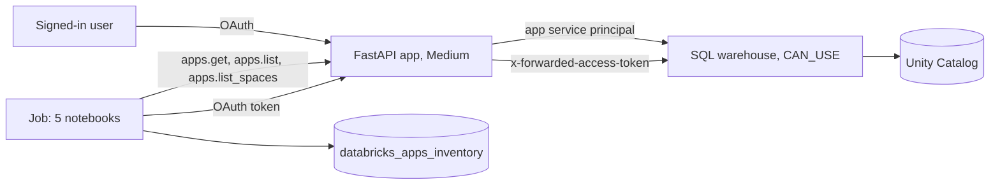

# Databricks Apps, App Spaces and Serverless Micro Apps

## Overview

The bundle deploys one small FastAPI app at the Medium compute size, then a job inspects it. The app has two routes. `/whoami/app` runs a query as the app service principal. `/whoami/user` runs the same query as the signed-in user, with the token the platform forwards in `x-forwarded-access-token`. The job reads the app through the SDK, checks its health with the job identity's OAuth token, audits every app in the workspace for cost, looks at App Spaces (Beta) read-only, and stops the app when you set a parameter.

**Cost.** The app bills about 0.5 DBU per hour while it is running (Medium), roughly 365 DBU a month if you leave it on. A stopped app does not bill. The job's last task, `cleanup`, stops it when `stop_app` is `true`.

## What this shows

| Guide artifact | Where it is |
|---|---|
| `app.yaml` with a start command and `valueFrom` | `app/app.yaml`: `WAREHOUSE_ID` reads the `sql-warehouse` resource key |
| Bundle `apps` resource | `resources/databricks_apps.app.yml`: warehouse with `CAN_USE`, `user_api_scopes: [sql]`, `compute_size: MEDIUM` |
| App authorization and user authorization | `app/app.py`: `whoami_app` and `whoami_user` |
| App inventory | `databricks_apps_inventory`, one row per app |
| Cost check across the workspace | `03_cost_check`: size, status, resources, and a running-but-idle flag |
| App Spaces (Beta), read-only | `04_app_spaces`: `apps.list_spaces`, or the UI steps when the preview is off |

## Architecture



## Reference code

- `app/`: `app.py`, `app.yaml`, `requirements.txt`. The app reads only. It creates no tables, so a redeploy changes no data.
- `resources/databricks_apps.app.yml`: the app. `resources/databricks_apps.job.yml`: five tasks.
- `guides/databricks-apps/`: `00_start_here` and one notebook per task. Each also runs on its own with Run all.
- `src/apps_lib.py`: parsing `app.yaml` env, resolving `valueFrom` keys, idle detection, the inventory `MERGE`, and the stop-or-no-op decision. `tests/test_apps_lib.py` runs them with no workspace.

## Tasks

| Task | What it does |
|---|---|
| `read_app` | `apps.get`: URL, compute size and status, active deployment and source path, resources, user API scopes, service principal. Merges one row into `databricks_apps_inventory`. |
| `health_check` | Calls `/health`, `/whoami/app`, and `/whoami/user` with the job identity's OAuth token and shows the identity each route reports. |
| `cost_check` | Lists every app with size, status, and resources. Flags apps that are running but idle. Stopped apps are never flagged because they do not bill. |
| `app_spaces` | App Spaces and Genie App Builder are Beta. Lists spaces with `apps.list_spaces` if the preview is on, and prints the UI steps if not. Creates nothing. |
| `cleanup` | Stops the app when `stop_app` is `true`. Runs even if an earlier task failed. Keeps the app by default. |

## Run it

```bash
cd reference/databricks-apps
databricks bundle deploy --target dev --profile <profile> \
  --var catalog=<catalog> --var warehouse_id=<warehouse-id> \
  --var app_service_principal=<app-service-principal-application-id>
databricks bundle run databricks_apps_demo --target dev --profile <profile> --var ...   # deploys the source, starts the app
databricks bundle run capability_guides_databricks_apps --target dev --profile <profile> --var ...
python -m pytest -q tests
```

## Clean up

The app keeps billing until you stop it. Pick one:

1. Run the job with `stop_app=true`: `databricks bundle run capability_guides_databricks_apps --params stop_app=true ...`
2. `databricks apps stop <app_name>`
3. Delete it: `databricks apps delete <app_name>`, or `databricks bundle destroy --target dev --var ...` for the whole bundle. Deleting stays a step you run yourself.

## Safe to rerun

- `read_app` merges on `app_name`, so a second run updates the same row. Only that one table is written.
- `health_check`, `cost_check`, and `app_spaces` only read.
- `cleanup` stops a running app and does nothing for a stopped, stopping, or missing one. Two runs leave the same end state.
- `bundle deploy` and `bundle run` update the one app in place.

## Reading the identities

`/whoami/app` returns the service principal from `current_user()`. `/whoami/user` returns the caller. The `visible_tables` counts can differ, because `system.information_schema.tables` lists only what each identity may see. To make the app service principal see the shared schema, grant it `USE CATALOG`, `USE SCHEMA`, and `SELECT` on that schema. The user token works only inside this workspace.

## Limitations and next steps

- The Apps API has no request counter, so "idle" means running with no deployment or update for `idle_days`. Confirm in the app's Insights tab (Beta) and in `system.billing.usage` before you stop an app.
- App Spaces and Genie App Builder need a workspace admin to turn on Governed agentic app-building on the Previews page. Genie App Builder has no public API, and the notebook only reads spaces.
- Serverless Micro Apps were announced on June 16, 2026 and have no public docs, so nothing here covers them.
- A job running as a user may not be accepted by the app proxy. The health check reports that case in its `note` column and does not fail.
