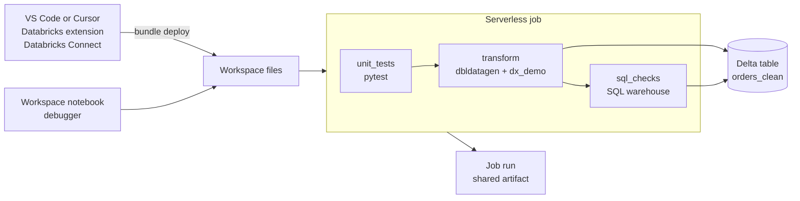

# Developer workflow in the IDE

## Overview

This guide covers one author, debug, test loop: write PySpark in an IDE, step through it with a breakpoint, run the same tests locally and on serverless, and ship the result as a bundle job whose run anyone can open.

Success criterion: complete a representative author-debug-test workflow using supported SQL, Python, notebook, or pipeline tooling.

## What this shows

- A small Python package (`src/dx_demo/`) with pure PySpark transformations. Column names and the dataset come from a spec file, `use_cases/general.yml`.
- One edge case that the tests catch: keys must be normalized before de-duplication, and a dated record must beat an undated one.
- A workspace notebook (`src/explore.py`) that imports the package for interactive work and the notebook debugger.
- The same pytest suite running locally and in a serverless job task.
- A SQL file (`src/validate_output.sql`) that a SQL task runs on the warehouse against the output table.

## Architecture

## Reference code

All files are in `reference/developer-experience/`.

| File | Role |
|---|---|
| `databricks.yml`, `resources/workflow.yml` | Bundle, variables, and the job `capability_guides_developer_experience_workflow` |
| `use_cases/general.yml` | Dataset columns, row count, seed, injected edge cases, output table |
| `src/dx_demo/transforms.py` | Generic PySpark functions: `clean_records`, `add_band`, `add_date` |
| `src/dx_demo/rules.py` | Plain-Python row rules, testable without Spark |
| `src/dx_demo/spec.py` | Spec loader and seeded data generation (dbldatagen, with a pure-Python fallback) |
| `src/explore.py` | Notebook source for interactive authoring |
| `src/run_tests.py` | `spark_python_task` runner that calls `pytest.main` and fails on any failing test |
| `src/transform.py` | Generates data from the spec, cleans it, writes the table |
| `src/validate_output.sql` | Checks run by the `sql_checks` task |
| `tests/` | pytest suite shared by local and serverless runs |

To reuse the workflow for another dataset, add a file in `use_cases/` and set the `use_case`, `output_table`, `key_column`, and `value_column` variables. The transforms and tests do not change.

## IDE extensions

Install these in VS Code or Cursor before the demo:

| Extension | What it adds | Links |
|---|---|---|
| Databricks | Workspace connection, run and debug on serverless or clusters, Databricks Connect, bundle validate/deploy/run in the sidebar | [Marketplace](https://marketplace.visualstudio.com/items?itemName=databricks.databricks) · [Docs](https://docs.databricks.com/aws/en/dev-tools/vscode-ext/install) |
| Databricks Driver for SQLTools | Browse Unity Catalog and run SQL on a warehouse from the editor | [Marketplace](https://marketplace.visualstudio.com/items?itemName=databricks.sqltools-databricks-driver) · [Docs](https://docs.databricks.com/aws/en/dev-tools/sqltools-driver) |
| SQLTools | The SQL editor the Databricks driver plugs into | [Marketplace](https://marketplace.visualstudio.com/items?itemName=mtxr.sqltools) |
| Python | Debugger, pytest test explorer, interpreter for Databricks Connect | [Marketplace](https://marketplace.visualstudio.com/items?itemName=ms-python.python) · [Databricks Connect](https://docs.databricks.com/aws/en/dev-tools/vscode-ext/dev-tasks/databricks-connect) |
| Jupyter | Run notebook cells locally against Databricks | [Marketplace](https://marketplace.visualstudio.com/items?itemName=ms-toolsai.jupyter) · [Docs](https://docs.databricks.com/aws/en/dev-tools/vscode-ext/dev-tasks/notebooks) |
| YAML (Red Hat) | Completion and validation for `databricks.yml` from the bundle schema | [Marketplace](https://marketplace.visualstudio.com/items?itemName=redhat.vscode-yaml) · [Bundles in VS Code](https://docs.databricks.com/aws/en/dev-tools/vscode-ext/bundles) |

JetBrains users get the same loop with [Databricks Connect in PyCharm](https://docs.databricks.com/aws/en/dev-tools/databricks-connect/python/pycharm). Everything the extensions do is also available from the [Databricks CLI](https://docs.databricks.com/aws/en/dev-tools/cli/) in the IDE terminal.

## Demo steps

1. Open `reference/developer-experience/` in VS Code or Cursor with the Databricks extension. Select the workspace and the `dev` target.
2. Run `python -m pytest tests` in the IDE terminal. The plain-Python tests pass. The PySpark tests skip when `pyspark` is not installed.
3. Set up Databricks Connect (extension: "Configure Databricks Connect" or `pip install databricks-connect`) so `pyspark` tests and scripts run against serverless.
4. Open `src/dx_demo/transforms.py` and set a breakpoint on the `latest = Window...` line in `clean_records`.
5. Debug `test_duplicates_differing_in_case_and_whitespace_collapse` from the test explorer. Inspect the DataFrame at the breakpoint, then step over.
6. Break it on purpose: move the key normalization after the window. Re-run the test. It fails because `a-1 ` and `A-1` stay separate. Undo the change.
7. Upload and open `src/explore.py` in the workspace as a notebook. Run the cells, set a breakpoint in the notebook debugger, and step into `clean_records`.
8. From the IDE terminal run `databricks bundle validate --strict --target dev` with the three required `--var` values (`catalog`, `warehouse_id`, `app_service_principal`).
9. Run `databricks bundle deploy --target dev` with the same variables.
10. Run `databricks bundle run capability_guides_developer_experience_workflow --target dev` with the same variables. The terminal streams each task's output.
11. Open the run URL. `unit_tests` shows the same pytest output as the local run, `transform` shows row counts, and `sql_checks` shows the SQL result.
12. Share the run link. It holds the test results, the table write, and the SQL checks in one reviewable place.

## Artifacts produced

- The job `capability_guides_developer_experience_workflow` and its run history.
- The pytest output from the `unit_tests` task.
- The Delta table `<catalog>.<schema>.orders_clean`.
- The SQL check results from the `sql_checks` task.

## Limitations and next steps

- Local PySpark tests need `pyspark` or Databricks Connect. Without either, only the plain-Python tests run.
- The workspace cannot write `__pycache__` next to bundle files, so the runners set `sys.dont_write_bytecode`.
- Edge cases are injected in Python after generation, so row counts stay small enough to collect to the driver. Larger volumes need the injection moved into Spark.
- `output_table`, `key_column`, and `value_column` are repeated in the bundle variables because bundles cannot read the spec. `transform.py` fails if `output_table` disagrees with the spec.
- Next steps: package `dx_demo` as a wheel, add a `test` target run in CI, and add a second spec in `use_cases/`.
