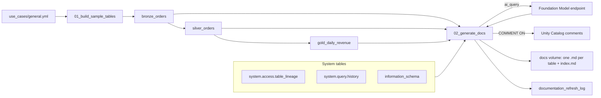

# Automated data documentation

## Overview

Success criterion: generate and refresh documentation containing schema, lineage, quality, ownership, and usage guidance.

This guide deploys one serverless job. The job builds a bronze, silver, and gold table chain from a spec file, then writes a markdown page for each table the spec lists and applies AI-drafted descriptions back to Unity Catalog as table and column comments. Each run overwrites the pages and adds a row to a log table, so a refresh is one job run.

## What this shows

| Criterion | Artifact |
|---|---|
| Schema | Columns and types from `information_schema.columns`, in the Schema section of each page |
| Lineage | Upstream and downstream tables from `system.access.table_lineage`, in the Lineage section |
| Quality | Row count, per-column null rate, and key uniqueness profiled by the job, in the Quality and Schema sections |
| Ownership | Table owner from `information_schema.tables` and tags from `information_schema.table_tags` |
| Usage guidance | Recent readers (`system.access.table_lineage`), recent queries (`system.query.history`), and a model-drafted usage note |
| Descriptions | `ai_query` against the chosen Foundation Model endpoint, applied with `COMMENT ON TABLE` and `ALTER TABLE ... ALTER COLUMN ... COMMENT` |
| Refresh | `documentation_refresh_log` holds one row per run |

## Architecture

## Reference code

- `reference/documentation/databricks.yml`: bundle, variables, targets, permissions
- `reference/documentation/resources/schema.yml`: the `docs` volume in the shared guide schema
- `reference/documentation/resources/job.yml`: job `capability_guides_documentation_refresh` (serverless, two notebook tasks)
- `reference/documentation/requirements.txt`: `dbldatagen` and `pyyaml`, installed by the first cell of `01_build_sample_tables`
- `reference/documentation/use_cases/general.yml`: domain spec (tables, column specs, row counts, seed, tags)
- `reference/documentation/guides/documentation-generation/00_start_here.py`: what the guide shows, the notebooks, the variables, and a link to the job
- `reference/documentation/guides/documentation-generation/01_build_sample_tables.py`: spec-driven table build with `dbldatagen`
- `reference/documentation/src/spec_helpers.py`: spec parsing and seeded Python fallback generator
- `reference/documentation/guides/documentation-generation/02_generate_docs.py`: profiling, system table queries, `ai_query`, comments, pages, log row
- `reference/documentation/src/doc_render.py`: markdown rendering helpers
- `reference/documentation/tests/test_doc_render.py`: unit tests (`python -m pytest reference/documentation/tests`)

## Demo steps

1. Show `use_cases/general.yml`: the only place the sample domain is defined. A different `--var use_case=<name>` swaps it.
2. Run `databricks bundle deploy --target dev` and open `guides/documentation-generation/00_start_here` in the workspace. It links to the deployed job. To run by hand instead, open `01_build_sample_tables`, then `02_generate_docs`, and use Run all in each.
3. Run `databricks bundle run capability_guides_documentation_refresh`.
4. Open the `01_build_sample_tables` output: generated rows, fixed seed, so reruns produce the same data.
5. In Catalog Explorer, open `silver_orders`. Show the lineage graph and the new table and column comments.
6. Open the `docs` volume and read `silver_orders.md`: schema, quality, lineage, ownership, usage.
7. Open `index.md` and follow the links to the other pages.
8. Query `documentation_refresh_log` to show the refresh record.
9. Run the job again and show a second log row with the pages overwritten.

## Artifacts produced

- Tables this bundle adds to the shared guide schema: `bronze_orders`, `silver_orders`, `gold_daily_revenue`, `documentation_refresh_log`
- Volume files in `/Volumes/<catalog>/<schema>/docs/`: `bronze_orders.md`, `silver_orders.md`, `gold_daily_revenue.md`, `index.md`
- Unity Catalog table comments and column comments on the three sample tables, plus tags from the spec
- One job run per refresh, with the task output showing each table documented

## Limitations and next steps

- System tables lag. `system.access.table_lineage` can take minutes to hours to show new tables, so the first run may show "none recorded" for lineage and readers. A second run fills them in.
- `ai_query` does not work against every endpoint. In this workspace the Sonnet 5 and Opus 5 endpoints reject batch inference, so the default is `databricks-claude-opus-4-8`. Check with a one-line `ai_query` before changing `model_endpoint`.
- Descriptions are drafts from table metadata and profile numbers, not from business knowledge. Review them before treating them as authoritative. Each run overwrites existing comments.
- Key uniqueness checks the first id-like column only.
- If `dbldatagen` fails on serverless, `01_build_sample_tables` falls back to a seeded Python generator that reads the same spec. The run used `dbldatagen`.
- Next steps: document more tables by adding them to the spec (the job documents only the tables the spec lists, because the guide schema is shared with other bundles), add a human-edited override file so reviewed comments are kept, and schedule the job.
