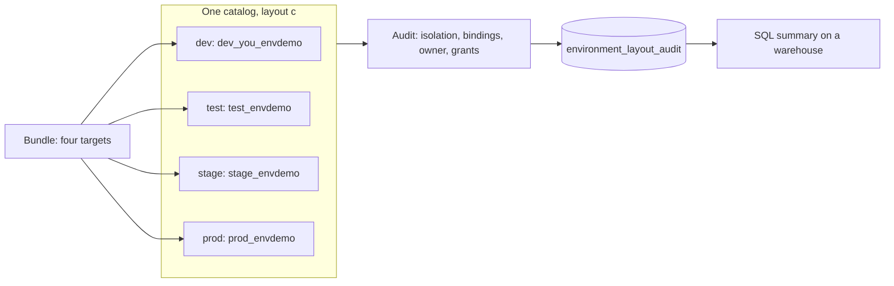

# Workspaces and catalogs across dev, test, stage, and prod

## Overview

Four environments need four sets of boundaries: where code runs (workspaces), where data lives (catalogs and storage), and who can change what (identities). This guide lays out the three common catalog layouts side by side, shows the commands that build the strongest one, and audits a real catalog against it. Job key: `capability_guides_environments`.

The bundle deploys `dev`, `test`, `stage`, and `prod` targets into the one workspace in your profile, and each target gets its own schema in one catalog. That is layout (c), the weakest layout and the only one a single workspace can show. The job reads the catalog's isolation mode, workspace bindings, owner, and grants through the SDK and reports what a layout check finds. The four-workspace, four-catalog setup is in `setup/` as SQL and CLI commands. This repo does not run them.

## Required setup

Run this once, before the job. `<principal>` is the person or service principal behind `databricks bundle run`.

1. **Read access to the catalog's bindings.** `02_audit_layout` reads the catalog's isolation mode, workspace bindings, and grants. The bindings API allows a metastore admin or the owner of the catalog. Without access the audit records bindings and grants as `info` and still finishes. To get the full findings, make the identity the catalog owner:
   ```bash
   databricks catalogs update <catalog> --owner <principal>
   ```
2. **The four-workspace layout is not run by the bundle.** `databricks bundle run capability_guides_environments` needs nothing from `setup/`. The files in `setup/` build the catalog-per-environment layout and are commands you run yourself, as a metastore admin, after substituting the placeholders. Run them in this order:
   1. Section 1 of `setup/02_credentials_and_bindings.sh`: one storage credential per environment (the script shows the AWS form; Azure and GCP use a managed identity or a Google service account in the same JSON slot).
   2. `setup/01_catalogs.sql`: external locations, catalogs, and domain schemas. Run it on a SQL warehouse.
   3. Sections 2 to 5 of `setup/02_credentials_and_bindings.sh`: isolate each catalog and bind it to its workspace.
   4. `setup/03_grants.sql`: grants to groups, and ownership to the environment's service principal.

   The script reads `PROFILE`, `ACCOUNT_ID`, `DEV_WS`, `TEST_WS`, `STAGE_WS`, and `PROD_WS` from the environment. To deploy your own bundle against that layout, start from `setup/databricks.four-workspaces.yml.example` and fill in the hosts, catalogs, and service principals.

## What this shows

| Step | Where | Result in the reference run |
|---|---|---|
| Four targets validate | `databricks bundle validate --strict -t dev\|test\|stage\|prod` | All four pass. |
| Four-workspace example validates | `setup/databricks.four-workspaces.yml.example` with real hosts and service principals substituted in a scratch copy | All four targets pass `--strict`. |
| Deploy and run `dev` | `databricks bundle run capability_guides_environments` | Succeeded in about 90 seconds: seed, audit, summary query. |
| Personal sandbox | `dev` target in development mode | The schema is `dev_<you>_envdemo`. |
| Sample data outside prod | `01_seed_environment` | 50 rows in `sample_orders` in dev, test, and stage. Prod gets none. |
| Rerun | same command | Same 50 rows; the audit table is replaced. |
| All four targets deployed | `test`, `stage`, `prod` deployed and run, then destroyed | The `environments` check turned from info to pass. |

Findings from the audit, run on `dev` with only that target deployed:

| Check | Status | Finding |
|---|---|---|
| `layout` | info | Layout (c): one catalog with environment schemas. |
| `environments` | info | Environment schemas here: dev. Missing: test, stage, prod. |
| `sandbox` | pass | The dev schema is a personal sandbox. |
| `isolation` | pass | The catalog is `ISOLATED`: only bound workspaces can see it. |
| `bindings` | pass | One workspace binding, read-write, and it is this workspace. |
| `owner` | pass | The catalog is owned by a service principal, not a person. |
| `storage` | pass | The catalog has its own managed storage location. |
| `tag` | pass | The schema is tagged `environment=dev`. |
| `schema_owner` | info | The dev schema is owned by a person, which is fine outside prod. |
| `grants` | info | No principal holds an explicit grant on the dev schema. |
| `boundary` | warn | Environments share one catalog. A binding cannot keep dev away from prod inside it, and they share one managed location. |

Run from the `prod` target with all four deployed: `environments` passed, `grants` passed (no person has write access to the prod schema), and `schema_owner` warned that the prod schema is owned by a person (whoever deployed it). The `boundary` warning appears in every environment.

## What the runs taught

- **A bound, isolated catalog still does not separate environments inside it.** The catalog here is `ISOLATED` and bound to one workspace, which is a good result for the catalog. It says nothing about dev versus prod, because both are schemas in that catalog. With several environment workspaces on one catalog, every one of them is bound to all four schemas.
- **Production mode with `name_prefix` also prefixes the schema.** The `[prod] ` preset gives `prod_envdemo`, so the schema variable stays `envdemo` in every target. Setting it to `prod_envdemo` as well produced `prod_prod_envdemo`.
- **A governed tag policy can refuse your environment names.** The reference metastore has a governed tag `environment` whose allowed values are `dev`, `staging`, `prod`, and `demo`. Tagging a schema `test` or `stage` was refused. The seed notebook prints the refusal and carries on, and the audit reports the missing tag as a warn. Pick environment names that match the policy, or ask the tag owner to add yours.
- **Whoever deploys owns what the bundle creates.** The prod schema belongs to the person who ran `bundle deploy -t prod`. In a real prod, CI deploys as a service principal, so that principal owns the schema. The audit warns when it does not.
- **Reading bindings takes a privilege.** The bindings API needs a metastore admin or the owner of the catalog. This run's identity could read them. The audit records a refusal as info rather than failing; that path is covered by a unit test, not by the run.

## Architecture



## Reference code

- `databricks.yml`: variables and the four targets (development mode for `dev`, production mode with a name prefix for the others)
- `resources/environments.schema.yml`: the environment schema
- `resources/environments.job.yml`: seed, audit, and a SQL summary task
- `guides/environment-workspaces-catalogs/01_seed_environment.py`: tags the schema, loads sample orders outside prod
- `guides/environment-workspaces-catalogs/02_audit_layout.py`: gathers facts through the SDK and writes the findings
- `guides/environment-workspaces-catalogs/03_audit_summary.sql`: counts the findings and lists the warnings
- `src/layout_lib.py`: layout classification and the checks, tested without Spark in `tests/`
- `setup/databricks.four-workspaces.yml.example`: targets for four workspaces and four catalogs
- `setup/01_catalogs.sql`, `02_credentials_and_bindings.sh`, `03_grants.sql`: the commands that build layout (a)

## Demo steps

1. Deploy `dev` and run the job: `databricks bundle deploy -t dev` then `databricks bundle run capability_guides_environments -t dev`.
2. Query the findings: `SELECT * FROM <catalog>.dev_<you>_envdemo.environment_layout_audit ORDER BY status`.
3. Find the `boundary` warning and explain why a catalog per environment fixes it.
4. Deploy `test`, `stage`, and `prod`, run the job in each, and rerun `dev`. The `environments` check now passes.
5. Open `setup/` and read `02_credentials_and_bindings.sh` as the layout (a) build: isolate, bind, bind prod read-only into stage.
6. Clean up: `databricks bundle destroy -t <target>` for each target.

## Limitations

- One workspace and one catalog cannot show workspace-catalog bindings between environments, per-environment storage, or per-environment identities. The `setup/` files cover them and are not run here.
- The `setup/` SQL and shell files use placeholders and have not been run. The CLI command names and flags match the installed CLI's `--help` and the bindings documentation. The example targets file validates with `--strict` after real hosts are substituted.
- The bundle creates its own schemas on purpose; other bundles in this repo write to the shared `capability_guides` schema.
- The audit reads one catalog. It does not scan the metastore for other environment catalogs, so it cannot confirm that layout (a) or (b) is complete.
