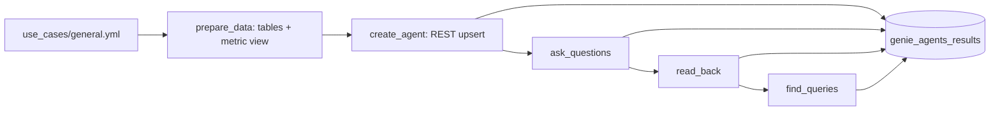

# Genie Agents

## Overview

The job creates a Genie Agent over the `sales_metrics` metric view, asks it four questions through the Conversation API, reads the conversations back, and finds the SQL it ran in `system.query.history`. Each step writes its findings to `genie_agents_results`, so the guide's claims about compute, identity, and stored data have a run behind them.

## Required setup

Run these once, before the job. `<principal>` is the person or service principal behind `databricks bundle run`.

1. **Foundation bundle.** Deploy `reference/foundation` first. It creates the shared schema this guide writes to.
2. **SQL warehouse.** Genie runs its queries on the warehouse in the `warehouse_id` variable. It must be a Pro or serverless warehouse, and `<principal>` needs CAN USE on it. Create one if you have none:
   ```bash
   databricks warehouses create --name genie-agents --cluster-size 2X-Small --warehouse-type PRO --enable-serverless-compute
   ```
3. **Genie space creation.** `02_create_agent` creates a Genie Agent through the REST API. `<principal>` needs access to Databricks SQL and the right to create spaces, and Databricks Assistant must be enabled for the workspace. The agent runs queries with the credentials of the identity that saved it, so that identity needs the privileges below.
4. **Schema privileges.** The job creates the sample tables and the `sales_metrics` metric view:
   ```sql
   GRANT USE CATALOG ON CATALOG <catalog> TO `<principal>`;
   GRANT USE SCHEMA, CREATE TABLE, SELECT ON SCHEMA <catalog>.<schema> TO `<principal>`;
   ```
5. **Query history and billing (task 5).** `05_find_queries` reads `system.query.history` and `system.billing.usage`. A metastore admin enables the schemas if they are off, then grants read access:
   ```bash
   databricks system-schemas enable <metastore-id> query     # get the ID from: databricks metastores current
   databricks system-schemas enable <metastore-id> billing
   ```
   ```sql
   GRANT USE CATALOG ON CATALOG system TO `<principal>`;
   GRANT USE SCHEMA ON SCHEMA system.query TO `<principal>`;
   GRANT SELECT ON TABLE system.query.history TO `<principal>`;
   GRANT USE SCHEMA ON SCHEMA system.billing TO `<principal>`;
   GRANT SELECT ON TABLE system.billing.usage TO `<principal>`;
   ```
   The task stops before it changes anything if `system.query.history` is unreadable. A missing billing grant is recorded as `query failed` in the billing rows. Billing rows can take hours to appear.

## What this shows

| Capability | Artifact |
|---|---|
| Agent definition as data | `genie_agent` block in `use_cases/general.yml`: one text instruction, two example queries (one parameterized), column settings, sample questions, three benchmarks |
| Create or update by title | `build_agent_space` and `GenieClient.upsert_space`: `POST /api/2.0/genie/spaces` once, `PATCH` after |
| Questions through the API | `GenieClient.ask`: a question, a follow-up in the same conversation, a second question, and a vague one |
| What is stored | `04_read_back`: field names of conversations, messages, feedback, and the query result handle |
| Who ran the SQL and where | `05_find_queries`: `executed_by`, `executed_as`, `compute.warehouse_id`, `client_application` from `system.query.history` |

## Architecture



## Reference code

- `use_cases/general.yml`: the `genie_agent` block (instructions, examples, benchmarks, questions)
- `guides/genie-agents/00_start_here`: what the guide shows, the variables, links to the job
- `guides/genie-agents/02_create_agent`: builds and upserts the agent, records the definition and warehouse
- `guides/genie-agents/03_ask_questions`: clears this user's earlier conversations, asks, rates the first answer
- `guides/genie-agents/04_read_back`, `05_find_queries`: stored fields, query history, billing
- `src/genie_lib.py`: `build_agent_space`, `definition_summary`, `field_paths`, `GenieClient`
- `src/agent_results.py`: `write_step`, `history_sql`, `wait_for_rows`
- `resources/genie_agents.job.yml`: the five-task job

## REST helper or bundle resource

The job uses the REST helper. A `genie_spaces` bundle resource is created at deploy time, before any task runs, and this agent needs the metric view that task 1 creates. Use the resource when the data already exists. It needs the direct deployment engine (CLI 1.3.0 and later, the default for new bundles). `databricks bundle schema` on CLI 1.17.0 lists these fields: `title`, `description`, `warehouse_id`, `parent_path`, `serialized_space` (inline JSON or YAML), `file_path` (a `.geniespace.json` file), `permissions`, and `lifecycle`.

A scratch bundle with this resource was deployed and destroyed in the reference workspace to check it:

```yaml
resources:
  genie_spaces:
    sales_agent:
      title: Sales questions
      warehouse_id: ${var.warehouse_id}
      serialized_space:
        version: 2
        config:
          sample_questions:
            - id: "0a1b2c3d4e5f60718293a4b5c6d7e8f9"
              question: ["What is revenue by sales channel?"]
        data_sources:
          metric_views:
            - identifier: ${var.catalog}.${var.schema}.sales_metrics
      permissions:
        - level: CAN_RUN
          group_name: users
```

Quote the IDs: an unquoted all-digit hex ID parses as a number and the API rejects it. `databricks bundle generate genie-space --existing-id <id> --key <name>` writes the resource file and the `.geniespace.json` for an agent built in the UI.

## Demo steps

1. Open the `genie_agent` block in the spec. The text instruction has three lines; revenue is defined in the metric view.
2. Open the latest `capability-guides-genie-agents` run and its five tasks.
3. Query the results:
   ```sql
   SELECT step, item, value FROM <catalog>.<schema>.genie_agents_results ORDER BY step, item;
   ```
4. Open the agent URL from `genie_spaces` (guide `genie-agents`) and ask "What is revenue for APAC?". The agent asks for a period.
5. Open the Monitor tab and find the four questions.
6. Query the history:
   ```sql
   SELECT executed_by, executed_as, compute.warehouse_id, client_application
   FROM system.query.history WHERE query_source.genie_space_id = '<space id>';
   ```

## Artifacts produced

- Tables: `genie_agents_results` (one set of rows per step, replaced on each run), `genie_spaces`, plus the shared `cust`, `ord_fact`, and the `sales_metrics` metric view
- Genie Agent created through the REST API; ID and URL in `genie_spaces`

## Reference run

- Definition: one metric view (the API returns it under `tables`), one text instruction, two example queries (one parameterized), three sample questions, three benchmarks, three column settings.
- Warehouse: serverless, type PRO, Small, one cluster.
- Answers: the three questions with expected rows matched, including the follow-up. The vague question drew the clarifying question. Before the example query carried date parameters, the same question was answered directly from the example and the text rule lost.
- Stored: messages hold ID, conversation ID, user ID, status, content, timestamps, `feedback.rating`, the generated SQL with description and statement ID, thought steps, and a result row count and statement ID. A conversation holds ID, title, type, and creation time. There is no call to read one conversation.
- Query history: six statements arrived after about four minutes (nine polls). All ran on the agent's warehouse; `executed_by` and `executed_as` were the asking user; `client_application` was `Databricks SQL Genie Space`. Three of the six are not explained by the three SQL answers, and the docs do not say what they are.
- Billing: `system.billing.usage` had `GENIE_AGENTS` rows for the account, but billing lags by hours and the query did not isolate this run.
- The author and the asker were the same user, so the run cannot separate the embedded warehouse credential from the asker's identity.

## Limitations and next steps

- One user, one warehouse, four questions. Test with a non-admin user and a row filter to see the per-user data access.
- Entity matching was requested on three metric view columns; the run did not check that values were stored.
- Rerunning updates the agent in place, deletes this user's earlier conversations in it, and replaces its own rows in `genie_agents_results`.
- Next: run the three benchmarks in the UI, move the definition into a bundle once the data exists, and query `system.billing.usage` the next day.
