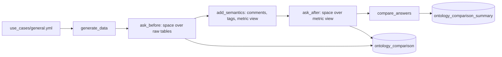

# Business terms and synonyms

## Overview

The sample sales tables store codes (`seg_cd`, `rgn_cd`, `ord_st`). The job asks a Genie Agent five business questions over the raw tables, adds table and column comments, tags, and a Unity Catalog metric view with synonyms, then asks a second space the same five questions. It records the SQL Genie wrote each time and whether the rows match an expected query.

## What this shows

| Capability | Artifact |
|---|---|
| Priority concepts defined once | `sales_metrics` metric view: 5 measures (Revenue, Order Count, Cancelled Orders, Active Customers, Average Order Value) and 6 dimensions |
| Table and column comments, tags | `COMMENT ON TABLE`, column comments, and `business_term` / `domain` tags on `cust` and `ord_fact` |
| Synonyms | `synonyms:` on every measure and dimension in the metric view, plus a glossary in the Genie instructions and sample questions |
| Better question interpretation | `ontology_comparison`: expected rows compared with each space's answer (see Reference run) |

## Architecture



## Reference code

- `use_cases/general.yml`: tables, comments, tags, metric view, Genie text, questions with expected SQL
- `guides/ontology/00_start_here`: what the guide shows, the variables, links to the job
- `guides/ontology/02_ask_before` and `04_ask_after`: update the space for a stage in place, ask each question, compare rows
- `guides/ontology/03_add_semantics` and `src/apply_semantics.py`: comments, tags and the metric view
- `src/ask_questions.py`: `stage_space`, `ask_all`, `write_answers`
- `src/genie_lib.py`: `rows_match`, `build_serialized_space`, `GenieClient`
- `resources/ontology.job.yml`: the five-task job

## Demo steps

1. Open the use-case spec and show the `metric_view` block: one definition of revenue, with synonyms.
2. Open the latest `capability-guides-ontology` run and its five tasks.
3. Query the summary table:
   ```sql
   SELECT question_id, baseline_match, enhanced_match FROM <catalog>.<schema>.ontology_comparison_summary;
   ```
4. Open `ontology_comparison` and compare `genie_sql` for one question across the two stages.
5. Open both Genie Agents from `genie_spaces` and ask "What is total revenue by customer segment?" in each.
6. Ask the second space "Show turnover by tier". Neither word appears in the column names.

## Artifacts produced

- Tables: `cust` (400 rows), `ord_fact` (6,000 rows), `ontology_comparison`, `ontology_comparison_summary`, `genie_spaces`
- Metric view: `sales_metrics`
- Genie Agents, created through `POST /api/2.0/genie/spaces` by the notebooks (a bundle `genie_spaces` resource can declare them instead): a baseline space and an enhanced space, IDs and URLs in `genie_spaces`

## Reference run

- Matches expected answer 0 of 5 before, 5 of 5 after. Five questions on generated data illustrate the mechanism; they are not a measured accuracy.

## Limitations and next steps

- The baseline space reads the same tables, so after the run it sees the added comments. Its answers in `ontology_comparison` were recorded before that.
- Five questions on synthetic data show the mechanism. They do not measure accuracy on real data.
- Rerunning the job deletes and recreates the two spaces with the same titles.
- Next: add certified example queries for the questions that still miss, and grant the space to business users.
