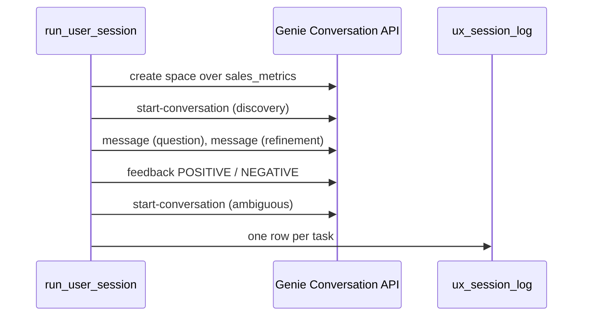

# Assistant user experience

## Overview

A scripted user works through a Genie Agent over the `sales_metrics` metric view: find out what data exists, ask a question, refine it in the same conversation, ask a vague question, and rate the answers. The job drives the Genie Conversation API and logs each task in `ux_session_log` with its outcome, any issue, and the training need.

## What this shows

| Task | What the job does |
|---|---|
| Discovery | Sends "What data is available here?" and logs the reply |
| Question | Asks for revenue by region in Q3 2026 and compares the rows with an expected query |
| Refinement | Sends "Now split that by customer segment" in the same conversation |
| Ambiguous question | Asks "Who are our best customers?" in a new conversation |
| Feedback | Posts thumbs up or down on the question and the refinement through the feedback endpoint |

## Architecture



## Reference code

- `use_cases/general.yml`: the `ux_script` block (steps, expected queries, training needs)
- `guides/user-experience/00_start_here`: what the guide shows, the variables, links to the job
- `guides/user-experience/03_run_user_session`: runs the steps and writes the log
- `src/genie_lib.py`: `GenieClient.ask`, `GenieClient.feedback`, `find_issues`
- `resources/genie_ux.job.yml`: the three-task job

## Demo steps

1. Open the `ux_script` block in the spec.
2. Open the latest `capability-guides-genie-ux` run and the `run_user_session` output.
3. Query the log:
   ```sql
   SELECT step_id, outcome, latency_s, issue, training_need FROM <catalog>.<schema>.ux_session_log ORDER BY logged_at, step;
   ```
4. Open the space URL from `genie_spaces` and find the conversation in the history.
5. Compare `generated_sql` for the question and the refinement: the second adds `Customer Segment` and keeps the Q3 filter.
6. Read the `ambiguous` row: Genie asked which measure "best" means.

## Artifacts produced

- Tables: `ux_session_log` (6 rows, replaced on each run), `genie_spaces`
- Genie Agent created through the API by the last notebook (a bundle `genie_spaces` resource can declare it instead); ID and URL in `genie_spaces`

## Reference run

- discovery answered; question and refinement matched the expected rows (15.9 s and 15.8 s); the ambiguous prompt drew a clarifying question; both feedback calls were accepted

## Limitations and next steps

- One scripted user is not a usability study. Replace the script with tasks observed from real people.
- Ratings come from a row comparison, not a person.
- Rerunning deletes and recreates the space with the same title.
- Next: add a customer-level dimension if "best customers" is a real question, and review thumbs-down feedback in the space monitoring tab.
