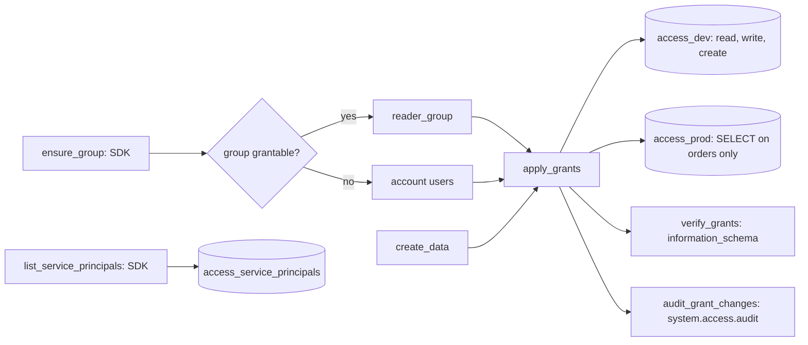

# Access management

## Overview

The job ensures a workspace group, builds a dev-like and a prod-like schema from the same spec, grants each schema to the group with different privileges, checks the result in `information_schema`, queries `system.access.audit` for the grant changes, and lists the workspace's service principals with their roles and credential metadata. Nothing is granted to an individual user.

## What this shows

| Guide artifact | Where it is |
|---|---|
| Group-based grants | `access_grants_applied`: every statement targets one group principal; `grant_sql` refuses an email address |
| Dev versus prod access difference | Dev-like schema: `USE_SCHEMA`, `SELECT`, `MODIFY`, `CREATE_TABLE`. Prod-like schema: `USE_SCHEMA` plus `SELECT` on `orders` only |
| Permission audit query | `access_audit_grant_changes` (from `guides/access-management/05_audit_grant_changes.sql`) |
| Service principals and roles | `access_service_principals` (read only) and the rotation procedure below |

In the reference run the audit table held 45 grant changes in the catalog over 30 days. Twelve were on this guide's schemas: nine applied (status 200) and three refused (status 404, the attempts to grant to the workspace-local group).

## Group and grantee

The job creates `capability-guides-readers` through the SDK (`w.groups.create`) and adds the app service principal to it. In this workspace the SCIM response says `WorkspaceGroup`, and Unity Catalog does not accept workspace-local groups as grantees: `GRANT ... TO capability-guides-readers` fails with `PRINCIPAL_DOES_NOT_EXIST`, and the audit log records the attempt with status 404. Only account-level groups can receive grants, and creating one needs account admin rights.

The job probes the grant. If the configured group is not grantable, it falls back to the built-in account-level group `account users` and records that in the `access_group` table (`unity_catalog_grantable = false`, `grantee_used = account users`). In a workspace with a SCIM-provisioned account group, set the `reader_group` variable to that group and the same job grants to it. The sample data is synthetic, so the fallback exposes nothing sensitive.

## Architecture



## Reference code

- `resources/access.job.yml`: six tasks. `audit_grant_changes` is a SQL task on the warehouse.
- `guides/access-management/`: `00_start_here` plus `01_ensure_group` (with `resolve_grantee`), `02_create_data`, `03_apply_grants`, `04_verify_grants` (asserts), `05_audit_grant_changes.sql` (SQL task), `06_check_audit` and `07_list_service_principals`. Each notebook also runs on its own with Run all.
- `src/governance_lib/sqlgen.py`: `grant_sql` and `principal_kind`, unit tested.
- `use_cases/general.yml`: the `access` section holds both environments' privileges.
- `sql/permission_audit.sql` and `05_audit_grant_changes.sql`: the audit and `information_schema` queries.

## Verification

`verify_grants` reads `schema_privileges` and `table_privileges` and asserts, using `inherited_from = 'NONE'` to isolate grants made here from privileges that cascade from the catalog:

- no person holds an explicit grant on either schema (the catalog owner appears only with privileges inherited from the catalog);
- the dev-like schema holds `SELECT`, `MODIFY`, and `CREATE_TABLE` for the group;
- the prod-like schema holds none of them at schema level, and the only table grant is `SELECT` on `orders`.

## Service principals and credential rotation

`list_service_principals` lists each service principal's name, application ID, active flag, group memberships (its roles), entitlements, and OAuth secret metadata (count, oldest creation time, latest expiry). It never reads a secret value and changes nothing.

To rotate the app service principal's credential without downtime:

1. Create a second secret with a lifetime: `databricks service-principal-secrets-proxy create <sp-id> --lifetime 7776000s`. The secret value is shown once.
2. Store it in the place that uses it (a secret scope, or the app's secret resource), never in code or a bundle file.
3. Redeploy or restart the consumer and confirm it authenticates with the new secret.
4. Delete the old secret: `databricks service-principal-secrets-proxy delete <sp-id> <old-secret-id>`.
5. Rerun this job and confirm `oauth_secret_count` and `latest_secret_expires` match what you expect. Rotate before the expiry the table shows.

## Demo steps

1. Open `use_cases/general.yml` and read the two environment blocks.
2. Open the latest run: `ensure_group` shows the group and whether Unity Catalog can grant to it.
3. Query what was applied:
   ```sql
   SELECT environment, statement FROM <catalog>.<schema>.access_grants_applied;
   ```
4. Compare effective grants for the two schemas:
   ```sql
   SELECT environment, securable, grantee, privilege, inherited_from
   FROM <catalog>.<schema>.access_effective_grants WHERE grantee = 'account users' ORDER BY 1, 2;
   ```
5. Show that a person cannot be granted directly: `grant_sql('SELECT', ..., 'someone@example.com')` raises `IndividualGrantError` (unit test).
6. Query the audit table, filtering on `status_code` to separate applied and refused changes.
7. Open `access_service_principals` and walk through the rotation procedure.

## Artifacts produced

- Job `capability-guides-access` (key `capability_guides_access`)
- Schemas `..._access_dev` and `..._access_prod`, each with `customers` (500 rows) and `orders` (2,000 rows)
- Tables `access_group`, `access_grants_applied`, `access_effective_grants`, `access_audit_grant_changes`, `access_service_principals`
- Workspace group `capability-guides-readers`

## Limitations and next steps

- Dev and prod are two schemas in one catalog because only one catalog was available. Real segregation uses separate catalogs, with the same grant pattern per catalog.
- `system.access.audit` lags the change by minutes, so a grant made seconds ago may not appear until the next run.
- Bundle-declared grants are authoritative for their securable. The job grants on the dev-like and prod-like schemas, so those schemas declare none.
