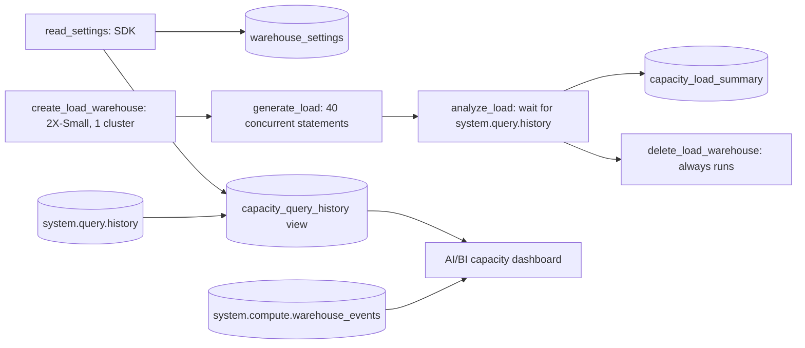

# Compute and capacity management

## Overview

The job reads the settings of the shared SQL warehouse without changing them, then creates a temporary 2X-Small serverless test warehouse with one cluster and a 5-minute auto-stop. It sends 40 heavy statements at once, reads the queueing back from `system.query.history`, and deletes the test warehouse. A small AI/BI dashboard reads the same system tables.

## What this shows

| Guide artifact | Where it is |
|---|---|
| Warehouse sizing and autoscale settings | `warehouse_settings` table (SDK read): size, min and max clusters, auto-stop, type, serverless, channel |
| Workload isolation layout | A separate warehouse per workload (see Isolation below) and the test warehouse used for the load |
| Capacity dashboard over query history | `Capability guides capacity` dashboard over `system.query.history` and `system.compute.warehouse_events` |
| Queueing under load | `capacity_load_summary` and `capacity_load_queries` |
| Warehouse type audit | `governance_warehouse_types` table: type (classic, pro, serverless), size, clusters, auto-stop, state, and flags |

In the reference run, the shared warehouse reported `Small`, 1 to 1 clusters, auto-stop 10 minutes, PRO, serverless. The test warehouse took 40 concurrent statements: 30 waited for capacity, the median wait at capacity was 61.1 s, the 95th percentile was 117.0 s, and at most 10 ran at once.

## Architecture



## Reference code

- `resources/compute_capacity.job.yml`: six tasks, the sixth a read-only audit. `delete_load_warehouse` uses `run_if: ALL_DONE` and depends on the create, load, and analyze tasks, so it runs after a failure too.
- `guides/compute-capacity-management/`: `00_start_here` plus `01_read_settings` (SDK settings and the workspace-scoped views), `02_create_load_warehouse`, `03_generate_load` (async statement execution through a thread pool), `04_analyze_load`, `05_delete_load_warehouse`, and `06_warehouse_type_audit` (lists every warehouse with its type, flags non-serverless warehouses and auto-stop above the default, and prints the API request that creates a serverless warehouse without sending it). Each notebook also runs on its own with Run all.
- `src/governance_lib/warehouses.py`: `warehouse_class`, `auto_stop_flag`, `audit_row`, and `serverless_request_body`, unit tested.
- `src/governance_lib/analysis.py`: `max_concurrency` and `percentile`, unit tested.
- `src/capacity.lvdash.json` and `resources/capacity.dashboard.yml`: the dashboard.
- `sql/capacity_queries.sql`: the queueing and event queries.

## Isolation, pause and resume, prioritization

- **Isolation.** Give each workload its own warehouse: one for BI dashboards, one for scheduled jobs, one for ad hoc analysts. A load spike on one cannot queue statements on another, and `system.billing.usage` attributes cost per warehouse. The test warehouse in this job is the pattern in miniature.
- **Pause and resume.** Auto-stop pauses a warehouse after its idle minutes (5 on the test warehouse, 10 on the shared one). The next statement starts it again. Serverless warehouses start in seconds, so a short auto-stop costs little latency.
- **Prioritization.** A warehouse has no per-query priority. Prioritize by routing: put the latency-sensitive workload on its own warehouse, size it up for faster statements, and raise `max_num_clusters` so concurrent statements scale out instead of queueing. Permissions (`CAN_USE`) decide who may submit to which warehouse.
- **Scale up and out.** A larger size makes each statement faster. More clusters add concurrency. The load job did not change either setting on the shared warehouse; it only read them.

## Demo steps

1. Open the `warehouse_settings` table. The shared warehouse row shows the size, cluster range, and auto-stop that the SDK returned.
2. Open the latest run of `capability-guides-compute-capacity` and the `create_load_warehouse` output: a 2X-Small serverless warehouse with 1 cluster and a 5-minute auto-stop.
3. Open `generate_load`: 40 statements submitted together, all succeeded.
4. Query the summary:
   ```sql
   SELECT * FROM <catalog>.<schema>.capacity_load_summary;
   ```
5. Query per-statement waits and show that 30 of 40 waited at capacity:
   ```sql
   SELECT statement_id, waiting_at_capacity_duration_ms, execution_duration_ms, total_duration_ms
   FROM <catalog>.<schema>.capacity_load_queries ORDER BY waiting_at_capacity_duration_ms DESC;
   ```
6. Open the capacity dashboard. The statements chart shows the burst on `capability-guides-capacity-test`; the wait chart shows the longest wait at capacity per hour.
7. Show that `delete_load_warehouse` ran and the test warehouse is gone from the warehouse list.
8. Query the audit and read the flags: pro and classic warehouses, and auto-stop above 45 minutes (pro, classic) or 10 minutes (serverless):
   ```sql
   SELECT name, warehouse_class, size, auto_stop_minutes, state, flags FROM <catalog>.<schema>.governance_warehouse_types ORDER BY flagged DESC, name;
   ```

## Artifacts produced

- Job `capability-guides-compute-capacity` (key `capability_guides_compute_capacity`)
- Tables and views: `warehouse_settings`, `governance_warehouse_types`, `capacity_test_warehouse`, `capacity_load_statements`, `capacity_load_queries`, `capacity_load_summary`, `capacity_load_events`, views `capacity_query_history` and `capacity_warehouse_events`
- Dashboard `Capability guides capacity`

## Reference run

- The shared warehouse was Small, 1 to 1 clusters, 10-minute auto-stop. The test warehouse was 2X-Small, 1 to 1 clusters, 5-minute auto-stop. Both were PRO and serverless.
- The load was 40 statements submitted at once. Thirty queued, at most 10 ran at once, the median wait at capacity was 61.1 seconds, and the 95th percentile and the longest wait were both 117.0 seconds.
- `system.compute.warehouse_events` had not yet recorded events for the test warehouse when the job finished, so `capacity_load_events` is empty for that run.

## Limitations and next steps

- `system.query.history` lags the statements by a few minutes. `analyze_load` polls until all 40 statements appear.
- `system.compute.warehouse_events` lagged further. When the job finished, it had no events for the test warehouse, so `capacity_load_events` is empty for that run. The dashboard's events table shows the shared warehouse.
- The test warehouse has one cluster, so the run shows queueing, not scale-out. To see scale-out, set `max_num_clusters` above 1 on a warehouse you own and rerun.
- The system tables hold every workspace in the metastore, so the views filter on this workspace's ID at run time.
