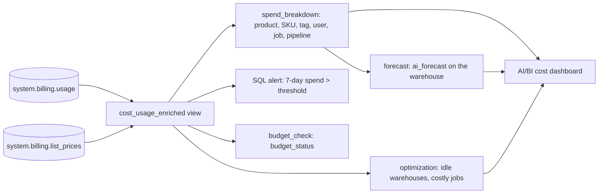

# Cost tracking and chargeback

## Overview

The job joins `system.billing.usage` to `system.billing.list_prices` in a workspace-scoped view, `cost_usage_enriched`, and breaks list-price spend down by product and SKU, custom tag, user, job, and pipeline. A SQL alert watches 7-day spend against a threshold variable, `ai_forecast` projects the next 30 days, and two queries flag optimization candidates. A small AI/BI dashboard reads the results.

## What this shows

| Guide artifact | Where it is |
|---|---|
| Spend by product and tag | `cost_by_product`, `cost_by_sku`, `cost_by_tag` (tags `capability_guide_job` and `capability_guide_use_case`) |
| Spend by user, job, pipeline | `cost_by_user`, `cost_by_job`, `cost_by_pipeline` |
| Budget alert | SQL alert `capability guides 7-day spend above 50 USD` plus the `budget_status` table |
| Forecast and optimization queries | `cost_forecast_30d`, `opt_idle_warehouses`, `opt_costly_jobs` |

In the reference run, list-price spend over the last 7 days was 107.70 USD against a 50 USD threshold, so `budget_status.breached` is true. The forecast covers 2026-10-15 through 2026-11-13 (30 days) and sums to 10,318.55 USD, with a range of 9,655.43 to 11,256.42 USD. It rests on only 3 days of history (this workspace is new), so treat it as a demonstration of the mechanics rather than a planning number.

## Architecture



## Reference code

- `resources/cost_chargeback.job.yml`: six tasks. `forecast` is a SQL task on the warehouse because `ai_forecast` is disabled on serverless job compute in this workspace.
- `guides/cost-chargeback/`: `00_start_here` plus `01_build_views` (usage x list price), `02_spend_breakdown`, `03_budget_check`, `05_check_forecast` and `06_optimization`. Each notebook also runs on its own with Run all.
- `guides/cost-chargeback/04_forecast.sql`: the `ai_forecast` statements, run as a SQL task.
- `resources/budget.alert.yml`: the alert, with `budget_threshold_usd` (default 50) as a variable.
- `src/cost.lvdash.json` and `resources/cost.dashboard.yml`: the dashboard.
- `sql/cost_queries.sql`: every breakdown and optimization query as plain SQL.

## Budget mechanism

This guide records a SQL alert on 7-day list-price spend. The account budgets API is the other option. A call to it from the workspace returned `NotFound`, because it needs account-level access, so the job records the alert as the mechanism in `budget_status.mechanism`.

## Demo steps

1. Open `cost_by_product`. It lists spend per product (jobs, serverless SQL, Lakebase, apps, and so on) at list price.
2. Open `cost_by_tag`. Jobs from the capability guides appear under their `capability_guide_job` tag; everything else shows as `(untagged)`. Untagged spend is the gap a tag policy would close.
3. Open `cost_by_user` and `cost_by_job` for chargeback by person and workload.
4. Open the alert and show its query, the threshold variable, and the hourly schedule. Compare with `budget_status`.
5. Query the forecast:
   ```sql
   SELECT ds, cost_forecast_usd, cost_lower_usd, cost_upper_usd FROM <catalog>.<schema>.cost_forecast_30d ORDER BY ds;
   ```
6. Open `opt_idle_warehouses` and `opt_costly_jobs` for optimization candidates.
7. Open the cost dashboard.

## Artifacts produced

- Job `capability-guides-cost` (key `capability_guides_cost`)
- View `cost_usage_enriched`; tables `cost_by_*`, `cost_daily`, `cost_forecast_30d`, `cost_actual_vs_forecast`, `budget_status`, `opt_idle_warehouses`, `opt_costly_jobs`
- SQL alert and AI/BI dashboard `Capability guides cost`

## Reference run

- 7-day list-price spend was 107.70 USD against the 50 USD `budget_threshold_usd`, so `budget_check` reported a breach. The account budgets API was not reachable from the workspace, so the reference uses a SQL alert and a threshold variable. The guide's walkthrough recommends Budgets for threshold alerts.
- The 30-day forecast covered 2026-10-15 to 2026-11-13 and summed to 10,318.55 USD (range 9,655.43 to 11,256.42). It rested on 3 days of history, so it shows the method and not a plan.
- `opt_idle_warehouses` lists 30-day spend, statement count, USD per statement, and auto-stop, and flags auto-stop above 10 minutes or disabled and fewer than 100 statements in 30 days. `opt_costly_jobs` ranks jobs by USD per run.

## Limitations and next steps

- Costs are list prices. Discounts and commitments change the invoice.
- The system tables hold every workspace in the metastore, so the view filters on this workspace's ID at run time.
- Billing records land with a delay, and the current day is partial, which pulls the forecast down.
- Most spend in the reference workspace is untagged. Add tags (or a serverless usage policy) to workloads before using the tag breakdown for chargeback.
