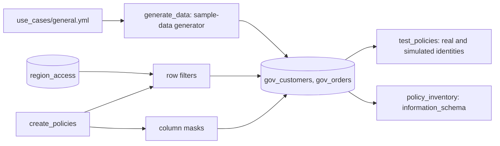

# Row and column security

## Overview

The job generates two tables from the use-case spec (`gov_customers` with 5,000 rows and `gov_orders` with 20,000), then applies Unity Catalog policies: column masks on `gov_customers.email` and `gov_customers.national_id`, an attribute row filter on `gov_orders.sensitivity`, and a dynamic row filter on `gov_customers.region` that reads a mapping table keyed on `session_user()`. It then tests the policies for several identities and writes the policy inventory from `information_schema`.

## What this shows

| Guide artifact | Where it is |
|---|---|
| Column masks and row filters | `mask_email`, `mask_national_id`, `filter_orders_sensitivity`, `filter_customers_region` and the `region_access` mapping table |
| Results as different identities | `policy_test_results`: the job identity (real), a twin of the job identity, the `account users` role, and the app service principal |
| Policy inventory | `policy_inventory`, from `information_schema.column_masks` and `information_schema.row_filters` |

Reference run results for customer CUST-000001 and row counts:

| Identity | Mode | Customers | Orders | Regions | email | national_id |
|---|---|---|---|---|---|---|
| Job identity (admin) | real | 5,000 | 20,000 | APAC, EMEA, LATAM, NA | `user000001@example.com` | `819-02-0031` |
| `account users` role | simulated | 3,478 | 17,972 | EMEA, NA | NULL | NULL |
| App service principal | simulated | 1,019 | 17,972 | APAC | `u***@example.com` | `***-**-0031` |

## Policy design

- **Branch on `session_user()` first.** While a role is assumed, `session_user()` returns the role name, `is_member('admins')` is false, and a group is not a member of itself, so `is_member('account users')` is false too. Each policy matches the restricted role first, then checks `is_member('admins')`, then falls through to the partial mask or the mapping lookup.
- **Masks.** The restricted role sees NULL, admins see the real value, and everyone else sees a partial value (`u***@example.com`, `***-**-0031`).
- **Attribute filter.** Rows with `sensitivity = 'restricted'` are hidden from everyone but admins.
- **Dynamic filter.** The permitted regions come from `region_access` (`principal`, `region`), keyed on `session_user()`. Changing someone's access is an `INSERT` into that table, not a policy rewrite. An unmapped principal sees no rows.

## Architecture



## Reference code

- `resources/row_column_security.job.yml`: four tasks.
- `guides/row-column-security/`: `00_start_here` plus `01_generate_data`, `02_create_policies` (mapping table, mask and filter functions, `ALTER TABLE ... SET MASK / SET ROW FILTER`), `03_test_policies` and `04_policy_inventory`. Each notebook also runs on its own with Run all.
- `src/governance_lib/sqlgen.py`: `mask_body`, `attribute_filter_body`, `dynamic_filter_body`, unit tested. Each takes the session expression and membership expression as arguments, which is how the test evaluates the same logic for another identity.
- `use_cases/general.yml`: tables, masked columns, filter columns, and the mapping rows.
- `sql/policy_test_queries.sql` and `sql/policy_inventory.sql`.

## Testing as a second identity

The job runs as the deploying user, an admin, so the real policies let every row through. Three test methods, in order of strength:

1. **Role switching (the real test).** In the workspace menu, assume the `account users` role and run `sql/policy_test_queries.sql`. The text matches the admin run and the results differ: fewer customers, NULL masked columns, restricted orders hidden. UC evaluates grants, masks, and filters against the assumed role. Audit records keep the human in `identity_metadata.run_by`, so the switch does not hide who acted.
2. **Run as the app service principal.** This needs an OAuth token or secret for the service principal, or a job with `run_as` set to it. This run had neither. Minting a secret for the app's identity was not done, and setting `run_as` needs the `servicePrincipal.user` role on it, which the deploying user did not have. The `app service principal` row is therefore simulated.
3. **Twin evaluation (what the job does).** The same policy logic runs with `session_user()` and `is_member()` replaced by literals, against the unfiltered rows. The job first checks that the twin reproduces the real policy for the job identity (all five measures match), then reports the twin results for the other identities. The simulated rows show the policy logic, not what a session as that identity returned.

## Demo steps

1. Open `use_cases/general.yml`: the masked columns, filter columns, and mapping rows are all there.
2. Open the latest run and the `create_policies` output, then `src/governance_lib/sqlgen.py` for the generated SQL.
3. Query the real tables as yourself: every row, real values.
4. Query `policy_test_results` and compare the four identities.
5. Switch to the `account users` role, run `sql/policy_test_queries.sql`, and compare.
6. Query the inventory:
   ```sql
   SELECT * FROM <catalog>.<schema>.policy_inventory ORDER BY policy_type, table_name;
   ```
7. Add a region for the app service principal with an `INSERT` into `region_access`, rerun the test queries, and show the change without touching a policy.

## Artifacts produced

- Job `capability-guides-row-column-security` (key `capability_guides_row_column_security`)
- Tables `gov_customers`, `gov_orders`, `region_access`, `policy_test_results`, `policy_inventory`; functions `mask_email`, `mask_national_id`, `filter_orders_sensitivity`, `filter_customers_region`

## Limitations and next steps

- A table can have one row filter, so the attribute filter and the dynamic filter sit on different tables here. To combine them, put both rules in one function.
- A mask or filter belongs to the table object. Apply policies to a copy when other pipelines read the original.
- Membership checks are cached for a short time, so make group changes a few minutes before a demo.
- With a SCIM-provisioned account group for each role, replace the `account users` role name in the spec with those group names. The pattern does not change.
