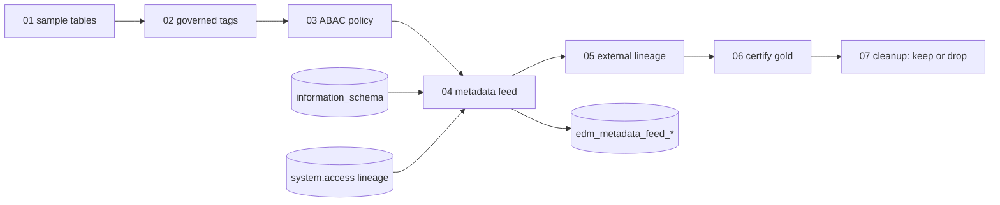

# Unity Catalog with an enterprise data management program

## Overview

The job builds the Unity Catalog side of an EDM integration on three sample tables in the shared schema. It applies governed tags as the contract between the EDM tool and the platform, creates an ABAC policy that masks and filters on those tags, builds the metadata feed that an EDM scanner reads, registers external lineage for a non-Databricks source and a BI report, and sets the certification tag on the gold table. The `tag_mode` job parameter picks the path: `governed` (default) creates two account-level governed tags and uses ABAC; `plain` creates nothing at the account level, applies plain tags, and uses a column mask and row filter. A last task removes the policies and external metadata when `cleanup` is `drop`. It defaults to `keep`.

## Required setup

Run these once, before the job. The identity that runs the job is the person or service principal behind `databricks bundle run`. It is written `<principal>` below. A metastore admin or account admin runs most of them.

If you lack account-level rights, skip items 1 and 2 and run with `tag_mode=plain` (item 6). It creates nothing at the account level. Items 3 to 5 apply in both modes.

1. **Governed tags (`tag_mode=governed`, the default).** Governed tags are account-level tag policies. The job identity needs permission to create tag policies, or an admin creates them first:
   ```bash
   databricks tag-policies create-tag-policy edm_pii --json '{"description": "Kind of personal identifier a column holds",
     "values": [{"name": "id_number"}, {"name": "contact"}]}'
   databricks tag-policies create-tag-policy edm_region --json '{"description": "Column holds the data region used for row filtering"}'
   ```
   Then give `<principal>` the ASSIGN permission on `edm_pii` and `edm_region`: Catalog Explorer, **Governed tags**, the tag, **Permissions**. There is no SQL `GRANT` for it. Without it `02_apply_tags` falls back to plain tags.
2. **ABAC policies.** `03_abac_policy` needs serverless compute or Databricks Runtime 16.4 or above. The job already runs serverless. For a manual run, attach serverless compute.
3. **External metadata.** `05_external_lineage` needs `CREATE EXTERNAL METADATA` on the metastore. Without it the step records `SKIPPED`:
   ```sql
   GRANT CREATE EXTERNAL METADATA ON METASTORE TO `<principal>`;
   ```
4. **Certification.** `06_certify_gold` needs ASSIGN on the system tag `system.certification_status` (Catalog Explorer, **Governed tags**, `system.certification_status`, **Permissions**) and APPLY TAG on the table:
   ```sql
   GRANT APPLY TAG ON TABLE <catalog>.<schema>.edm_customer_revenue_gold TO `<principal>`;
   ```
   Without them the step records `not permitted`.
5. **Lineage feed.** `04_metadata_feed` reads `system.access`. A metastore admin enables the schema if it is off, then grants read access:
   ```bash
   databricks system-schemas enable <metastore-id> access   # get the ID from: databricks metastores current
   ```
   ```sql
   GRANT USE CATALOG ON CATALOG system TO `<principal>`;
   GRANT USE SCHEMA ON SCHEMA system.access TO `<principal>`;
   GRANT SELECT ON TABLE system.access.table_lineage TO `<principal>`;
   GRANT SELECT ON TABLE system.access.column_lineage TO `<principal>`;
   ```
   Without them the lineage feed tables are skipped. Lineage appears a few minutes after a query, so the first run can be empty.
6. **No account rights: use plain tags.** Run the job with `tag_mode=plain`. It applies plain tags and a column mask and row filter, and skips items 1 and 2:
   ```bash
   databricks bundle run capability_guides_unity_catalog_edm --target dev --params tag_mode=plain
   ```

## What this shows

| Guide artifact | Where it is |
|---|---|
| Sample tables with sensitive columns, comments | `edm_customers`, `edm_orders`, `edm_customer_revenue_gold` |
| Tags as the EDM contract | `edm_tag_contract`: governed tags `edm_pii` and `edm_region`, plain table tags |
| Tag-driven ABAC policy | `CREATE POLICY` mask and row filter, checked in `edm_policy_check` |
| Metadata feed for the scanner | `edm_metadata_feed_tables`, `_columns`, `_tags`, `_privileges`, `_table_lineage`, `_column_lineage` |
| Least-privilege scanner grants | Printed by `04_metadata_feed`, not run |
| External lineage | `edm_external_lineage`: a PostgreSQL table and a BI report, related to Unity Catalog tables |
| Certification | `edm_certification_status` and the `system.certification_status` tag |

## Architecture



## Reference code

- `resources/unity_catalog_edm.job.yml`: seven tasks in a chain. `cleanup` uses `run_if: ALL_DONE`.
- `guides/unity-catalog-edm/`: `00_start_here` and one notebook per task. Each notebook also runs on its own with Run all.
- `src/governance_lib/edm.py`: the SQL and plans (tag contract, policy SQL, scanner grants, feed queries, external objects), unit tested.
- `src/governance_lib/edm_api.py`: the lineage lookup used by the external lineage and cleanup notebooks, tested with fakes.

## Permissions and fallbacks

- **`tag_mode`.** `governed` (default) adds tag policies with allowed values and ASSIGN control, and ABAC policies that follow the tag to new tables. `plain` skips all of that and creates nothing at the account level. Each notebook prints which mode ran.
- **Governed tags** (`tag_mode=governed`) need permission on the account's tag policies. If the job identity lacks it, `02_apply_tags` applies plain tags, lists the governed tags that exist, and says so. `03_abac_policy` then attaches the same functions with `SET MASK` and `SET ROW FILTER`, because ABAC matches only governed tags.
- **External metadata** needs `CREATE EXTERNAL METADATA` on the metastore. Without it `05_external_lineage` records `SKIPPED`.
- **Certification** needs `ASSIGN` on `system.certification_status` and `APPLY TAG` on the table. Without them `06_certify_gold` records `not permitted`.
- **Lineage system tables** need `SELECT` on `system.access.table_lineage` and `column_lineage`. Lineage appears a few minutes after a query, so the lineage feed can be empty on the first run.

## Demo steps

1. Open `edm_tag_contract` to see which tags were governed and which were plain.
2. Open the `abac_policy` output: the row count the job identity sees and the masked `national_id`.
3. Open `edm_policy_check`; every row should be `passed`.
4. Query a feed table:
   ```sql
   SELECT table_name, column_name, tag_name, tag_value FROM <catalog>.<schema>.edm_metadata_feed_tags;
   ```
5. Copy the `GRANT` statements from the `metadata_feed` output.
6. Open `edm_customer_revenue_gold` in Catalog Explorer and read its lineage graph, with the external CRM table and the BI report.

## Artifacts produced

- Job `capability-guides-unity-catalog-edm` (key `capability_guides_unity_catalog_edm`)
- Tables: `edm_customers`, `edm_orders`, `edm_customer_revenue_gold`, `edm_baseline_counts`, `edm_tag_contract`, `edm_policy_check`, `edm_metadata_feed_*`, `edm_external_lineage`, `edm_certification_status`
- Governed tags `edm_pii` and `edm_region` (account level), two ABAC policies on `edm_customers`, and two external metadata objects with relationships

## Limitations and next steps

- Governed tag policies are account-level and stay after cleanup. Delete `edm_pii` and `edm_region` yourself with `w.tag_policies.delete_tag_policy`.
- External lineage is not in the lineage system tables, so a scanner that reads only those tables will not receive it.
- The policies apply to `account users` with no exempt group. Add `EXCEPT <steward group>` for a real deployment.
- The feed is a snapshot. Schedule `04` after the jobs that write the governed tables finish.
