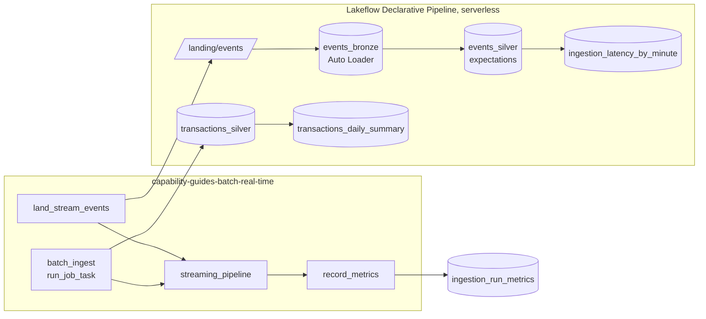

# Batch and real-time ingestion

## Overview

One job runs both paths. The batch path is the configuration-driven framework writing `transactions_silver`. The real-time path is a serverless Lakeflow Declarative Pipeline: Auto Loader picks up new event files incrementally, expectations validate them, and a materialized view tracks latency and throughput per minute. A final task records the run's metrics in a table.

## What this shows

| Success criterion | Artifact |
|---|---|
| Priority batch pattern | `batch_ingest` task (runs the framework job) and the `transactions_daily_summary` materialized view |
| Supported real-time path | `events_bronze` (Auto Loader streaming table) and `events_silver` (streaming table with expectations) |
| Latency | `latency_seconds` per row in `events_silver`; p50/p95 in `ingestion_latency_by_minute` and `ingestion_run_metrics` |
| Throughput and scaling | events per minute in `ingestion_latency_by_minute`; serverless pipeline autoscaling |
| Checkpoints | streaming tables keep their own checkpoints. A rerun ingests only new files (bronze count grows by exactly one run's events). |
| Monitoring | pipeline event log and expectation metrics in the pipeline UI; `ingestion_run_metrics` history |

## Architecture



## Reference code

- `src/pipeline/*.sql`: pipeline datasets, one per file
- `resources/streaming.pipeline.yml`: serverless, triggered pipeline
- `resources/batch_real_time.job.yml`: the orchestrating job
- `src/record_ingestion_metrics.py`: latency, throughput, and update metrics

## Demo steps

1. Open the latest successful run of the batch and real-time job and walk the four tasks.
2. Open the `streaming_pipeline` task to jump to the pipeline update. Show the graph: bronze, silver, and the two materialized views.
3. Click `events_silver` and show the expectation metrics (rows passed and dropped per rule).
4. Open the `record_metrics` output: bronze and silver totals, rows dropped by expectations, p50/p95 latency, and peak events per second.
5. Press **Quick run** again. When it finishes, `bronze_events_total` grows by exactly one run's events. Auto Loader skipped files it had already processed.
6. Query latency per minute:
   ```sql
   SELECT * FROM <catalog>.<schema>.ingestion_latency_by_minute ORDER BY ingested_minute DESC;
   ```
7. Explain the latency number honestly. The pipeline runs in triggered mode, so latency includes the wait for the update to start. For seconds-level latency, set `continuous: true` on the pipeline. For sub-second operational paths, use real-time mode or Zerobus ingest.

## Artifacts produced

- Tables: `events_bronze`, `events_silver`, `ingestion_latency_by_minute`, `transactions_daily_summary`, `ingestion_run_metrics`
- Reference run: 4,800 events across two runs (98 dropped by expectations), p50 latency 124 s and p95 150 s in triggered mode, peak 40 events/s

## Limitations and next steps

- Triggered mode keeps cost low for a demo. Latency targets need continuous mode, and that should be measured separately.
- The event generator writes files. Message buses (Kafka, Kinesis, Event Hubs) use the same streaming table with a different source.
