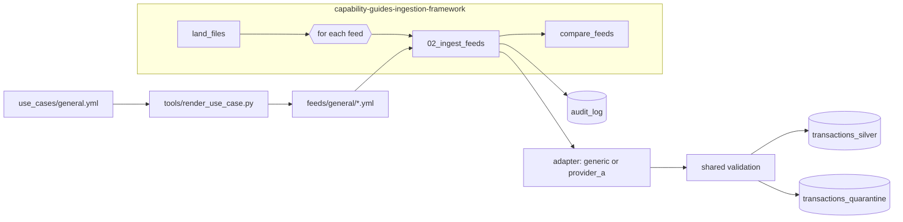

# Metadata-driven ingestion

## Overview

Metadata-driven ingestion describes each source in configuration and runs every source through one shared code path. Use native expectations for row rules, AUTO CDC for upserts, and a for_each task for fan-out before writing a custom runner. Isolate source quirks behind a small adapter, and quarantine rejected rows with the rule they failed. This reference implements the pattern for two providers.

## What this shows

| Success criterion | Artifact |
|---|---|
| Provider-specific logic is isolated | `adapters/provider_a.py` is the only provider-specific Python. It decodes single-letter status codes. |
| Audit is reused | Every feed writes one row to `audit_log` through `audit.py`, on success or failure. |
| Validation is reused | Rules are declared once in the use-case spec and compiled to SQL by `validation.py`. |
| Orchestration is reused | One `for_each` task runs the `02_ingest_feeds` notebook once per feed. |
| Error handling is reused | `runner.run_feed` records the failure in the audit log and re-raises it, so the job's retry and alert settings apply. |

## Architecture



## Reference code

- `configuration-vs-code/00_start_here.py`: the notebooks in order, how to run them, and the variables
- `configuration-vs-code/01_land_files.py`, `02_ingest_feeds.py`, `03_compare_feeds.py`: the job's three steps, each runnable on its own
- `src/capability_framework/adapters/provider_a.py`: provider A's status-code lookup
- `src/capability_framework/adapters/generic.py`: configuration-only adapter
- `src/capability_framework/runner.py`: shared read, validate, quarantine, MERGE, audit
- `src/capability_framework/validation.py`: rule-to-SQL compiler
- `resources/ingestion_framework.job.yml`: the job

## Demo steps

1. Open `feeds/general/provider_a.yml` and `provider_b.yml` side by side. Point out that the only differences are format, options, mapping, and adapter name.
2. Open `adapters/provider_a.py`. It holds 20 lines of provider-specific code, and nothing in it touches validation or audit.
3. Open `runner.py` and walk through `run_feed`. The same function handles both feeds.
4. In the guide page, press **Quick run** on the ingestion framework job, or open the latest successful run.
5. In the run, open the `ingest_each_feed` task. The same task ran twice with different inputs.
6. Open the `compare_feeds` output. Both feeds show read, valid, and quarantined counts from the same audit table.
7. Query the quarantine reasons:
   ```sql
   SELECT source_feed, reason, count(*) FROM <catalog>.<schema>.transactions_quarantine
   LATERAL VIEW explode(_quarantine_reasons) r AS reason GROUP BY ALL;
   ```
   Both feeds fail the same rules, because the rules are shared.

## Reference run

Two providers send the same kind of record in different shapes. Provider-specific logic lives in one adapter file. Everything else runs through one shared framework: reading, mapping, validation, quarantine, upsert, audit, and error handling.

Artifacts:

- Tables: `transactions_silver`, `transactions_quarantine`, `audit_log`
- Volume: `landing/provider_a/`, `landing/provider_b/`
- Run: reference run with 2,000 provider A rows (1,881 valid, 119 quarantined) and 1,500 provider B rows (1,408 valid, 92 quarantined)

## Limitations and next steps

- The sample data is synthetic and deterministic. Swap in real landing paths by changing the feed options.
- Adapters are registered in code (`adapters/__init__.py`). A new adapter is a code review, which is intended.
