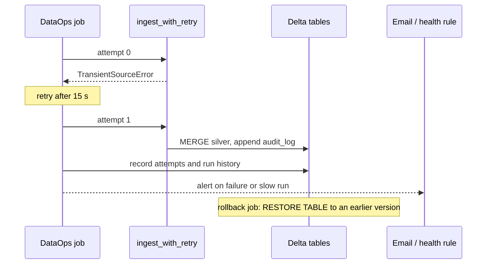

# Pipeline operations

## Overview

Best practice: make tasks idempotent (MERGE or overwrite by partition) so retries and repair runs are safe, send failure and duration alerts to Slack, PagerDuty, or a webhook, track trends in `system.lakeflow` tables with SQL alerts, set `max_concurrent_runs`, queueing, and timeouts, and recover with RESTORE inside retention plus deep clone backups. The guide page in the app explains the practice. This README covers the reference job.

## Reference run

The DataOps job runs a feed through settings an operations team relies on: retries, failure and duration alerts, a timeout, single-run concurrency, run history, and an audit trail. The first attempt of the ingest task fails on purpose to show the retry working. A separate rollback job restores the silver table to an earlier Delta version, and the CI/CD guide covers redeploying a known-good release.

## What this shows

| Success criterion | Artifact |
|---|---|
| Environment separation | `dev` and `test` bundle targets with separate schemas and name prefixes; see the environment separation walkthrough |
| Run history | `dataops_run_history` (last 25 runs from the Jobs API) and the job's run list |
| Alerting | `email_notifications.on_failure`, `on_duration_warning_threshold_exceeded`, and a `RUN_DURATION_SECONDS` health rule |
| Retry/restart | `max_retries: 2` with a 15 s interval. The run shows attempt 0 failed and attempt 1 succeeded. Failed runs can also be repaired from the run page. |
| Audit trail | `dataops_task_attempts`, `audit_log`, and `DESCRIBE HISTORY` on `transactions_silver` |
| Rollback or redeployment | `capability-guides-rollback` job (`RESTORE TABLE ... TO VERSION AS OF`) and redeploying an earlier Git tag through CI/CD |

## Architecture



## Reference code

- `dataops/00_start_here.py`: the notebooks in order, how to run them, and the variables
- `resources/dataops.job.yml`: retries, notifications, health rule, timeout, concurrency
- `dataops/02_ingest_with_retry.py` and `src/capability_framework/retry_demo.py`: `simulate_transient_failure` (first attempt fails, retries pass)
- `dataops/03_record_audit_trail.py`: task attempts, run history, Delta history
- `resources/rollback.job.yml` and `dataops/04_rollback_table.py`: version restore

## Demo steps

1. Open `resources/dataops.job.yml` and point out the retry, notification, and health settings.
2. Open the latest successful DataOps run. `ingest_with_retry` shows two attempts: the first failed with the simulated outage, the second succeeded.
3. Open the `record_audit_trail` output: task attempts for this run, recent audit rows, and the silver table's Delta history.
4. Query run history:
   ```sql
   SELECT * FROM <catalog>.<schema>.dataops_run_history ORDER BY started_at DESC;
   ```
5. Open the job's **Job notifications** and **Health** settings to show where alerts route.
6. Run the rollback job and show the restore output, then `DESCRIBE HISTORY` with the new `RESTORE` entry.
7. Show environment separation: the same bundle deploys to `dev` and `test` with different schemas (see the CI/CD guide).

## Artifacts produced

- Tables: `dataops_task_attempts`, `dataops_run_history`, `audit_log`, `transactions_silver` history
- Runs: a DataOps run with a failed attempt followed by a successful retry; a rollback run restoring silver from version 7 to version 6

## Limitations and next steps

- Notifications go to email here. Webhook destinations (Slack, PagerDuty, Teams) use the same `webhook_notifications` block.
- Restore is per table. For a multi-table rollback, redeploy the previous release and rerun from a known input.
