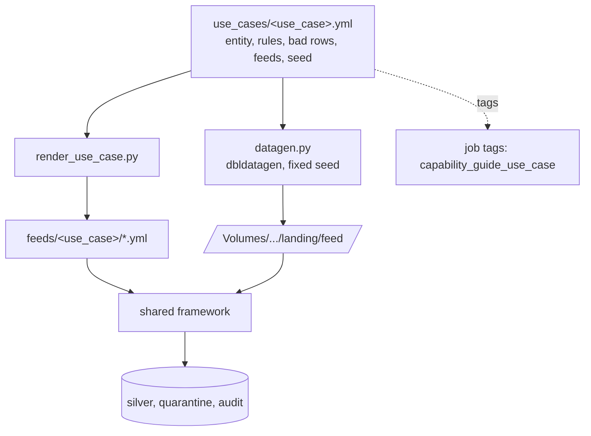

# Reusability / templatization

## Overview

The second feed, provider B, was onboarded without new code. It is a block in the use-case spec. A renderer turns that block into a feed config, and the same job ingests it next to provider A. The whole use case is templated the same way, so a new tenant or domain is one new spec file.

## What this shows

| Success criterion | Artifact |
|---|---|
| Two representative source configurations | `feeds/general/provider_a.yml` (CSV, flat) and `provider_b.yml` (JSON, nested) |
| Mapping-only onboarding diff | Provider B's spec block: `format`, `source_columns`, `mapping`, `adapter: generic` |
| Comparable successful runs for both feeds | `compare_feeds` output and `audit_log` rows for the same job run |

## Architecture

## Parameters: what changes at each layer

Nothing tenant-specific is hard-coded in a job, task, or pipeline. Each layer takes parameters from the one above it:

| Layer | Set when | Parameters in this bundle | Example override |
|---|---|---|---|
| Bundle variables | deploy | `catalog`, `schema`, `use_case`, `warehouse_id`, `notification_email`, `app_service_principal`, `release` | `databricks bundle deploy --var use_case=<spec> --var schema=<tenant_schema>` |
| Job parameters | each run | `catalog`, `schema`, `use_case` (defaults come from the bundle variables) | `databricks bundle run capability_guides_ingestion_framework --params use_case=<spec>` |
| Task parameters | each task | `--use-case-file=.../use_cases/{{job.parameters.use_case}}.yml`, `--feeds-dir=.../feeds/{{job.parameters.use_case}}`, `--run-id={{job.run_id}}` | inherited from job parameters |
| Task values and `for_each` inputs | runtime | `land_files` sets `feeds` from the spec; `ingest_each_feed` iterates `{{tasks.land_files.values.feeds}}` | add a feed to the spec |
| Child job parameters | runtime | `run_job_task.job_parameters` passes `catalog`, `schema`, and `use_case` to the framework job | inherited |
| Pipeline configuration | deploy | `landing_events_path`, `catalog`, `schema`, `use_case`, read in SQL as `${landing_events_path}` | `--var` at deploy |
| Tags | deploy | `capability_guide_job`, `capability_guide_use_case`, `environment`, `release` | `--var use_case=...` |

Two ways to add a tenant or use case:

- **Same deployment, new run:** commit `use_cases/<spec>.yml` and the rendered `feeds/<spec>/`, redeploy files, then run with `--params use_case=<spec>` (or use **Run now with different parameters** on the job page). Tables land in the deployment's schema.
- **Isolated deployment:** deploy with `--var use_case=<spec> --var schema=<tenant_schema>`. The tenant gets its own schema, volume, jobs, pipeline, and tags.

## Reference code

- `use_cases/general.yml`: the only file a new use case needs
- `tools/render_use_case.py`: writes `feeds/<use_case>/*.yml` and checks drift with `--check`
- `src/capability_framework/use_case.py`: spec validation and feed rendering
- `src/capability_framework/datagen.py`: deterministic sample data with dbldatagen

## Demo steps

1. Open `use_cases/general.yml` and find the `provider_b` block. It holds the source shape and the mapping, with no code.
2. Run `python tools/render_use_case.py use_cases/general.yml --check` locally. The committed feed configs match the spec.
3. Show the onboarding diff for a third feed: copy the `provider_b` block, rename it to `provider_c`, change `format` and the mapping, and rerun the renderer. No Python changes are needed.
4. Open the latest framework run. `land_files` sets the task value `feeds` from the spec, and `ingest_each_feed` iterates over it.
5. Compare the `compare_feeds` output for both feeds: same columns, same rules, similar quarantine rates.
6. Show the parameter layers (table above): run the framework job with `--params use_case=general`, then point out where `{{job.parameters.use_case}}` flows into task parameters and `for_each` inputs.
7. Show tenant reuse: `databricks bundle deploy --var use_case=<new-spec> --var schema=<tenant-schema>` stamps out the same jobs with new data, feeds, and tags.

## Artifacts produced

- Generated configs: `feeds/general/provider_a.yml`, `feeds/general/provider_b.yml`
- Run: both feeds in one job run, each with its own `audit_log` row
- Determinism: rerunning lands identical files, and the MERGE keeps silver idempotent

## Limitations and next steps

- Provider shapes are described as SQL over canonical columns. Very irregular sources may still need an adapter.
- Multi-tenant isolation (per-tenant catalogs, grants, and Lakebase schemas) is planned. Today, isolation is by schema and the `use_case` variable.
