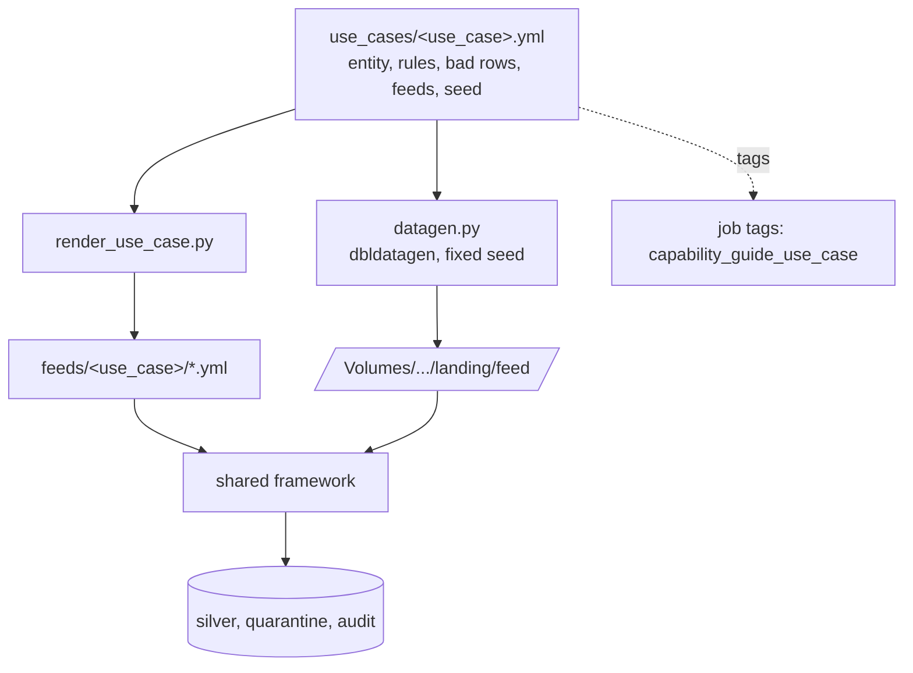

# Reusability / templatization

## Overview

The second feed, provider B, was onboarded without new code. It is a block in the use-case spec. A renderer turns that block into a feed config, and the same job ingests it next to provider A. The whole use case is templated the same way, so a new tenant or domain is one new spec file.

## What this shows

| Success criterion | Artifact |
|---|---|
| Two representative source configurations | `feeds/general/provider_a.yml` (CSV, flat) and `provider_b.yml` (JSON, nested) |
| Mapping-only onboarding diff | Provider B's spec block: `format`, `source_columns`, `mapping`, `adapter: generic` |
| Comparable successful runs for both feeds | `compare_feeds` output and `audit_log` rows for the same job run |

## Architecture

## Reference code

- `use_cases/general.yml`: the only file a new use case needs
- `tools/render_use_case.py`: writes `feeds/<use_case>/*.yml` and checks drift with `--check`
- `src/capability_framework/use_case.py`: spec validation and feed rendering
- `src/capability_framework/datagen.py`: deterministic sample data with dbldatagen

## Demo steps

1. Open `use_cases/general.yml` and find the `provider_b` block. It holds the source shape and the mapping, with no code.
2. Run `python tools/render_use_case.py use_cases/general.yml --check` locally. The committed feed configs match the spec.
3. Show the onboarding diff for a third feed: copy the `provider_b` block, rename it to `provider_c`, change `format` and the mapping, and rerun the renderer. No Python changes are needed.
4. Open the latest framework run. `land_files` sets the task value `feeds` from the spec, and `ingest_each_feed` iterates over it.
5. Compare the `compare_feeds` output for both feeds: same columns, same rules, similar quarantine rates.
6. Show tenant reuse: `databricks bundle deploy --var use_case=<new-spec> --var schema=<tenant-schema>` stamps out the same jobs with new data, feeds, and tags.

## Artifacts produced

- Generated configs: `feeds/general/provider_a.yml`, `feeds/general/provider_b.yml`
- Run: both feeds in one job run, each with its own `audit_log` row
- Determinism: rerunning lands identical files, and the MERGE keeps silver idempotent

## Limitations and next steps

- Provider shapes are described as SQL over canonical columns. Very irregular sources may still need an adapter.
- Multi-tenant isolation (per-tenant catalogs, grants, and Lakebase schemas) is planned. Today, isolation is by schema and the `use_case` variable.
