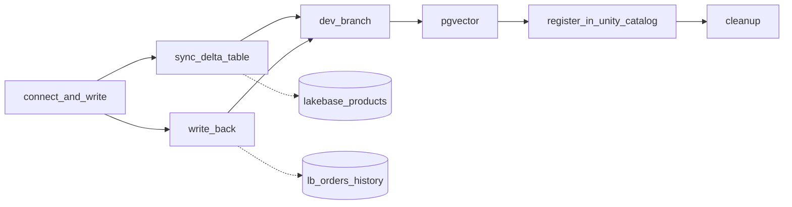

# App development with Lakebase

## Overview

The `capability-guides-lakebase-apps` job walks the main steps of building an app on Lakebase, the managed Postgres on Databricks. It connects with an OAuth token minted for the job identity, syncs a Delta table into Postgres, sends app writes back to Delta with Change Data Feed, branches for dev work, runs a pgvector query, registers the database in Unity Catalog, and has an optional cleanup step.

The bundle creates the Lakebase project with the `postgres_project`, `postgres_branch`, and `postgres_endpoint` resources (Beta, Databricks CLI 0.287.0 or later). The project's compute scales to zero after five idle minutes, so an idle project costs close to nothing. Every notebook is safe to rerun.

## What this shows

| Capability | Artifact |
|---|---|
| Project, branch, and endpoint in a bundle | `resources/lakebase.postgres.yml` |
| A token per pooled connection, with a retry for scale to zero | `make_pool` and `connect_with_retry` in `src/lakebase_lib.py`, used by `01_connect_and_write` |
| App-owned tables | `lakebase_apps.orders` in Postgres |
| Reverse ETL in Triggered mode | `lakebase_products` (Delta) and `lakebase_products_synced` (Unity Catalog and Postgres) |
| Write-back with Change Data Feed (Public Preview) | `lb_orders_history`, with `insert`, `update_preimage`, `update_postimage`, and `delete` rows |
| Expiring dev branch | `dev-demo`, created with a one-hour `ttl` and deleted at the end of the notebook |
| pgvector | `lakebase_vectors.docs` with an hnsw index |
| Unity Catalog registration (Beta) | the catalog `lakebase_apps_demo`, queried from a serverless SQL warehouse |

## Architecture



## Reference code

- `resources/lakebase.postgres.yml`: the project (scale to zero after 300 seconds), a `dev` branch with a seven-day `ttl`, and its endpoint.
- `resources/lakebase_apps.job.yml`: seven tasks. `cleanup` uses `run_if: ALL_DONE` and does nothing unless `cleanup` is `delete`.
- `guides/lakebase-apps/00_start_here`: what the guide shows, the variables, and a link to the job.
- `guides/lakebase-apps/01_connect_and_write` to `07_cleanup`: one notebook per task.
- `src/lakebase_lib.py`: token timing, retry policy, connection strings, create-or-reuse decisions, and the SQL, covered by `tests/test_lakebase_lib.py`. `tests/test_notebooks_rerun_safe.py` checks that every notebook can run twice.

## Demo steps

1. Deploy the bundle, then run `capability-guides-lakebase-apps`. Allow 10 to 20 minutes. The first run waits on the synced table pipeline and, if Change Data Feed is on, the first snapshot.
2. Read the app table through Postgres, or in the Lakebase SQL editor:
   ```sql
   SELECT order_id, customer, status, amount FROM lakebase_apps.orders ORDER BY order_id;
   ```
3. Read the synced table from Postgres (the Unity Catalog schema name is the Postgres schema name):
   ```sql
   SELECT * FROM "<schema>".lakebase_products_synced ORDER BY product_id;
   ```
4. Read the change history in Databricks SQL:
   ```sql
   SELECT order_id, _pg_change_type, status, _timestamp
   FROM <catalog>.<schema>.lb_orders_history
   WHERE order_id IN (1002, 1005) ORDER BY _sort_by DESC;
   ```
5. Query the registered catalog from a serverless SQL warehouse:
   ```sql
   SELECT * FROM lakebase_apps_demo.lakebase_apps.orders;
   ```
6. To remove the demo, run the job with the parameter `cleanup` set to `delete`. Run `databricks bundle destroy` to delete the project.

## Rerun behavior

| Notebook | A second run |
|---|---|
| 01 | `IF NOT EXISTS` on the schema and table. Orders are upserted, so each row returns to its starting values. |
| 02 | The Delta table is created if missing and refilled with `INSERT OVERWRITE`. The synced table is reused and a pipeline update starts. A failed one is deleted and created again. |
| 03 | The feed is reused when the schema already has one. The orders are reset, then one is updated and one deleted. The history table grows by a few rows. |
| 04 | A leftover branch with the same ID is deleted, then the branch is created again from current production data. |
| 05 | `IF NOT EXISTS` on the extension, table, and index. The rows are upserted. |
| 06 | Registration is skipped when the catalog exists. |
| 07 | Does nothing unless `cleanup` is `delete`, and each step first checks that its object exists. |

## Artifacts produced

- Delta tables: `lakebase_products`, `lakebase_products_synced` (the Unity Catalog side of the synced table), `lb_orders_history`
- In the Lakebase project: the schemas `lakebase_apps`, `lakebase_vectors`, and the synced table's schema, the Change Data Feed configuration `lakebase_apps`, the registered catalog `lakebase_apps_demo`, and the `dev` branch from the bundle
- The synced table's pipeline, which runs only when triggered

## Limitations and next steps

- Several resources are Beta or Public Preview: the `postgres_*` bundle resources, catalog registration, and Change Data Feed. A workspace admin turns Change Data Feed on from the Previews page, and the destination catalog cannot use default storage. When either blocks it, notebook 03 explains and ends without failing.
- Catalog registration needs `CREATE CATALOG` on the metastore. Without it, notebook 06 prints the Catalog Explorer steps.
- The job runs as one identity, which gets a Postgres role as the project creator. A different `run_as` identity needs its own role.
- Notebook 04 deletes and recreates its branch because the SDK has no reset call. Reset from parent is in the Lakebase UI.
- The bundle's `dev` branch expires after seven days. Redeploy to create it again.
- The reference run uses one production branch. Scale to zero adds a few seconds to the first query after idle, which notebook 01 retries.
- A real app adds a connection check on checkout, and the PgBouncer pooler (password roles only) when connection count becomes the problem.
