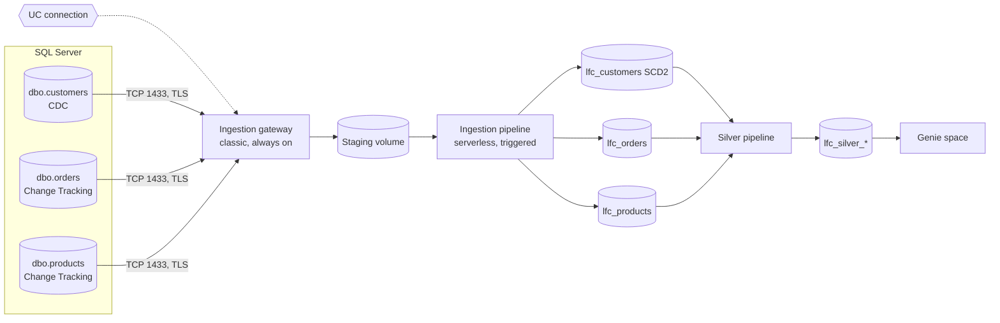

# SQL Server ingestion with Lakeflow Connect

## Overview

Lakeflow Connect ingests three SQL Server tables into Unity Catalog through two managed pipelines. The ingestion gateway runs on classic compute in the workspace network and reads CDC and Change Tracking from SQL Server. The ingestion pipeline runs on serverless compute and applies the staged changes to bronze. A Unity Catalog connection holds the credentials. One job then proves the parts a customer asks about. It changes rows on the source and checks each one in bronze, adds a column, full-refreshes one table, builds silver, and asks Genie a question. Job key: `capability_guides_lakeflow_connect`.

**This bundle does not run in the reference workspace.** The gateway needs classic compute, and the reference workspace allows only serverless compute ("Only serverless compute is supported in the workspace"). The bundle validates there, but the gateway cannot start, so this guide has no recorded run. To run it, deploy to a workspace that allows classic compute, with a SQL Server the gateway can reach on port 1433.

## What this shows

| Step | What happens | Checked by |
|---|---|---|
| Check the source | Host and port come from the connection. `customers` has CDC, `orders` and `products` have Change Tracking, no table has both. Gateway started. | `01_check_source` asserts the capture per table |
| First load | Ingestion pipeline snapshots the three tables | `ingest` pipeline task |
| Live changes | 3 plan changes, 10 new orders, 5 shipped, 2 deleted, 2 cancelled | `03_land_changes` checks every change in bronze, including a closed and a current version per customer |
| Schema change | `ALTER TABLE dbo.customers ADD loyalty_tier`, values for 20 customers | `04_schema_change` waits for the column and values in `lfc_customers` |
| Full refresh | `full_refresh_selection: [lfc_orders]` | `05_check_full_refresh`: source and bronze counts match, customer history kept |
| Silver and lineage | Three materialized views over bronze | `06_lineage_and_genie` reads `system.access.table_lineage` |
| Genie | Space over silver; revenue by plan | Genie's SQL is run and compared with a hand-written query |

## Per-table decisions

| Source table | Capture | SCD type | Why |
|---|---|---|---|
| `dbo.customers` | CDC | 2 | Plan and status history: point-in-time reporting needs every version |
| `dbo.orders` | Change Tracking | 1 | Latest status is enough; lighter on the source |
| `dbo.products` | Change Tracking | 1 | Small reference table |

## Architecture



## Reference code

- `source/01_setup_source.sql`: the DBA's one-time script: tables, sample rows, logins, CDC and Change Tracking through the utility procedures, grants
- `resources/sqlserver.pipelines.yml`: gateway and ingestion pipeline, with per-table SCD type, the full refresh window, and auto full refresh off
- `resources/silver.pipeline.yml` and `guides/sqlserver-lakeflow-connect/silver/silver.sql`: silver tables
- `resources/lakeflow_connect.job.yml`: the demo job, and the paused 30-minute schedule
- `src/lfc_lib.py`: source connection, change batch, landing checks, pipeline updates, run log, Genie calls

## Deploy

```bash
cd reference/lakeflow-connect
databricks bundle deploy --target dev --profile <profile> \
  --var catalog=<catalog> --var warehouse_id=<warehouse-id> \
  --var app_service_principal=<app-sp-application-id> \
  --var sqlserver_connection_name=<uc-connection> --var sqlserver_database=LakeflowDemo
databricks bundle run lfc_gateway --target dev --profile <profile> --no-wait   # continuous; leave it running
databricks bundle run capability_guides_lakeflow_connect --target dev --profile <profile>
```

Create the connection and the secret scope first:

```bash
databricks connections create --profile <profile> --json '{
  "name": "<uc-connection>", "connection_type": "SQLSERVER",
  "options": {"host": "<server-fqdn>", "port": "1433", "user": "lakeflow_ingest", "password": "<password>",
              "trustServerCertificate": "false"}}'
databricks secrets create-scope lakeflow_connect_demo --profile <profile>
databricks secrets put-secret lakeflow_connect_demo sqlserver_app_user --profile <profile>
databricks secrets put-secret lakeflow_connect_demo sqlserver_app_password --profile <profile>
```

## Demo steps

1. **Their questions first.** Open the walkthrough's questions section and answer the customer's list before showing anything.
2. **Connection.** Catalog Explorer, **Connect > Connections**: open the connection. Host, port, and login are visible; the password is not.
3. **Ingestion wizard.** **Data ingestion > SQL Server**, pick the connection, name the gateway and its staging schema, select tables, and set history tracking per table. Then open the bundle's `sqlserver.pipelines.yml` and show the same choices as code.
4. **Live changes.** Run `02_make_changes` and `03_land_changes`, or make changes by hand in SSMS, then query:
   ```sql
   SELECT customer_id, plan_name, __START_AT, __END_AT FROM <catalog>.<schema>.lfc_customers
   WHERE customer_id = <id> ORDER BY __START_AT;
   ```
5. **Day two.** Run `04_schema_change`, then show `DESCRIBE TABLE lfc_customers`. Show the `full_refresh_orders` task and explain why it names one table.
6. **Lineage and Genie.** Open `lfc_silver_orders` in Catalog Explorer, **Lineage** tab, then the Genie space and ask for revenue by plan.
7. **Bundle in Git.** Show `resources/` in the repository and the deploy commands above.

## Limitations

- The gateway runs on classic compute and must stay up. A gateway down longer than the CDC or Change Tracking retention loses changes, and the affected tables need a full refresh.
- A workspace that allows only serverless compute cannot start the gateway.
- Connect to the primary. Read replicas and Always On secondaries are not supported; on an Availability Group, use the listener.
- The job's change and schema steps use the `lakeflow_demo_app` login, not the connector's. In production, the application owns those changes.
