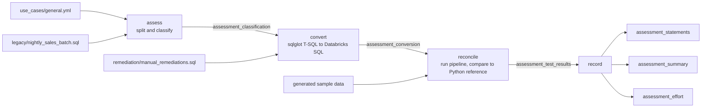

# Legacy workload migration

## Overview

This guide assesses one representative legacy workload, a nightly T-SQL sales batch, and records how much of it converts automatically, what needs hand remediation, whether the converted pipeline produces the same results, and how much effort each role should expect. A serverless job runs four tasks: assess, convert, reconcile and record. Every number comes from the run, not from an estimate typed into a document.

Databricks Lakebridge (Analyzer, Transpiler, Reconcile) is the supported product path for production-scale migrations. This bundle shows the same assess, convert, reconcile loop on one workload so you can see each step and its artifacts end to end.

## Lakebridge: the supported migration toolkit

[Lakebridge](https://databrickslabs.github.io/lakebridge/) ([GitHub](https://github.com/databrickslabs/lakebridge)) is the Databricks Labs toolkit for migrating to Databricks. It covers the same three stages as this bundle, at estate scale:

| Stage | Lakebridge component | What it does |
|---|---|---|
| Assess | **Profiler**, **Analyzer** ([Assessment guide](https://databrickslabs.github.io/lakebridge/docs/assessment/)) | Profiler connects to the source environment and reports workload size, complexity, and features used. Analyzer scans SQL and orchestration code to size the migration and flag problem constructs. |
| Convert | **Transpilers** ([Transpiler guide](https://databrickslabs.github.io/lakebridge/docs/transpile/)) | BladeBridge is the mature transpiler for a wide range of dialects and some ETL/orchestration. Morpheus is the next-generation transpiler with experimental dbt support. Switch is LLM-powered and converts SQL and other formats into Databricks notebooks. |
| Reconcile | **Reconciler** ([Reconcile guide](https://databrickslabs.github.io/lakebridge/docs/reconcile/)) | Compares data in Databricks with the source system after migration. |

Sources include SQL platforms (for example MSSQL, Oracle, Teradata, Snowflake, Redshift, Synapse, BigQuery, Netezza), ETL tools (for example SSIS, DataStage, Talend, Alteryx, SAS), and orchestrators (Airflow, ADF, Oozie). See the [overview](https://databrickslabs.github.io/lakebridge/docs/overview/) for the current list.

Getting started ([installation](https://databrickslabs.github.io/lakebridge/docs/installation/)):

```bash
databricks labs install lakebridge
databricks labs lakebridge install-transpile
databricks labs lakebridge transpile --transpiler-config-path <path> --input-source <path> \
  --source-dialect <dialect> --output-folder <path> --catalog-name <catalog> --schema-name <schema>
```

How this bundle maps to Lakebridge: `01_assess` stands in for Analyzer on one workload, `02_convert` (sqlglot) stands in for a transpiler, and `03_reconcile` stands in for Reconciler. Use this bundle to explain the loop and its artifacts. Use Lakebridge for a real estate.

## Reference run

Results from the sqlglot reference bundle on one generated workload. The guide page teaches the Lakebridge path; this bundle is a teaching stand-in.

| Success criterion | Artifact |
|---|---|
| Assess one representative workload | `legacy/nightly_sales_batch.sql` (13 steps) and the `assessment_classification` table, one row per step with its construct |
| Record automated coverage | `assessment_summary`: `automated_coverage_pct`, plus clean, warning and manual counts |
| Record remediation | `assessment_statements` (construct, status, notes per step), `assessment_conversion` (legacy, converted and hand-written SQL), `remediation/manual_remediations.sql` |
| Record testing | `assessment_test_results` (step execution, row counts, key sets, column values, checksums) and `tests_passed` / `tests_failed` in `assessment_summary` |
| Record role-based effort | `assessment_effort`: hours for data engineer, analytics engineer, QA and platform admin, with the assumption behind each |

## Architecture



Statuses used by the convert task:

- **clean**: sqlglot converts the step and nothing needs review.
- **warning**: converted, but a semantic difference needs a check (temp table, IDENTITY, TOP, MERGE).
- **manual**: no safe automatic conversion (cursor, WHILE loop, DML against a CTE, TRY/CATCH). A hand-written replacement is kept in the remediation file.

## Reference code

- `databricks.yml`, `resources/job.yml`: bundle, schema and the serverless job `capability_guides_legacy_conversion_assessment`
- `use_cases/general.yml`: the spec. Sample data columns and seed, workload paths, expected-results definition, effort model
- `legacy/nightly_sales_batch.sql`: the legacy workload (temp table, MERGE, IDENTITY, cursor, WHILE, TOP, ISNULL, GETDATE, TRY/CATCH)
- `remediation/manual_remediations.sql`: set-based rewrites for the manual steps
- `guides/legacy-conversion/`: `00_start_here` (overview, variables, job link), `01_assess`, `02_convert`, `03_reconcile`, `04_record`: one notebook per task, each runs standalone with Run all
- `requirements.txt`: `sqlglot`, `pyyaml`, installed by the first cell of each step notebook
- `src/lc_helpers.py`: step splitting, classification, conversion, effort model
- `src/lc_expected.py`: independent pure-Python reference implementation and reconciliation checks
- `src/lc_datagen.py` and `src/sample_data.py`: sample input from the spec (fixed seed)
- `tests/test_helpers.py`: unit tests, run with `python -m pytest reference/legacy-conversion/tests` (needs `sqlglot`, `pyyaml`, `pytest`)

## Demo steps

1. Open `legacy/nightly_sales_batch.sql` and point out the constructs that need remediation.
2. Open `use_cases/general.yml` and show that the sample data, expected results and effort assumptions are config, not code.
3. Deploy: `databricks bundle deploy --target dev` with the `catalog`, `warehouse_id` and `app_service_principal` variables.
4. Run `databricks bundle run capability_guides_legacy_conversion_assessment`, or start the job from the guide app. To run by hand, open `guides/legacy-conversion/00_start_here`, then each step notebook in order.
5. In the run, open the `01_assess` task output: one line per step with its construct.
6. Open the `02_convert` task output and the `assessment_conversion` table: compare `legacy_sql` with `converted_sql` for a clean step, then `manual_sql` for the cursor step.
7. Open the `03_reconcile` task output: each step executes, then the output tables are compared with the Python reference.
8. Query `assessment_summary` for coverage, remediation count and test results.
9. Query `assessment_effort` and read the assumption column next to the hours.
10. Optional: change a number in `use_cases/general.yml` (rows, an effort hour value), redeploy and rerun to show the artifacts follow the spec.

## Artifacts produced

All tables are in the bundle schema (`capability_guides` by default, shared with the other guide bundles; the dev target uses `dev_<user>_capability_guides`).

| Table | Contents |
|---|---|
| `assessment_classification` | Step, construct, feature tags, legacy SQL |
| `assessment_conversion` | Status, notes, converted SQL, hand-remediated SQL, SQL that was executed |
| `assessment_test_results` | One row per check with expected, actual and pass/fail |
| `assessment_statements` | Per step: construct, status, notes |
| `assessment_summary` | Automated coverage %, remediation count, tests passed and failed |
| `assessment_effort` | Hours per role, split by clean, warning, manual and fixed work, with assumptions |
| `dim_customer`, `fact_daily_sales`, `region_summary`, `dim_date`, `etl_log`, `stg_orders_raw` | Outputs and input of the converted pipeline |

Result of the reference run: 13 steps, 5 clean, 4 warning, 4 manual (69.2% automated coverage, 4 remediations), 26 of 26 checks passed. Effort: data engineer 23.25 h, analytics engineer 9.5 h, QA 13.5 h, platform admin 3.4 h.

Effort formula: `hours = fixed + clean x a + warning x b + manual x c` per role. The per-status hours and the fixed hours are assumptions in `use_cases/general.yml`, reviewed by each role. They are planning inputs for one workload, not a quote.

## Limitations and next steps

- One workload with 13 steps. Real estates need Lakebridge Analyzer to inventory thousands of objects and Lakebridge Transpiler and Reconcile to run at that scale.
- Step splitting relies on `-- STEP nn | name` markers. Lakebridge parses the original source files directly.
- Classification is rule-based (regex on the step text). It is enough to route steps but will miss unusual constructs.
- sqlglot handles T-SQL expressions and common DML well. Procedural code (cursor, WHILE, TRY/CATCH, DML on a CTE) is always flagged manual.
- Reconciliation covers row counts, key sets, column values and sums for four output tables, against sample data of 120 generated rows. It does not compare against output from the legacy system.
- The effort hours are assumptions and do not include data migration, cutover or performance tuning.
- To reuse the bundle for another workload, copy `use_cases/general.yml`, change the workload paths, sample columns, expected block and effort model, and set the `use_case` variable. The notebooks and `src/` do not change as long as the legacy script uses the step markers.
