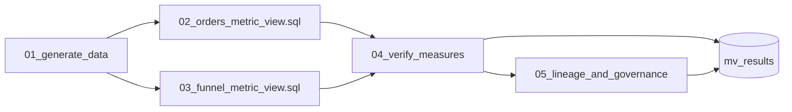

# Metric views

## Overview

A job defines business metrics once in Unity Catalog metric views and proves the numbers are right. It generates small synthetic orders, customers, products, and sessions tables, deploys two metric views with SQL tasks from `.sql` files kept in the repo, queries them with `MEASURE()`, and compares every measure with a hand-written aggregate over the same tables. The last step reads the object type, grants, certification tag, and upstream lineage. Job key: `capability_guides_metric_views`.

`mv_orders_metrics` has order count, gross and net revenue, active customers (a distinct count), average order value and discount rate (ratios), and window measures for the prior month, month-over-month growth, a rolling three months, and a running total. `mv_funnel_metrics` has sessions and conversion rate. Both carry display names, synonyms, and formats.

All data is generated in `src/mv_lib.py` with fixed seeds. Nothing is real.

Bundles have no native metric view resource (checked with `databricks bundle schema` on CLI 1.17.0 and in the bundle resources docs), so the job creates the views with SQL tasks on the warehouse.

## Required setup

- **Run `01_generate_data` first.** It writes the four sample tables the views read.
- **Create the two metric views on a SQL warehouse.** `02_orders_metric_view.sql` and `03_funnel_metric_view.sql` are plain SQL files that the job runs as SQL tasks. Opened as notebooks they never run on their own, so `mv_orders_metrics` and `mv_funnel_metrics` do not exist, and `04` and `05` would fail with `TABLE_OR_VIEW_NOT_FOUND`. Run 02, then 03, either way:
  - In the SQL editor or a notebook: attach a SQL warehouse, type your catalog and schema into the `catalog` and `schema` parameter boxes, and run each file in order.
  - Or run the whole job: `databricks bundle run capability_guides_metric_views --target dev --var catalog=<catalog> --var warehouse_id=<warehouse-id> --var app_service_principal=<app-service-principal-application-id>`.
- **Privileges** for the running user: `USE CATALOG` and `USE SCHEMA` on the schema, `SELECT` on the four tables, and `CREATE TABLE` on the schema (that covers creating a metric view). `GRANT USE CATALOG ON CATALOG <catalog> TO <principal>; GRANT USE SCHEMA, SELECT, CREATE TABLE ON SCHEMA <catalog>.<schema> TO <principal>;`

## Run it

- **By hand:** open the `guides/metric-views` folder and read `00_start_here`. Run all in `01_generate_data`, then open each `.sql` file, attach a SQL warehouse, fill in the `catalog` and `schema` parameter boxes, and run it. Then Run all in `04_verify_measures` and `05_lineage_and_governance`.
- **As a job:** run `capability-guides-metric-views`, or Quick run in the app. The two SQL tasks run in parallel.
- **Safe to rerun, in any mix:** tables are replaced, `CREATE OR REPLACE VIEW` replaces the definition, and each step swaps its own rows in `mv_results`.

```bash
cd reference/metric-views
databricks bundle deploy --target dev --profile <profile> \
  --var catalog=<catalog> --var warehouse_id=<warehouse-id> \
  --var app_service_principal=<app-service-principal-application-id>
databricks bundle run capability_guides_metric_views --target dev --profile <profile> --var ...
python -m pytest -q tests     # helper and YAML checks, no workspace needed
```

## Reference run

Results from one run in the reference workspace on a serverless SQL warehouse. The data is small and synthetic, so the run shows the pattern works, not how fast it is.

| Step | Result in the reference run |
|---|---|
| Deploy | Two SQL tasks created `mv_orders_metrics` (17 columns) and `mv_funnel_metrics` (10 columns). Both read back as type `METRIC_VIEW`. |
| Measures against hand-written SQL | 67 measure checks (43 on orders, 24 on sessions) across 884 groups. Every group matched. Groupings: total, customer segment, product category, order month, region and channel, session channel, session month. |
| Window measures | Prior month, month-over-month growth, rolling three months, and running total matched `LAG` and framed `SUM` over monthly totals, both by month (21 groups) and by month and segment (83 groups). |
| Ratio pitfalls | Conversion rate over all sessions is 8.63%; the average of daily rates is 14.23%. Average order value overall is 1,236.59; the average of the four segments' values is 1,242.59. Active customers overall is 240; adding up the monthly counts gives 2,274. |
| Lineage | The lineage API listed all three source tables for the orders view and both for the sessions view. |
| Tags | `system.certification_status = certified` was set on both views and read back. |
| Rerun | A second run left 70 rows in the verify step, not 140. |

### What the reference run taught

- **`CREATE OR REPLACE VIEW` drops tags.** The certification tag was gone after a replace. `ALTER VIEW ... AS $$ ... $$` changed the definition and kept it. The CREATE VIEW docs describe a `COPY *` clause (Databricks Runtime 18.3 and above, the default from 19) that keeps grants and tags; the SQL parser on this warehouse rejected it. Step 5 sets the tag again after every deploy.
- **Unqualified table names in the YAML resolve at creation.** With `USE CATALOG` and `USE SCHEMA` set from the job parameters, `source: mv_orders` kept pointing at that schema when the view was queried from another schema that held a table of the same name. Use three-part names where the YAML does not run under a `USE`.
- **A quoted `'on'` stays quoted.** Unquoted, `on` is a boolean in YAML 1.1. A test fails if a join loses its quotes.
- **`#` comments do not survive.** Version 1.1 removes them on save, so the files put scope notes in `comment:` fields.

## Architecture



## Files

| File | Purpose |
|---|---|
| `00_start_here` | What the job does and how to run it. |
| `01_generate_data` | Writes `mv_customers`, `mv_products`, `mv_orders`, and `mv_sessions`. |
| `02_orders_metric_view.sql` | The orders metric view, run by a SQL task. |
| `03_funnel_metric_view.sql` | The sessions metric view, run by a SQL task. |
| `04_verify_measures` | `MEASURE()` queries, hand-written SQL, and three pitfalls. Fails the job on a mismatch. |
| `05_lineage_and_governance` | Object type, owner, grants, certification tag, and upstream lineage. |
| `../../src/mv_lib.py` | Sample data, group-by-group comparison, results table. |
| `../../tests/test_mv_lib.py` | Plain pytest checks of the helpers and the YAML in the `.sql` files. |

## Variables

| Variable | Meaning |
|---|---|
| `catalog` | Unity Catalog catalog that holds the schema and the metric views. |
| `warehouse_id` | SQL warehouse that runs the two SQL tasks. |
| `app_service_principal` | Application ID of the app service principal that triggers quick runs. |
| `schema` | Bundle variable with a default: `capability_guides`, or `dev_<user>_capability_guides` in the dev target. |
