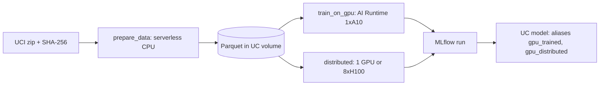

# AI Runtime: serverless GPU for training

## Overview

Best practice: develop on AI Runtime in a notebook with one GPU, log to MLflow, register in Unity Catalog with an alias, and move to `@distributed` or a multinode job only when one GPU is too slow or too small. The guide page in the app explains the choices. This README covers the reference job.

## Reference run

A serverless CPU task builds the UCI Online Retail II churn snapshot and writes it as Parquet to a volume. A GPU task trains a small PyTorch classifier on one A10 and registers it as `churn_classifier_gpu` with the `gpu_trained` alias. A third task runs the same model through `databricks.air.distributed` when `distributed=true` on 8xH100, and otherwise trains on one GPU. Job key: `capability_guides_ai_runtime`.

Data: UCI Online Retail II (CC BY 4.0). Chen, D. (2012). Online Retail II [Dataset]. UCI Machine Learning Repository. https://doi.org/10.24432/C5CG6D. The job downloads the zip into a Unity Catalog volume and checks its SHA-256 before use.

## Required setup

Run these once, before the job. `<principal>` is the person or service principal behind `databricks bundle run`.

1. **Foundation bundle.** Deploy `reference/foundation` first.
2. **Schema privileges.**
   ```sql
   GRANT USE CATALOG ON CATALOG <catalog> TO `<principal>`;
   GRANT USE SCHEMA, CREATE TABLE, CREATE MODEL, SELECT, MODIFY, READ VOLUME, WRITE VOLUME ON SCHEMA <catalog>.<schema> TO `<principal>`;
   ```
3. **Serverless GPU availability.** AI Runtime must be available in the workspace's geo (GPU availability varies by workspace). With the compliance security profile, an admin enables the AI Runtime previews. FedRAMP High and DoD IL5 are not supported.
4. **Accelerator and quota.** Default `GPU_1xA10` (`--var gpu_accelerator=...` to change). The task-level `compute.hardware_accelerator` field is Beta in the bundle schema (CLI 1.17). If a run waits for a GPU, ask your account team about capacity for the workspace.
5. **Multi-GPU run (optional).** `@distributed` is Beta, single node, and needs 8xH100 or 8xB300 (the docs call 8xB300 a Public Preview waitlist; the bundle schema marks it Private Preview): deploy with `--var distributed_accelerator=GPU_8xH100`, then run with `--params distributed=true`.
6. **Outbound internet access** to `archive.ics.uci.edu` and PyPI.
7. **Bundles and AI Runtime.** Bundles can declare `ai_runtime_task` (Public Preview, command script via `deployments[].command_path`, with `compute.accelerator_type` and `accelerator_count`). This guide uses notebook tasks with a GPU `compute` block. If your CLI rejects `compute.hardware_accelerator`, create the task in the Jobs UI with **Serverless GPU** compute.

## What this shows

| Need | Artifact |
|---|---|
| GPU and environment | Job `compute.hardware_accelerator` and `environments` (environment version 6) |
| Data in | `ai_runtime/churn_snapshot.parquet` in the source volume, read with pandas on the GPU node |
| Tracking | MLflow runs `train-gpu` and `train-ddp-<n>gpu` with parameters, `train_loss`, `holdout_auc`, and the GPU name |
| Registry | `churn_classifier_gpu` versions, aliases `gpu_trained` and `gpu_distributed` |
| Multi-GPU | `02_distributed` with `databricks.air.distributed`, gated by the `distributed` parameter |

## Architecture



## Reference code

- `resources/ai_runtime.job.yml`: three tasks, a GPU `compute` block on two of them
- `guides/ai-runtime/00_start_here`: what the guide shows, variables, Required setup
- `guides/ai-runtime/00_prepare_data`: Spark on CPU, Parquet out
- `guides/ai-runtime/01_train_on_gpu`: single-GPU training, MLflow, registration
- `guides/ai-runtime/02_distributed`: `databricks.air.distributed` with DDP
- `src/gpu_churn.py`: array prep, model, training loop, and constants

## Demo steps

1. Run `databricks bundle run capability_guides_ai_runtime --target dev`.
2. Open the `train-gpu` run in the experiment: the GPU name, `train_loss`, and `holdout_auc`.
3. Open the model `churn_classifier_gpu` in Unity Catalog: the `gpu_trained` alias on the latest version.
4. Rerun the job and see a new version, with the alias moved and no second alias.

## Artifacts produced

- Table `ai_runtime_churn` and `ai_runtime/churn_snapshot.parquet` in the source volume
- MLflow runs `train-gpu` and `train-ddp-<n>gpu`
- Model `churn_classifier_gpu` with aliases `gpu_trained` and `gpu_distributed`

## Limitations and next steps

- The model is small. Run times and AUC show the workflow, not a GPU speedup.
- The `distributed=true` path was written against the documented `databricks.air.distributed` API and needs a run on 8xH100 to confirm. Untested there: the return type of `.distributed()` (the docs say values are collected from all ranks), passing arguments to it, and importing `src/gpu_churn.py` inside the rank processes.
- Nothing bills while idle. The job creates no endpoint or schedule. Add a `schedule` block to the job to run it on a timer.
- Next: serve the registered model (see the Online model scoring guide).
