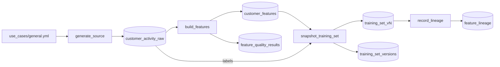

# Feature preparation from source data

## Overview

One serverless job turns a generated source table into a governed feature table in Unity Catalog. It checks the features, freezes a versioned training set, and reads back the lineage from the source. Job key: `capability_guides_feature_preparation`.

## What this shows

| Need | Artifact |
|---|---|
| Reproducible source data | `customer_activity_raw`, generated by dbldatagen from `use_cases/general.yml` with a fixed seed (20,000 rows, 2% null `usage_score`) |
| Governed features | `customer_features`, created with the Feature Engineering client (primary key `customer_id`). The task falls back to a primary-key Delta table if the client is missing |
| Quality checks | `feature_quality_results`: 16 checks (key not null, key unique, 9 not-null, 5 ranges). The task fails if any check fails |
| Versioned model input | `training_set_v<N>`: a snapshot joined from the feature table at Delta version N and the labels at the source version. `training_set_versions` records both versions |
| Lineage | `feature_lineage`: upstream tables that Unity Catalog reports for the feature table and the training set |

## Architecture

## Reference code

- `use_cases/general.yml`: source columns, derived features, ranges, seed
- `resources/feature_preparation.job.yml`: the four-task job
- `src/fp_build_features.py` (`create_feature_table`, `main`): feature table and checks
- `src/ml_common.py` (`build_frame`, `quality_queries`): data generation and check SQL
- `src/fp_snapshot_training_set.py` (`main`): time-travel join and version registry
- `src/fp_record_lineage.py` (`upstreams`): Unity Catalog lineage API
- `tests/test_helpers.py`: unit tests for the helpers

## Demo steps

1. Open `use_cases/general.yml`: columns, null rate, derived features, and ranges live there.
2. Run `databricks bundle run capability_guides_feature_preparation --target dev`.
3. Open `customer_features` in Catalog Explorer: primary key and Delta history.
4. Query `feature_quality_results` for the latest run.
5. Query `training_set_versions`: the snapshot name, feature table version, and source version.
6. Reproduce the training input: `SELECT * FROM customer_features VERSION AS OF <feature_table_version>`.
7. Open the Lineage tab on `training_set_vN`: it shows `customer_features` and `customer_activity_raw` upstream.
8. Set a range in the spec to an impossible value, redeploy, and rerun: `build_features` fails and no training set is written.

## Artifacts produced

- Tables `customer_activity_raw`, `customer_features`, `feature_quality_results`, `training_set_v<N>`, `training_set_versions`, `feature_lineage`
- A successful run of `capability-guides-feature-preparation`

## Limitations and next steps

- The data is synthetic and arrives in one batch. A real pipeline reads a governed source and refreshes features on a schedule or with a Lakeflow Declarative Pipeline.
- Quality checks run after the table is written. Add expectations in a pipeline to stop bad rows earlier.
- Unity Catalog lineage can lag a query by a minute or more. `record_lineage` polls for up to five minutes and records what it found rather than failing.
- Each run rewrites the feature table, so the training set name changes with the table version. A production flow would merge into the table and keep older snapshots.
