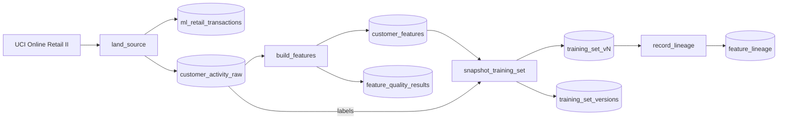

# Feature preparation from source data

## Overview

Keep model inputs in governed Unity Catalog feature tables with a primary key and timestamp, check them before use, build training sets with point-in-time joins, log the training set with the model, and refresh features by MERGE. Time travel reproduces an input only within the VACUUM retention window, so snapshot or clone data that must last longer. This reference builds that flow from a public retail dataset.

## What this shows

| Need | Artifact |
|---|---|
| Real, reproducible source data | `ml_retail_transactions` holds all 1,067,371 invoice lines of UCI Online Retail II. 243,007 have no customer ID and stay out of the snapshot. `customer_activity_raw` has one row per customer who ordered before 2010-09-01 (3,321 customers) with the `churned` label (no order in the next 6 months; 35.5% churned) |
| Governed features | `customer_features`, created with the Feature Engineering client (primary key `customer_id`). The notebook falls back to a primary-key Delta table if the client is missing |
| Quality checks | `feature_quality_results`: 18 checks (key not null, key unique, 10 not-null, 6 ranges). All 18 passed in the reference run. The notebook fails if any check fails |
| Versioned model input | `training_set_v<N>`: a snapshot joined from the feature table at Delta version N and the labels at the source version. `training_set_versions` records both versions |
| Lineage | `feature_lineage`: upstream tables that Unity Catalog reports for the feature table and the training set |

## Data source

UCI Online Retail II: invoice lines from a UK online retailer, 2009-12-01 to 2011-12-09. License CC BY 4.0.

Chen, D. (2012). Online Retail II [Dataset]. UCI Machine Learning Repository. https://doi.org/10.24432/C5CG6D

`land_source` downloads the zip into a Unity Catalog volume and checks it against a pinned SHA-256. A second run finds the verified zip and downloads nothing. No login or manual upload is needed.

The data is messy, and the guide keeps that visible:

- Blank customer IDs: 243,007 of 1,067,371 lines. They stay in `ml_retail_transactions` and never reach the snapshot.
- Credit notes: invoice numbers starting with `C` count as `returns`.
- A null order gap: `days_between_orders` is null for the 1,284 customers (38.7%) with one order. `order_gap_days = coalesce(days_between_orders, days_since_purchase)` fills it, and `single_order` flags those customers.

`customer_features` has 3,321 rows. Derived columns: `order_gap_days`, `single_order`, `lifetime_spend`, `returns_per_year`, and `is_inactive` (`days_since_purchase > 90`; 41.7% of customers).

## Architecture

## Reference code

- `use_cases/general.yml`: dataset, snapshot date, label window, derived features, ranges
- `resources/feature_preparation.job.yml`: the four-task job
- `guides/data-ingestion-feature-preparation/00_start_here`: what the guide shows, the variables, links to the job
- `guides/data-ingestion-feature-preparation/01_land_source`: download, checksum, transactions table, and customer snapshot
- `guides/data-ingestion-feature-preparation/02_build_features` (`create_feature_table`): feature table and checks
- `src/public_data.py` (`fetch`, `customer_snapshot_sql`): download, SHA-256 check, and snapshot query
- `src/ml_common.py` (`land_transactions`, `quality_queries`): table loading and check SQL
- `guides/data-ingestion-feature-preparation/03_snapshot_training_set`: time-travel join and version registry
- `guides/data-ingestion-feature-preparation/04_record_lineage` (`upstreams`): Unity Catalog lineage API
- `tests/test_helpers.py`: unit tests for the helpers

## Demo steps

1. Open `use_cases/general.yml`: dataset, snapshot date, derived features, and ranges live there.
2. Run `databricks bundle run capability_guides_feature_preparation --target dev`.
3. Open `customer_features` in Catalog Explorer: primary key and Delta history.
4. Query `feature_quality_results` for the latest run.
5. Query `training_set_versions`: the snapshot name, feature table version, and source version.
6. Reproduce the training input: `SELECT * FROM customer_features VERSION AS OF <feature_table_version>`.
7. Open the Lineage tab on `training_set_vN`: it shows `customer_features` upstream, then `customer_activity_raw`, then `ml_retail_transactions`.
8. Set a range in the spec to an impossible value, redeploy, and rerun: `build_features` fails and no training set is written.

## Reference run

One serverless job downloads a public retail dataset and turns it into a governed customer feature table in Unity Catalog. It checks the features, freezes a versioned training set, and reads back the lineage to the raw invoice lines. Job key: `capability_guides_feature_preparation`.

Artifacts:

- Tables `ml_retail_transactions`, `customer_activity_raw`, `customer_features`, `feature_quality_results`, `training_set_v<N>`, `training_set_versions`, `feature_lineage`
- A successful run of `capability-guides-feature-preparation`

## Limitations and next steps

- The data arrives as one file. A production pipeline reads a governed source and refreshes features on a schedule or with a Lakeflow Declarative Pipeline.
- Quality checks run after the table is written. Add expectations in a pipeline to stop bad rows earlier.
- Unity Catalog lineage can lag a query by a minute or more. `record_lineage` polls for up to five minutes and records what it found rather than failing.
- Each run rewrites the feature table, so the training set name changes with the table version. A production flow would merge into the table and keep older snapshots.
