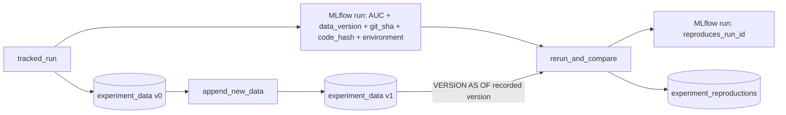

# Reproducible experiments

## Overview

A tracked run records which data version, code, and environment produced its metric. A second run reads only those records, trains again, and asserts the metric matches. Between the two runs the job appends new rows to the table, so only the recorded Delta version reproduces the result. Job key: `capability_guides_experiment_rerun`.

## What this shows

| Need | Artifact |
|---|---|
| Data version | Tags `data_table` and `data_version` on the MLflow run (Delta version of `experiment_data`) |
| Code | Tags `git_sha` (the `release` job parameter, set by CI to the commit SHA) and `code_hash` (hash of the training functions) |
| Environment | Tag `environment`: JSON of python, scikit-learn, numpy, pandas, mlflow, scipy versions |
| Rerun | `rerun_and_compare` reads those tags, reads `VERSION AS OF <data_version>`, trains, and fails if the AUC differs by more than 0.001 or the code hash differs |
| Evidence | `experiment_reproductions`: original and rerun AUC, difference, tolerance, environment changes, and the AUC on the latest data as a control |

## Architecture

## Reference code

- `resources/experiment_rerun.job.yml`: three tasks; the run ID passes through a task value
- `src/et_tracked_run.py` (`main`): records data version, code hash, environment
- `src/et_append_new_data.py` (`main`): moves the table past the recorded version
- `src/et_rerun_and_compare.py` (`main`): reads references, reruns, asserts
- `src/ml_common.py` (`code_hash`, `environment_versions`, `diff_environment`, `within_tolerance`)

## Demo steps

1. Run `databricks bundle run capability_guides_experiment_rerun --target dev --params release=$(git rev-parse HEAD)`.
2. Open the `tracked-run` run in the experiment: metric `holdout_auc` and the tags.
3. Open the `append_new_data` output: the table moved to a later version.
4. Open the `rerun` run: `reproduces_run_id` points at the original, `auc_difference` is the gap.
5. Query `experiment_reproductions`: `reproduced = true`, and `latest_data_auc` differs from the original, which shows why the version matters.
6. Edit `make_pipeline` in `src/ml_common.py`, redeploy, and run `rerun_and_compare` alone against the earlier run ID: it fails on the code hash.

## Artifacts produced

- Table `experiment_data` (Delta history shows both versions) and `experiment_reproductions`
- MLflow runs `tracked-run` and `rerun`
- A successful run of `capability-guides-experiment-rerun`

## Limitations and next steps

- Reproduction holds on the same library versions. The task reports environment differences but only fails on the metric and the code hash.
- `code_hash` covers the training functions, not the whole repository. In CI, `git_sha` is the full reference.
- Delta time travel depends on `VACUUM` retention. Keep the retention window longer than your replay window.
- Next: use MLflow dataset tracking (`mlflow.log_input`) and log the environment as a pip requirements artifact.
