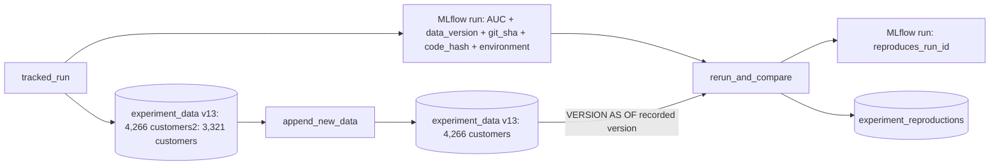

# Reproducible experiments

## Overview

Best practice: log the dataset with `mlflow.data` and `mlflow.log_input`, capture the Git commit, parameters, seed, and a pinned environment, and size Delta retention to your replay window. The reference job records the data version as a run tag; `mlflow.log_input` is the preferred pattern. The guide page in the app explains the practice.

## Reference run

A tracked run records which data version, code, and environment produced its metric. A second run reads only those records, trains again, and asserts the metric matches. Between the two runs the job appends the 945 customers who are new by the 2010-12-01 snapshot, so only the recorded Delta version reproduces the result. Job key: `capability_guides_experiment_rerun`.

Data: UCI Online Retail II (CC BY 4.0), invoice lines from a UK online retailer, 2009-12-01 to 2011-12-09. Chen, D. (2012). Online Retail II [Dataset]. UCI Machine Learning Repository. https://doi.org/10.24432/C5CG6D. The job downloads the zip into a Unity Catalog volume, checks its SHA-256, and builds one row per customer at the 2010-09-01 snapshot (3,321 customers).

## What this shows

| Need | Artifact |
|---|---|
| Data version | Tags `data_table` and `data_version` on the MLflow run (Delta version of `experiment_data`) |
| Code | Tags `git_sha` (the `release` job parameter, set by CI to the commit SHA) and `code_hash` (hash of the training functions) |
| Environment | Tag `environment`: JSON of python, scikit-learn, numpy, pandas, mlflow, scipy versions |
| Rerun | `rerun_and_compare` reads those tags, reads `VERSION AS OF <data_version>`, trains, and fails if the AUC differs by more than 0.001 or the code hash differs |
| Evidence | `experiment_reproductions`: original and rerun AUC, difference, tolerance, environment changes, and the AUC on the latest data as a control |

## Architecture

## Reference code

- `resources/experiment_rerun.job.yml`: three tasks; the run ID passes through a task value
- `guides/experiment-tracking/00_start_here`: what the guide shows, the variables, links to the job
- `guides/experiment-tracking/01_tracked_run`: records data version, code hash, environment
- `guides/experiment-tracking/02_append_new_data`: appends the customers new by 2010-12-01, which moves the table past the recorded version
- `guides/experiment-tracking/03_rerun_and_compare`: reads references, reruns, asserts
- `src/ml_common.py` (`code_hash`, `environment_versions`, `diff_environment`, `within_tolerance`)

## Demo steps

1. Run `databricks bundle run capability_guides_experiment_rerun --target dev --params release=$(git rev-parse HEAD)`.
2. Open the `tracked-run` run in the experiment: metric `holdout_auc` and the tags.
3. Open the `append_new_data` output: 945 customers appended, table moved from version 12 to 13.
4. Open the `rerun` run: `reproduces_run_id` points at the original, `auc_difference` is the gap (0.0 in the reference run; both AUCs are 0.716529).
5. Query `experiment_reproductions`: `reproduced = true`, and `latest_data_auc` is 0.720565 against the original 0.716529, which shows why the version matters.
6. Edit `make_pipeline` in `src/ml_common.py`, redeploy, and run `03_rerun_and_compare` on its own (leave `run_id` blank to use the latest tracked run): it fails on the code hash.

## Artifacts produced

- Table `experiment_data` (Delta history shows versions 12 and 13) and `experiment_reproductions`
- MLflow runs `tracked-run` and `rerun`
- A successful run of `capability-guides-experiment-rerun`

## Limitations and next steps

- Reproduction holds on the same library versions. The task reports environment differences but only fails on the metric and the code hash.
- `code_hash` covers the training functions, not the whole repository. In CI, `git_sha` is the full reference.
- Delta time travel depends on `VACUUM` retention. Keep the retention window longer than your replay window.
- Next: use MLflow dataset tracking (`mlflow.log_input`) and log the environment as a pip requirements artifact.
