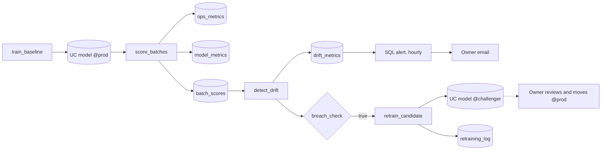

# Model quality and drift

## Overview

Best practice: attach data quality monitoring (an inference profile) to a table of model requests, join delayed labels, alert on the drift and profile tables, and retrain into a challenger that a person reviews before promotion. The reference job computes PSI itself as a custom example and does not use data quality monitoring. The guide page in the app explains the practice.

## Reference run

A job trains a model on a 2010-09-01 customer snapshot, scores nine later monthly snapshots, and records operational and model metrics in Unity Catalog tables. The drift is real: the customer base changes from month to month. The job detects it with PSI and mean shift, a SQL alert emails the owner, and a conditional task trains a challenger model for review. Job key: `capability_guides_model_drift`.

Data: UCI Online Retail II (CC BY 4.0), invoice lines from a UK online retailer, 2009-12-01 to 2011-12-09. Chen, D. (2012). Online Retail II [Dataset]. UCI Machine Learning Repository. https://doi.org/10.24432/C5CG6D. The job downloads the zip into a Unity Catalog volume and checks its SHA-256. Metrics are computed in the job; data quality monitoring was not used.

## What this shows

| Need | Artifact |
|---|---|
| Operational metrics | `ops_metrics`: rows, scoring seconds, rows per second, null rate per batch |
| Model metrics | `model_metrics`: AUC, accuracy, actual and predicted positive rate per batch |
| Real drift | Each batch is the whole customer base at a monthly snapshot from 2010-10-01 to 2011-06-01 (`drift.batch_dates` in the spec), with the churn label that followed. The baseline has 3,321 customers and a 35.5% churn rate |
| Detection | `drift_metrics`: PSI and mean shift in baseline standard deviations per batch and feature. A breach is PSI above 0.2 or a shift above 0.5 |
| Owner alert | SQL alert `capability guides model drift: PSI above threshold` reads the newest batch hourly and emails `notification_email`. Job failures email the same address |
| Retraining workflow | `breach_check` runs `retrain_candidate` only on a breach. It registers a `challenger` version and writes `retraining_log` with `status = awaiting review` |

## Architecture

## Retraining workflow

1. The alert or a failure email reaches the owner.
2. The owner opens `drift_metrics` to see which feature moved and from which batch.
3. The job has already registered a `challenger` trained on the baseline data plus batches 1 to 8. `retraining_log` shows its AUC next to `@prod` on the newest batch.
4. The owner reviews the challenger. If it holds up, they move the `prod` alias to its version with `set_registered_model_alias`. Scoring jobs load `models:/<model>@prod`, so they pick it up on the next run.
5. If the shift is a data fault rather than a real change, the owner fixes the source and leaves `@prod` alone.

## Reference code

- `use_cases/general.yml`: `drift` section (batch dates, thresholds)
- `resources/model_drift.job.yml`: five tasks with an if/else condition
- `resources/drift.alert.yml`: the SQL alert
- `guides/model-performance-drift/00_start_here`: what the guide shows, the variables, links to the job
- `guides/model-performance-drift/01_train_baseline`: baseline model and the `prod` alias
- `guides/model-performance-drift/02_score_batches`: scoring and metric tables
- `guides/model-performance-drift/03_detect_drift` and `src/ml_common.py` (`psi`, `mean_shift`, `is_breach`)
- `guides/model-performance-drift/04_retrain_candidate`: challenger and `retraining_log`

## Demo steps

1. Run `databricks bundle run capability_guides_model_drift --target dev`.
2. Query `ops_metrics` and `model_metrics`: nine batches, with `snapshot_date` marking each one. AUC is 0.75 to 0.77, predicted churn 0.25 to 0.30, actual churn 0.39 to 0.54.
3. Query `drift_metrics WHERE breached`: `tenure_months` from batch 1 (the customer base ages; the data starts 2009-12-01), `days_since_purchase` from batch 4, and `order_gap_days` from batch 7 on mean shift only. `monthly_spend`, `products_per_order`, and `returns` never breach.
4. Open the job run: `breach_check` is true and `retrain_candidate` ran.
5. Open the SQL alert and evaluate it (or wait for the hourly schedule): it triggers and emails the owner.
6. Open `retraining_log` and the model's `challenger` alias: AUC 0.8147 against 0.7663 for `@prod` on batch 9.
7. Move `prod` to the challenger version and rerun `02_score_batches` to see the new model score the later batches.

## Artifacts produced

- Models `churn_drift_model` (`prod`, `challenger` aliases)
- Tables `drift_training_data`, `batch_scores`, `ops_metrics`, `model_metrics`, `drift_metrics`, `retraining_log`
- SQL alert and a successful run of `capability-guides-model-drift`

## Limitations and next steps

- The alert runs hourly and checks only the newest run's output, so the email can lag the job by up to an hour.
- Batch AUC did not fall in this run (0.75 to 0.77), but the model under-predicts churn: predicted rate 0.25 to 0.30 against an actual 0.39 to 0.54. Drift metrics and calibration catch this; AUC alone would not.
- Each run overwrites `batch_scores`, `ops_metrics`, `model_metrics`, and `drift_metrics`, so they hold the latest run only; `retraining_log` grows. Append with a run ID if you need history.
- Next: data quality monitoring (data profiling) on `batch_scores` for managed drift tables and a dashboard, and a human approval step before promotion.
