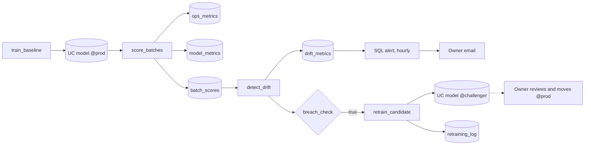

# Model quality and drift

## Overview

A job trains a model, scores five batches, and records operational and model metrics in Unity Catalog tables. Batches 4 and 5 carry a shifted `days_since_login`. The job detects the shift with PSI and mean shift, a SQL alert emails the owner, and a conditional task trains a challenger model for review. Job key: `capability_guides_model_drift`. Metrics are computed in the job; Lakehouse Monitoring was not used.

## What this shows

| Need | Artifact |
|---|---|
| Operational metrics | `ops_metrics`: rows, scoring seconds, rows per second, null rate per batch |
| Model metrics | `model_metrics`: AUC, accuracy, actual and predicted positive rate per batch |
| Simulated drift | `days_since_login` plus 30 in batches 4 and 5 (`drift.shift` in the spec); labels are recomputed from the shifted values |
| Detection | `drift_metrics`: PSI and mean shift in baseline standard deviations per batch and feature. A breach is PSI above 0.2 or a shift above 0.5 |
| Owner alert | SQL alert `capability guides model drift: PSI above threshold` reads the newest batch hourly and emails `notification_email`. Job failures email the same address |
| Retraining workflow | `breach_check` runs `retrain_candidate` only on a breach. It registers a `challenger` version and writes `retraining_log` with `status = awaiting review` |

## Architecture

## Retraining workflow

1. The alert or a failure email reaches the owner.
2. The owner opens `drift_metrics` to see which feature moved and from which batch.
3. The job has already registered a `challenger` trained on the baseline data plus the drifted batches. `retraining_log` shows its AUC next to `@prod` on the newest batch.
4. The owner reviews the challenger. If it holds up, they move the `prod` alias to its version with `set_registered_model_alias`. Scoring jobs load `models:/<model>@prod`, so they pick it up on the next run.
5. If the shift is a data fault rather than a real change, the owner fixes the source and leaves `@prod` alone.

## Reference code

- `use_cases/general.yml`: `drift` section (batches, shift, thresholds)
- `resources/model_drift.job.yml`: five tasks with an if/else condition
- `resources/drift.alert.yml`: the SQL alert
- `guides/model-performance-drift/00_start_here`: what the guide shows, the variables, links to the job
- `guides/model-performance-drift/01_train_baseline`: baseline model and the `prod` alias
- `guides/model-performance-drift/02_score_batches`: scoring and metric tables
- `guides/model-performance-drift/03_detect_drift` and `src/ml_common.py` (`psi`, `mean_shift`, `is_breach`)
- `guides/model-performance-drift/04_retrain_candidate`: challenger and `retraining_log`

## Demo steps

1. Run `databricks bundle run capability_guides_model_drift --target dev`.
2. Query `ops_metrics` and `model_metrics`: five batches, with `drifted_input` marking batches 4 and 5.
3. Query `drift_metrics WHERE breached`: only `days_since_login` in batches 4 and 5.
4. Open the job run: `breach_check` is true and `retrain_candidate` ran.
5. Open the SQL alert and evaluate it (or wait for the hourly schedule): it triggers and emails the owner.
6. Open `retraining_log` and the model's `challenger` alias.
7. Move `prod` to the challenger version and rerun `02_score_batches` to see the new model score the shifted batches.

## Artifacts produced

- Models `churn_drift_model` (`prod`, `challenger` aliases)
- Tables `drift_training_data`, `batch_scores`, `ops_metrics`, `model_metrics`, `drift_metrics`, `retraining_log`
- SQL alert and a successful run of `capability-guides-model-drift`

## Limitations and next steps

- The alert runs hourly and checks only the newest run's output, so the email can lag the job by up to an hour.
- Batch AUC did not fall in this run (0.9425 to 0.9452), because the label is computed from the shifted feature and the model still ranks rows well. The input-drift signal fires without any loss in AUC.
- Metrics tables append on every run. Add a retention rule or partition by date.
- Next: Lakehouse Monitoring (data profiling) on `batch_scores` for managed drift tables and a dashboard, and a human approval step before promotion.
